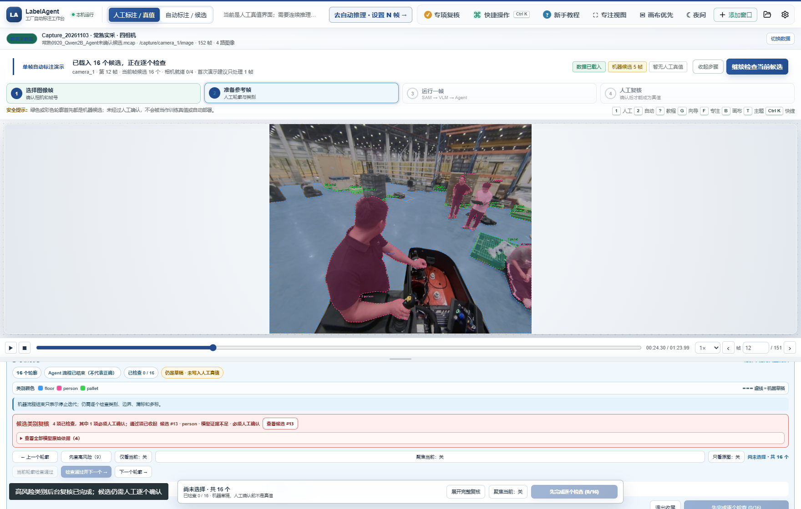

# LabelAgent 第367轮：八类完整覆盖快速起稿

## 本轮结论

新数据“尝试全部已选类别”路径中存在一次重复的 VLM 调用：模型先花约 33 秒生成八条 SAM 提示词，但输出与项目已经固化的八条标准提示词完全相同。本轮移除这次重复调用，SAM3、Agent、高风险类别复核和人工门禁均保留。

同一数据、同一相机、同一帧的浏览器验收中，首批候选从 36.375 秒降至 2.718 秒，减少约 92.5%。两种路径均生成 16 个初始候选，类别分布一致，初始轮廓几何 SHA-256 完全一致。

## 1. 改动前后

改动前，完整覆盖路径是：VLM 生成提示词 → SAM3 八类分割 → 后台 Agent → 高风险类别复核。VLM 最终仍返回项目固定提示词，所以这一段没有改变分割输入，却占用了大部分首屏等待时间。

改动后，完整覆盖路径直接读取项目固定提示词 → SAM3 八类分割；首批候选显示后，Agent 和高风险类别复核仍在后台继续。

## 2. 同帧结果核对

| 项目 | 改动前 | 改动后 |
|---|---:|---:|
| 首个接口回执 | 36.375 秒 | 2.718 秒 |
| 候选在原图上可见 | 36.407 秒 | 2.750 秒 |
| 初始候选总数 | 16 | 16 |
| floor / pallet / person | 1 / 11 / 4 | 1 / 11 / 4 |
| 八条 SAM 提示词 | 固定提示词 | 同一组固定提示词 |
| 初始几何 SHA-256 | `e7897016...e58859c` | `e7897016...e58859c` |
| 人工真值写入 | 0 | 0 |

后台完成时间可能命中模型精确请求缓存，因此不用于宣称冷启动加速；本轮速度结论只针对被明确删除的 33.199 秒重复 VLM 描述调用与首批候选回执。

## 3. 页面操作变化

参考帧准备中的该选项改名为“快速尝试全部已选推理类别（推荐用于完整覆盖）”。页面会明确说明：系统直接用固定提示词一次尝试全部类别；未产生有效轮廓的类别显示为“未生成”，不会伪造掩码。

“自动识别当前帧可见类别”仍保留，用于需要 VLM 判断可见类别和新类别线索的场景；快速完整覆盖不是人工真值，也不会自动进入训练集。

## 4. 防误用与验证

- 服务端只允许“完整当前标签表”使用快速固定提示词，单类或不完整子集会拒绝；
- 候选继续标记为 `candidate_only=true`、`human_truth=false`、`approved_for_training=false`；
- 新数据浏览器验收：页面错误 0、HTTP 错误 0、真值写请求 0；
- Python：1184 项通过，另有 190 个子测试通过；
- Node：156 项通过；
- 正式状态在部署前仍为 `9ef08118...ab115`，隔离端口均已关闭。

结构化证据见 `docs/evidence/workbench-stability-20261117/all-selected-fast-path-round367.json`。
