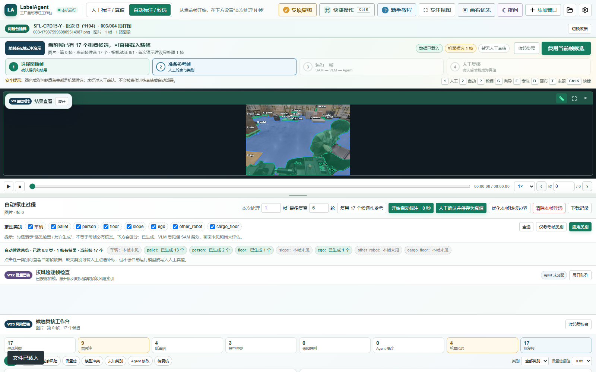
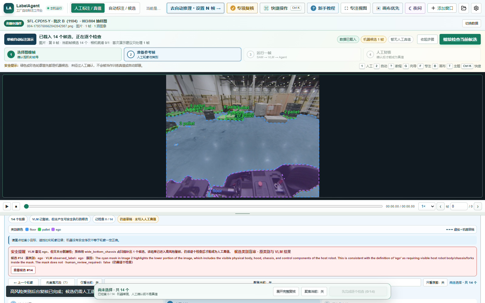
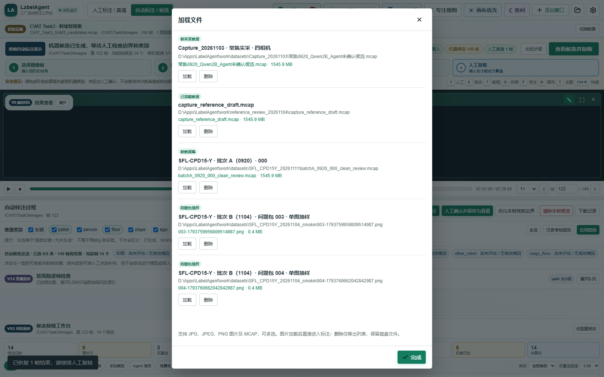

# Round 295–296：批次 B 双样本八类验收与编号显示优化（2026-11-20）

## 结论

003、004 两张批次 B 抽样图已经在一次性隔离工作台完成真实浏览器验收。两张图均能加载、
显示原图候选叠加，并为八个项目类别逐项给出“已生成 / 本帧未见 / 漏分待补”的可追溯状态。
Agent 后台复核与高风险类别复核均完成，0 页面错误、0 失败请求、0 HTTP 错误；没有生成
人工真值、参考帧或训练批准。

| 抽样 | 首批候选 | 类别组成 | 八类反馈 | 后台复核 | 真值/参考帧 |
| --- | ---: | --- | --- | --- | --- |
| 003 | 17 | pallet 13、person 2、floor 1、ego 1 | 8/8 | complete / complete | 0 / 0 |
| 004 | 14 | pallet 12、floor 1、ego 1 | 8/8 | complete / complete | 0 / 0 |

004 是本轮全新执行：首批候选约 16.756 秒出现，Agent 与高风险类别复核约 36.514 秒完成。
003 在同一隔离工作区第一次执行后被验收脚本安全复用，因此其 `0 ms` 只表示“读取已存在候选”，
不是模型推理耗时，不能拿来宣称加速。

## 003：有人、栈板、地面和宿主结构

VLM 判断 `pallet`、`person`、`floor`、`ego` 可见；系统留下17个候选。高风险类别盲审对3个
目标执行独立检查：清晰人体和宿主结构被保留；另一个极小、模糊的 `person` 候选被判为
证据不足，继续进入人工复核而没有自动删除。Agent 曾建议把一个人物候选改成 `ego`，但无人工
参考的新数据高风险互改门禁拒绝自动执行并保留原候选，证明安全门禁实际生效。

## 004：无人场景的栈板、地面和宿主结构

VLM 判断 `pallet`、`floor`、`ego` 可见，明确判断车辆、人物、斜坡、其他机器人和货台未见。
系统生成14个候选，分别为12个栈板、1个地面、1个宿主结构。界面八个类别均有独立状态，
原图叠加与候选复核面板正常显示。

完整结构化回执：
`docs/evidence/workbench-stability-20261117/batchb-cross-class-round295.json`。

## Round 296：003、004 不再同名

真实验收发现两条文件标题此前都显示“003/004 抽样图”，演示时仍需查看下一行文件名才能
区分。现已改为：

- `SFL-CPD15-Y · 批次 B（1104）· 问题包 003 · 单图抽样`；
- `SFL-CPD15-Y · 批次 B（1104）· 问题包 004 · 单图抽样`。

标题继续保留“问题包”和“单图抽样”，避免把两张 PNG 误解为完整 MCAP。真实 Edge 只打开
文件列表，未点击加载；两条均保持 `loaded=false`，当前正式 CVAT 工作区未切换。

结构化读回：
`docs/evidence/workbench-stability-20261117/batchb-sample-name-round296.json`。

## 测试、部署与回滚

- 网页回归：138/138 通过；
- 正式 `app.js` 与开发源哈希：
  `DC6BB55FF2EE14B11FCECE4D477995E7ED46A28D54DFB1ACBCA1F03FC0CB9097`；
- 正式 `index.html` 与开发源哈希：
  `C81C98E48F8CB538F7BEF321C9C393B8BF15A37CF46573D77905B48A3D7E9062`；
- 回滚点：
  `D:\Apps\LabelAgent\.local\backups\batchb-sample-name-round296-20261120-045435`；
- 部署前两文件哈希分别为：
  `9440B53003C798776DF75C0998946A11F8E5F3E824FD3428587FEFF4CC2ECE6D`、
  `88DFF0A2B1CF94BBDCE677ACA3B512E9859BC4038C33AE22A1C4249CDE254299`。

隔离端口 `18793` 已关闭。正式工作台仍是 CVAT Task3 150 帧，人工真值绑定哈希保持
`e35a944554c74c00717de5a4cfdafd8b01f51df20a90781121469eec4f9a70a3`；SAM、VLM 在线，运行
状态 `idle`。

## 边界

这轮证明的是两张抽样图上的链路、八类反馈和安全隔离，不代表完整003/004包已经验收，也不
代表候选已经人工确认。003的一个小人物候选仍需人工判断；所有候选继续保持
`candidate_only=true`、`human_truth=false`、`approved_for_training=false`。
