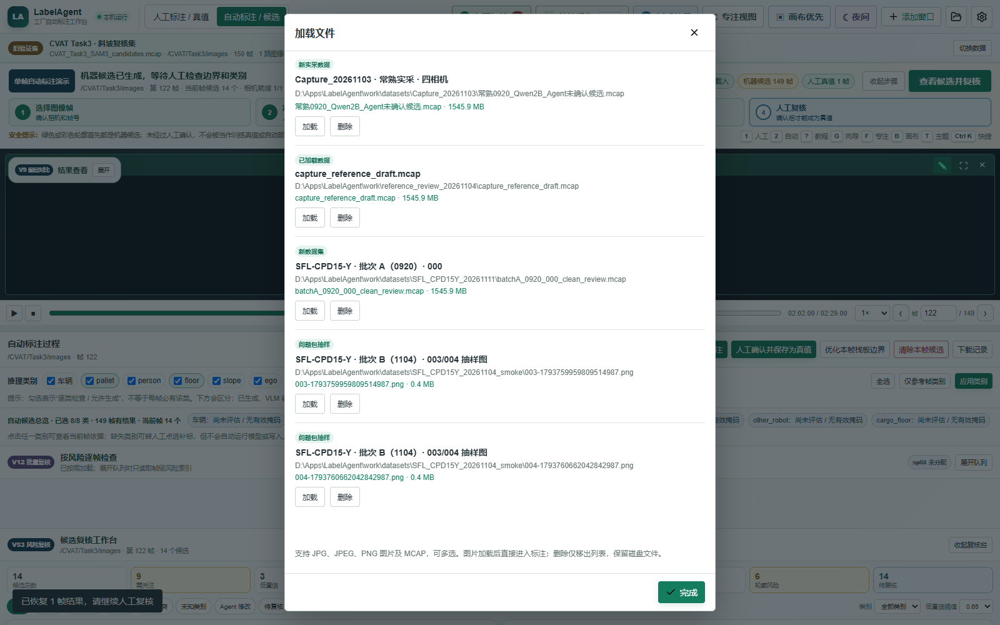

# Round 294：批次 B 003/004 抽样图加入工作台（2026-11-20）

## 结果

批次 B 的两张本地抽样图已经出现在正式工作台“加载文件”列表中：

- `003-1793759959809514987.png`，471,700 字节；
- `004-1793760662042842987.png`，444,794 字节。

两项都显示统一徽标“问题包抽样”和名称
`SFL-CPD15-Y · 批次 B（1104）· 003/004 抽样图`。它们都保持未加载；当前正式工作区仍是
CVAT Task3 150 帧，未发生数据切换。

结构化浏览器读回：
`docs/evidence/workbench-stability-20261117/batchb-smoke-library-round294.json`。

## 写入范围与回滚

本轮只向本机 `D:\Apps\LabelAgent\work\files.json` 追加两条现有 PNG 的索引，没有复制、修改
或删除原图。写入前文件索引已备份到：

`D:\Apps\LabelAgent\.local\backups\batchb-smoke-library-round294-20261120-044129\files.json`

- 写入前索引 SHA-256：
  `0D8487CD72B3D29612F67EC351CED54F993E98527D44C7DF59AF6E29196BE214`；
- 备份 SHA-256 与写入前完全一致；
- 写入前列表版本：
  `aa19a1746faff4ba6c579e751364958f6fe85927ac3cd09d035c3de7e2116011`；
- 写入后列表版本：
  `e84e731e8719caec0b3292f4293ec36fd44e94eb518b6258d6f9e2b6337ac089`；
- 写入后索引 SHA-256：
  `7EDB40A9BDFCF5577AEA4C2BB183EF556A2B7D70B24564C49EEB46C5D9A8C5C1`；
- 文件列表由 8 项变为 10 项。

## 独立验收

真实 Edge 打开正式工作台，只打开文件列表，没有点击任何“加载”按钮：

- 两张抽样图均存在、可用、`loaded=false`；
- 两张均显示“问题包抽样”；
- 当前顶部仍显示“旧验证集 / CVAT Task3 · 斜坡复核集”；
- 浏览器回执 `passed=true`、`clickedLoad=false`；
- 人工真值绑定哈希前后均为
  `e35a944554c74c00717de5a4cfdafd8b01f51df20a90781121469eec4f9a70a3`。

## 不能扩大解释的边界

这两项只是从问题包各抽取的一张图，不是完整 003/004 MCAP，也不代表批次 B 已全部落地、已经
标注完成或已经通过训练验收。本轮没有运行 SAM/VLM/Agent 推理，没有修改机器候选、人工真值、
训练集、模型权重或 OSS 数据。
