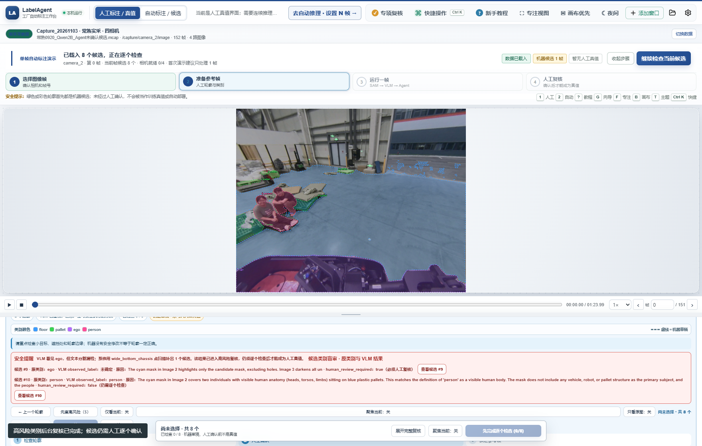

# 第 353 轮：候选复核去重与工作台存储稳定化

## 本轮结论

本轮继续沿用“候选先显示、后台再复核”的最新流程，没有回退到旧版同步等待。主要完成两件事：

1. 已经格式完整的批量复核结论不再重复请求模型；
2. 在不删除文件的前提下，为 C 盘恢复了最低运行余量，避免工作台因临时空间不足而无法启动。

## 为什么还会慢

上一轮已经把“三个候选中一个出错，三个全部重跑”改成了“只重跑有问题的一个”。继续实测后发现，批量结果即使已经明确给出 `uncertain` 或 `conflict`，旧逻辑仍会把这个候选再单独问一次模型。

这次改为：

- 高置信确认原类别：直接保留候选；
- 格式完整的不确定、冲突、低置信或改判其他类别：直接进入人工复核；
- 仅原因码与不确定结论矛盾、但其余语义完全一致：只规范原因码，不改变类别、置信度或人工复核路线；
- 真正缺字段、字段冲突且无法安全规范：才允许单项串行重试；
- 任意结果都仍是机器候选，不会自动写成人工真值，也不会自动进入训练集。

## 真实页面验收

在独立工作台中使用 `Capture_20261103`、`camera_2` 第 0 帧、8 个选中类别进行真实页面验收：

- 新实采数据身份与四相机信息显示正确；
- 候选约 4.09 秒返回、约 4.11 秒显示在原图上；
- 后台 Agent 与类别复核约 31.03 秒完成；
- 得到 8 个候选：5 个 pallet、1 个 person、1 个 floor、1 个 ego；
- 8/8 类覆盖按钮全部显示，未检出的类别明确显示“本帧未见”；
- 页面错误、HTTP 错误、失败请求、人工真值写请求均为 0；
- 人工真值与参考帧均未创建。

## 三目标批量复核专测

为避免普通页面样本没有触发批量路径，本轮又复用了上一轮留存的 9 个真实候选，只清空既有复核结果，不改候选几何。3 个高风险目标的结果如下：

| 项目 | 结果 |
|---|---:|
| 高风险目标数 | 3 |
| 批量独立复核 | 3/3 |
| 串行重试 | 0 |
| 保留候选 | 2 |
| 转人工复核 | 1（ego） |
| 自动写入人工真值 | 0 |
| 自动批准训练 | 0 |
| 接口耗时 | 1.265 秒（命中既有模型缓存） |

ego 的批量结论为不确定，但原因码错误地声称“已知类别可见”。新逻辑只把原因码规范为“视觉证据不足”，不更改不确定结论，并直接放入人工复核队列。因此本轮证据证明的是调用链路去重和安全路线保持，不把缓存耗时解释成冷启动加速比例。

## 回归、部署与回滚

- 专项测试：35 项、11 个子测试全部通过；
- 正式测试集：1155 项、186 个子测试全部通过；
- 生产源码与版本库源码 SHA-256：`350269120CFCEFB6B7E193FFDBC676675066D720A849DF113E5465BCE7FC7FDE`；
- 上一版已备份到 `D:\Apps\LabelAgent\.local\backups\candidate-audit-direct-review-round353-20261120\candidate_class_audit.py`；
- 上一版备份 SHA-256：`A5CF3E72849EE47543EF02EB71BF091B5F19EB751B41C0C5D06A434CDBC9A541`；
- 正式 `state.json` 部署前后 SHA-256 均为 `9EF08118DD2BA0760CC93CF57BBEAAE4B3BED062D383DF4E6A454C389D4AB115`；
- 正式工作台当前空闲，仍选中 `Capture_20261103` 与 `/capture/camera_1/image`；
- 两个隔离验收服务已经关闭，8891、8892 端口均已释放。

## 存储稳定化

工作台启动前发现 C 盘一度只剩约 200 MiB，低于项目的 256 MiB 安全门槛。本轮只对 LabelAgent 的历史归档、隔离副本、源码、测试、文档和工作区依赖做透明压缩，没有删除模型、数据、候选、人工真值或备份。当前 C 盘约 280 MiB，已经恢复到安全线以上；D 盘仍不足 2 GiB，管理器会继续给出只读告警，不会自动删除模型下载残片。

结构化证据见 `docs/evidence/workbench-stability-20261117/candidate-audit-direct-review-round353.json`。

## 下一步

继续寻找未命中缓存、同时含至少 3 个高风险候选的新帧，单独测量冷后台耗时；并将“批量复核完成数、人工复核数、真正重试数”直接显示在进度区域，让用户不看日志也能知道后台是否卡住。
