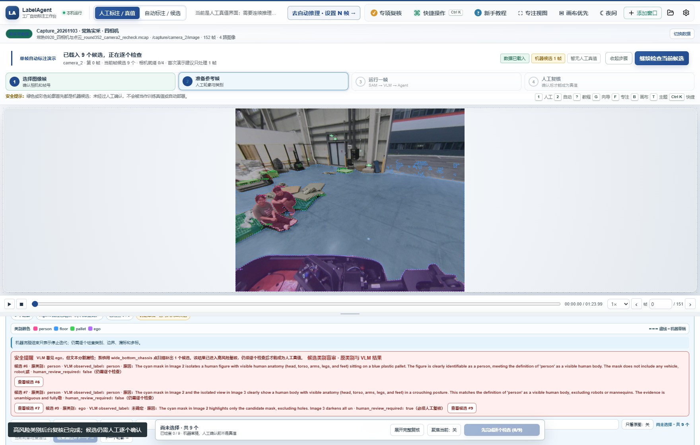

# 第 352 轮：候选类别批审逐项回退与新数据集实测

## 本轮解决的问题

工作台的候选很快就能显示，但后台“逐个检查类别”仍可能等待较久。根因是三个候选虽然以独立请求组成一个传输批次，但只要其中一个候选不确定或输出字段不合规，原逻辑会丢弃另外两个已经高置信确认的结果，把三项全部串行重跑。

本轮将回退粒度从“整组三项”收窄到“有问题的单项”：

- 只有完整通过 schema、仍确认原类别、`candidate_supported=true` 且置信度不低于 0.90 的批量结果才会保留；
- 不确定、冲突、改判其他类别或字段不合规的单项继续串行复核；
- 批量请求失败或返回数量错位时，仍然整组串行回退；
- 每个串行回退结果记录明确原因，便于以后定位慢点；
- 候选几何、人工真值和训练许可均不由该流程自动修改。

## 真实新数据集验收

验收使用 `Capture_20261103` 四相机实采数据、`camera_2` 第 0 帧，共选择 8 类。页面生成 9 个候选：5 个 pallet、2 个 person、1 个 floor、1 个 ego。逐类别反馈完整显示哪些类别已生成、哪些本帧未见，以及 ego 需要人工复核。

真实执行模式从三项全部串行：

`sequential, sequential, sequential`

变为：

`independent_batch_3, independent_batch_3, sequential`

两个人员候选通过批审的严格门槛后直接保留；ego 的批量输出存在“声称不确定、但又使用已知类别原因码”的字段矛盾，因此只对 ego 串行复核。串行复核仍将 ego 路由到人工检查，说明优化没有把不确定结果强行通过。

## 耗时解释

同一 camera_2 图像的首次冷内容运行中，候选约 19.17 秒出现，后台约 79.31 秒完成。修复后的同图复核中，候选约 3.75 秒出现，后台约 5.78 秒完成，但模型响应缓存已命中。因此这组数值只证明路由和结果闭环正确，不能作为独立的冷启动加速比例。

另用 camera_3 新内容做了冷验收：候选约 19.67 秒出现，后台约 38.20 秒完成，页面与零真值写入门禁均通过；该帧只有一个高风险候选，未触发三项批审，也不用于证明本轮批审加速。

## 安全与部署验收

- 浏览器页面错误：0；HTTP 错误：0；人工真值写请求：0；
- 专项测试：34 项、11 个子测试全部通过；
- 全项目测试：1154 项、186 个子测试全部通过；
- 正式工作台重启后，页面、4090/5090 SAM、主 VLM 与 5090 加速通道全部正常；
- 正式 `state.json` 哈希重启前后完全一致；
- 正式源码已备份到 `D:\Apps\LabelAgent\.local\backups\candidate-audit-partial-fallback-round352-20261120\candidate_class_audit.py`；
- 结构化证据见 `docs/evidence/workbench-stability-20261117/candidate-audit-partial-fallback-round352.json`。

## 下一步

继续使用不同帧和不同相机做无缓存的三候选以上批审样本，单独测量冷后台耗时；同时保留当前候选先显示、后台审计后补充风险提示的交互方式，使用户无需等待完整复核即可先查看结果。
