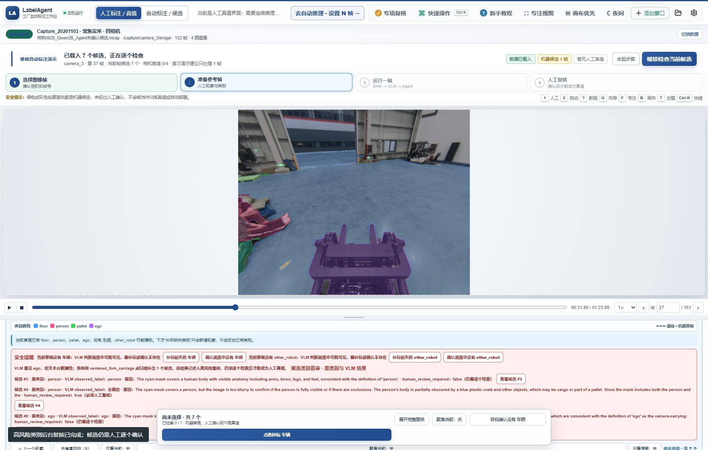
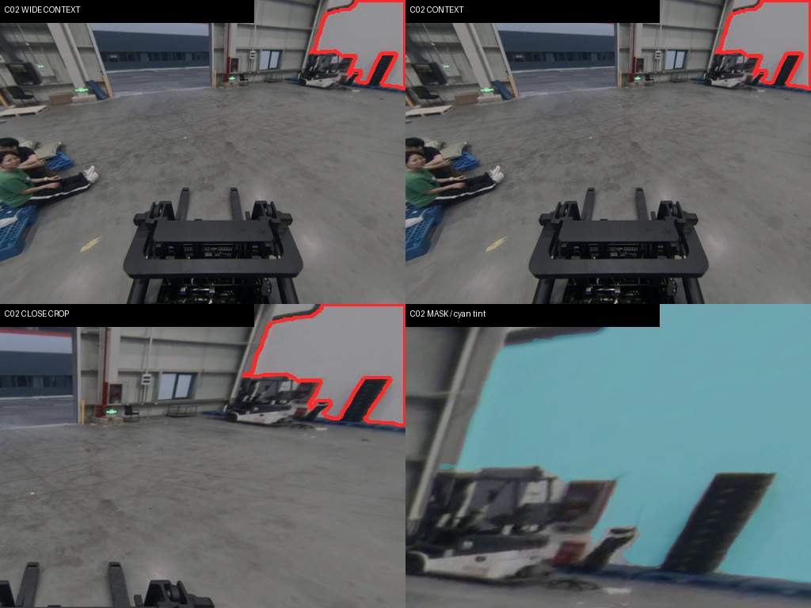
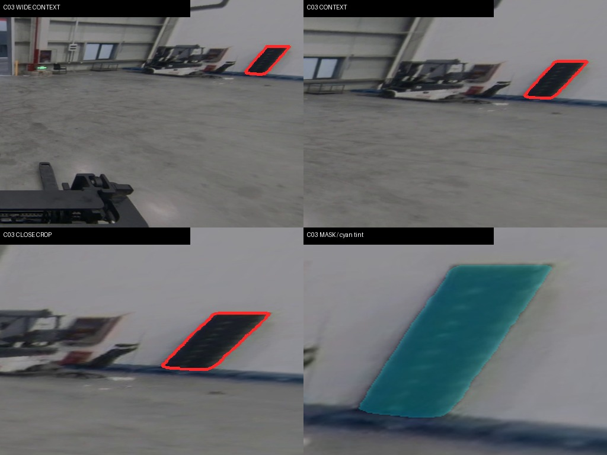
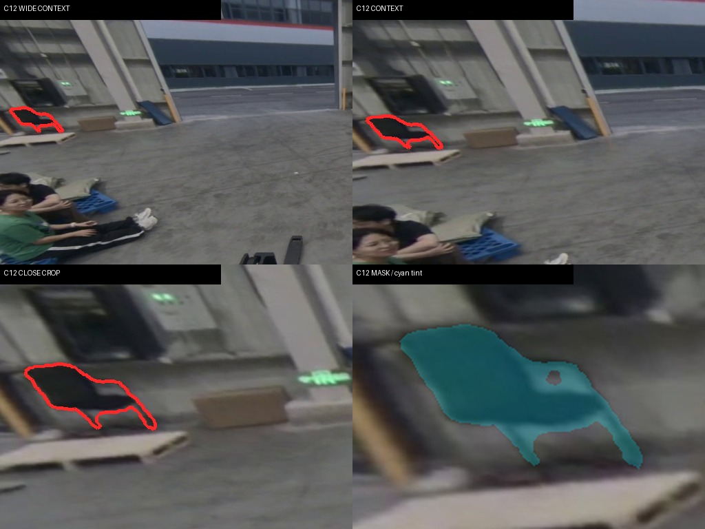

# 第 358 轮：新数据集跨相机验收与漏分恢复实验

## 本轮目标

验证新数据集不是只在 `camera_2 / frame 1` 上偶然可用，并检查 VLM 已看见、但文本 SAM 没有生成轮廓时，现有“两阶段类别补漏”能否真正找回目标。

本轮全部运行在隔离工作台。正式工作台保持 `Capture_20261103 / camera_1`、状态为 idle；没有写入人工真值、参考帧或训练批准。

## 跨相机、跨远帧验收

隔离工作台先从 `camera_2` 切换到此前没有候选的 `camera_3`，再直接跳到第 37 帧。原 `camera_2` 的第 0、1 帧候选没有出现在新相机中。

| 指标 | camera_3 / frame 37 |
|---|---:|
| 第一批候选与画布可见 | 19.687 秒 |
| 后台复核完成 | 54.328 秒 |
| 总候选 | 7 |
| pallet / person / floor / ego | 2 / 2 / 2 / 1 |
| 高风险类别复核 | 3 个，全部三目标批审 |
| 保留 / 转人工 | 2 / 1 |
| 协议重试 | 0 |
| 页面与 HTTP 错误 | 0 |

结果正确贴在第 37 帧，8 个已选类别都有“已生成”“本帧未见”或“VLM 看见、SAM 漏分”的可追溯状态。

## 两阶段补漏实测

验收工具新增 `--coverage-probe`，可复现选择页面中的“自动识别 + 已选类别补漏”。随后在相邻空白的第 38 帧运行完整流程。

| 指标 | camera_3 / frame 38 |
|---|---:|
| 模式 | auto_visible_with_coverage |
| 第一批候选 | 20.860 秒 |
| 候选回贴原图 | 20.891 秒 |
| 后台复核完成 | 55.829 秒 |
| 总候选 | 8 |
| pallet / person / floor / ego | 3 / 2 / 2 / 1 |
| 人工真值与参考帧写入 | 0 |

该模式确实一次编码图像并尝试了 8 类，但车辆和 `other_robot` 仍显示“VLM 看见，SAM 漏分”。`other_robot` 的额外语义提示 `autonomous pallet truck` 也返回 0 个轮廓。因此，“补漏流程已执行”不能表述为“漏分已解决”。

## 文本提示扩展为什么没有解决

对同一帧额外测试了 8 个不依赖颜色的提示：`robot`、`autonomous pallet truck`、`forklift`、`forklift truck`、`industrial vehicle`、`mobile robot`、`automated guided vehicle`、`self-driving forklift`。

这些提示在一次图像编码中全部返回 0 个候选，总耗时约 0.62 秒。说明瓶颈不是单一英文名称写错，而是远处小目标无法仅靠当前文本定位召回。

## 固定点扫描实验

随后在 4090 SAM 通道上运行完全不依赖颜色和人工目标位置的固定点网格：

| 阶段 | 数量 |
|---|---:|
| 固定扫描点 | 184 |
| SAM 原始候选 | 184 |
| 几何过滤后 | 49 |
| NMS 后 | 19 |
| 进入 VLM 分类 | 12 |
| 上下文分类为 `other_robot` | 2 |

点扫描可以找回文本 SAM 完全漏掉的物体，但也暴露了假阳性。

### 真实车辆候选

VLM 将该候选识别为 `vehicle_or_forklift`，说明点扫描确实能覆盖远处叉车；但轮廓同时粘连了大块墙面，不能直接作为高质量训练候选。

### 明显墙板假阳性

带上下文分类曾把它误判为 `other_robot`。加入“仅看候选像素”的无背景复核后，它被降级为 `unknown_object / review_required`，没有进入自动候选。

### 外观不明确的低矮平台

上下文分类认为它可能是 `other_robot`，但无背景复核看不出电机、底盘或自主移动证据，同样降级为人工复核。

## 结论

1. 新数据集已证明可以跨相机、跨较远帧运行，候选作用域和画布回贴正确。
2. 两阶段补漏能够尝试所有类别，但现有文本 SAM 仍漏掉远处车辆与机器人。
3. 固定点扫描能提高召回，但原始轮廓存在墙面粘连，且上下文 VLM 会产生假阳性。
4. 无背景复核能阻止假阳性自动进入，但过于保守，真实或疑似机器人也会被降级。
5. 当前点扫描方案只能作为候选发现实验，不能部署为自动真值或训练数据。

5090 SAM 通道当前不提供 `/segment_points_batch`，返回 HTTP 404；4090 通道支持并完成了实验。正式文本分割仍优先走 5090，不受这一能力差异影响。

## 测试与状态

- 页面与交互测试：83/83 通过；
- 正式 Python 测试：1157 项、186 个子测试通过；
- 隔离端口 8891 已释放；
- 正式端口 8765 正常；
- 没有部署未通过完整门禁的点扫描方案。

结构化证据见 `docs/evidence/workbench-stability-20261117/cross-camera-coverage-point-scan-round358.json`。

## 下一步

下一轮不扩大扫描规模，优先解决两项具体问题：

1. 对点扫描候选加入“目标主体正点 + 墙面/地面负点”的边界精修，先把真实叉车候选从墙面中拆开；
2. 将车辆与 `other_robot` 做互斥分类：常规叉车归车辆，只有可见独立自主底盘证据时才进入 `other_robot`，其余统一送人工复核。
