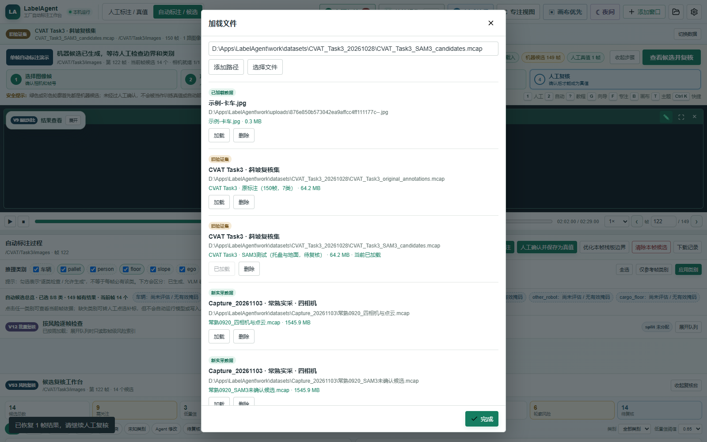

# Round 293：新旧数据集身份修复与正式界面验收（2026-11-20）

## 这轮解决的问题

文件列表里三份 `Capture_20261103` 实采数据仍沿用“常熟0920”旧文件名，界面此前只按
文件名展示，用户很容易把它们误认为旧数据。1104 批次 B 当前本地也只有 003、004 各一张
抽样 PNG，不具备完整 MCAP，不能伪装成已经可加载的完整数据集。

本轮把“显示名”与磁盘历史文件名分开：不重命名、不移动数据，只根据受控绝对路径持续显示
数据集身份。

| 路径范围 | 正式界面徽标 | 正式界面名称 |
| --- | --- | --- |
| `Capture_20261103` | 新实采数据 | `Capture_20261103 · 常熟实采 · 四相机` |
| `SFL_CPD15Y_20261111` / `batchA_0920` | 新数据集 | `SFL-CPD15-Y · 批次 A（0920）· 000` |
| `SFL_CPD15Y_20261104` / `20261104_smoke` | 问题包抽样 | `SFL-CPD15-Y · 批次 B（1104）· 003/004 抽样图` |
| `CVAT_Task3_20261028` | 旧验证集 | `CVAT Task3 · 斜坡复核集` |

## 正式浏览器验收

使用真实 Microsoft Edge 打开正式地址 `http://127.0.0.1:8765`，只打开“加载文件”窗口，
没有点击任何“加载”按钮，也没有切换当前工作区。

- 当前顶部持续显示 `旧验证集 / CVAT Task3 · 斜坡复核集`，150 帧、1 路图像；
- 两份 CVAT 文件均显示“旧验证集”；
- 三份 `Capture_20261103` 文件均显示“新实采数据”，不再被旧的“常熟0920”文件名误导；
- `batchA_0920_000_clean_review.mcap` 显示“新数据集”；
- 浏览器验收结果 `passed=true`，`clickedLoad=false`。

结构化读回：
`docs/evidence/workbench-stability-20261117/dataset-identity-round293.json`。

## 1104 批次 B 的真实边界

> 后续状态：Round 294 已将下面两张抽样 PNG 以“问题包抽样”加入正式文件列表，但仍未加载，
> 也仍然不是完整 MCAP；详见 `BATCHB_SMOKE_LIBRARY_ROUND294_20261120.md`。

本机目录 `D:\Apps\LabelAgent\work\datasets\SFL_CPD15Y_20261104_smoke` 当前只有：

- `003-1793759959809514987.png`，471,700 字节；
- `004-1793760662042842987.png`，444,794 字节。

它们尚未加入正式文件列表，也不是完整 MCAP。因此本轮只提前提供“问题包抽样”身份显示，
没有声称批次 B 已完整落地或可连续推理。OSS 未发生任何写入或移动。

## 测试、部署和回滚

- 两套网页回归合计 138/138 通过；新增的是路径行为测试，不只是检查页面里有没有文字；
- 正式 `app.js` 与开发源 SHA-256 均为
  `9440B53003C798776DF75C0998946A11F8E5F3E824FD3428587FEFF4CC2ECE6D`；
- 正式 `index.html` 与开发源 SHA-256 均为
  `88DFF0A2B1CF94BBDCE677ACA3B512E9859BC4038C33AE22A1C4249CDE254299`；
- 部署前文件备份位于
  `D:\Apps\LabelAgent\.local\backups\dataset-identity-round293-20261120-043337`；
- 旧 `app.js` / `index.html` 哈希分别为
  `0EBFB990741D9AAA9A56816DD1DE9FF6CA1ACC2141F82CECE301D222585FA3A8`、
  `FA337D5F681E9FE55B972DB4004F085B842F68C552E11BEB380028AACE818516`。

部署后工作台 HTTP 200，运行状态 `idle`；SAM 已加载，VLM `labelagent-vlm8b` 在线。
当前仍是 `CVAT_Task3_SAM3_candidates.mcap` 与 `/CVAT/Task3/images`，人工真值绑定哈希保持
`e35a944554c74c00717de5a4cfdafd8b01f51df20a90781121469eec4f9a70a3`。
本轮没有运行推理、没有修改候选、没有写人工真值或训练集，也没有改变模型权重。
