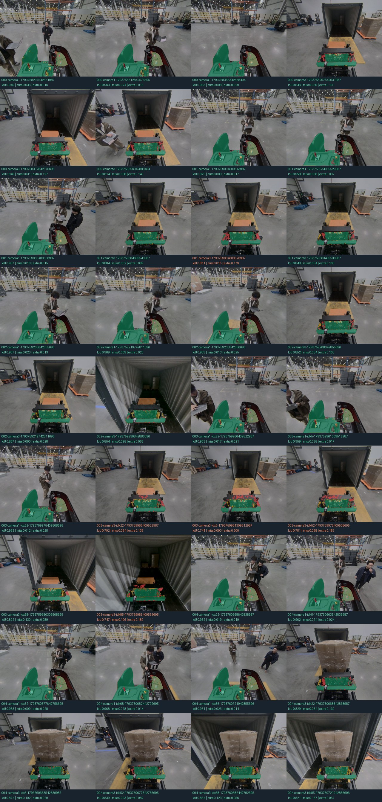

# Round449：camera3 原图相似参考负结果

日期：2026-11-22

## 为什么尝试

Round445 的五包等权审计仍有 4 张 camera3 告警。为避免用候选 mask 自己选择参考造成
循环自证，本轮只从 640×512 原图的固定下部自车 ROI 提取颜色归一化、灰度梯度和 ROI
直方图特征；查询 mask 完全不参与邻居选择。

每个外部包选原图距离最近的 3 张，再做包内严格 2/3 多数；所有外部包各投一票，包间
继续使用三分之二票。距离异常只记录警示，不允许通过排除困难包来降低告警。

## 结果

| 方法 | camera3 告警 | 距离异常警示样本 | 是否采用 |
|---|---:|---:|---|
| Round445 包内全时点、包间等权 | 4/19 | 不适用 | 保留基线 |
| Round449 原图 ROI 选 3 张、所有包等权 | 5/19 | 10/19 | 否 |

新增告警为 `003-camera3-idx22-1793759966409522987`。原有四个告警没有稳定消除；距离警示
也频繁集中在 004，说明简单 ROI 外观仍受光照、集装箱环境和遮挡影响，不能可靠代表叉车
姿态或组件可见性。

## 安全与可复现性

- 选择只读取经 SHA-256 校验的原图，不读取候选 mask；
- 单测将全部候选 mask 取反后，所选 sample ID 和选择清单 SHA 保持不变；
- 所有外部包仍保留一票，没有通过丢弃困难包美化数字；
- 输出显式标记 `experimental_reference_selector=true` 与
  `reference_selector_accepted_for_default=false`；
- 相关定向回归累计 55 项通过，1 项 Windows 符号链接权限限制而跳过；
- 不修改原 mask、人工真值、训练集、权重或正式工作台。

## 结论

冻结为可复现负结果，不接默认流程。下一步不继续微调简单图像距离，而应寻找外部姿态/
标定状态，或从多帧跟踪得到控制台与横梁的稳定几何状态；在独立真值不足前，Round445
包等权基线继续作为审计参考。
