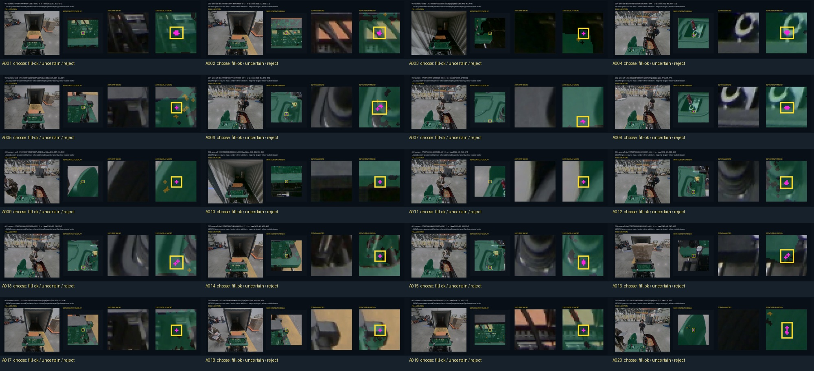

# Ego 风险队列盲审富集验证（Round476–478）

日期：2026-11-22

状态：助手盲审证据；不是人工真值、模型质量或新数据泛化证明

## 盲审设计

从 camera1、camera3 各自的高风险、中间风险、低风险 20% 区间中分别抽 10 项，共 60
项。抽样和打乱使用固定种子；图页只显示 A001–A060 和复核图，不显示风险档位、分数或
排名。独立代理确认只查看三张 JPG，没有打开映射、ranking 或 JSON；60 个判断冻结后才
解盲。

判断仅分为：`likely_fill_ok`、`uncertain`、`likely_reject`。这些仍是助手视觉判断。

## 解盲结果

| 风险区 | 样本 | fill-ok | uncertain | likely-reject | uncertain+reject |
| --- | ---: | ---: | ---: | ---: | ---: |
| 高 | 20 | 4 | 12 | 4 | 80% |
| 中 | 20 | 4 | 11 | 5 | 80% |
| 低 | 20 | 11 | 9 | 0 | 45% |

高风险和中风险的总体疑难率相同，因此当前不支持“高 > 中”的精细排序结论；高/中相比
低风险多 35 个百分点，说明队列能把较安全的尾部样本分开。

更重要的是，9 个 `likely_reject` 全部位于高+中风险区，低风险区为 0。先审 40/60
（66.7%）能够覆盖本轮盲审中 9/9 个明显疑似错误；只审高风险区只能覆盖 4/9。

## 分相机结果

| 相机 | 高风险疑难率 | 中风险疑难率 | 低风险疑难率 |
| --- | ---: | ---: | ---: |
| camera1 | 70% | 60% | 10% |
| camera3 | 90% | 100% | 80% |

camera1 有明显的尾部分离；camera3 即使低风险区也有 80% 的 uncertain/reject，说明该路
相机整体更难，不能用当前排序自动放行任何一档。适合的操作策略是：

1. camera1 与 camera3 都先审高+中风险区，以优先发现明显错误；
2. camera1 低风险区可以延后，但仍不能自动接受；
3. camera3 全部继续人工/助手复核，不能因为排名低而跳过；
4. 下一批新数据必须重新盲审，不能把本轮 60 项当作泛化证明。

## 产物与哈希

- 盲审包：`artifacts/round476-1104-ego-component-risk-blind-audit-20261122/blind_audit.json`
  - SHA-256：`1dc62aaa60d71231828b10b641f6c3bc23186bd5cc6809ab0a163527a2810061`
- 冻结判断：`docs/evidence/workbench-stability-20261117/ego-component-risk-blind-decisions-round476.json`
  - SHA-256：`cd1d455b03baba5b95c6915f93c91df3529dbecfb1212c5e3c4bab78d9f357e3`
- 解盲评估：`artifacts/round478-1104-ego-component-risk-blind-evaluation-v2-20261122.json`
  - SHA-256：`1ecb43e024730b3b7cab491056a26acdfe90cf65a0caa3a10c849304c3cbe7a6`

## 验证与正式工作台边界

- 定向及相关 ego 工具测试 88 项通过、1 项因 Windows 符号链接权限跳过；
- 盲审包原子发布、固定种子可复现、映射与判断 SHA 绑定；
- 2026-11-22 08:19 +08 只读检查：页面 HTTP 200、任务 idle、SAM ready/model_loaded、
  主 VLM ready、快速 VLM ready；
- `/api/run/readiness` 仅因当前数据未锁定参考帧返回 `reference_missing`，存储空间正常；
- 本轮没有改正式状态、参考帧、真值、训练、权重或工作台配置。
