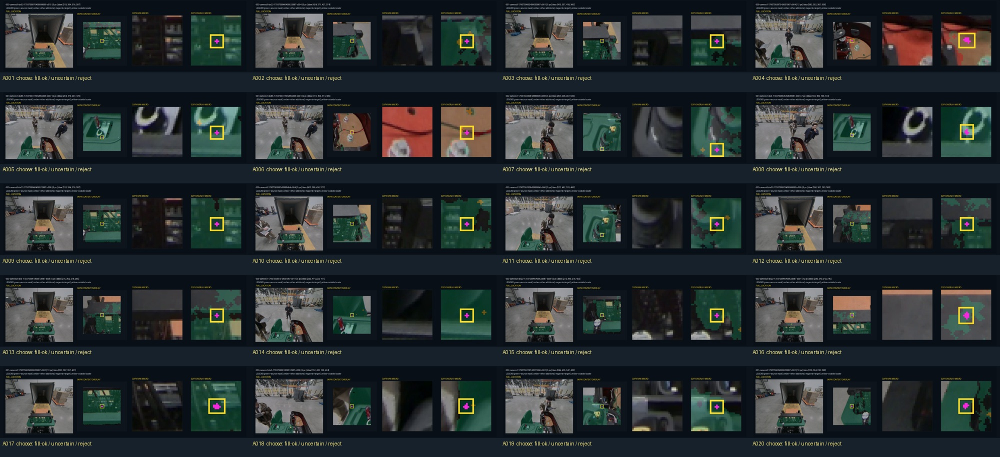

# Ego 风险队列不重叠复验（Round480–483）

日期：2026-11-22

状态：同一已曝光数据集上的第二轮助手盲审；不是人工真值或新数据泛化

## 复验设计

Round480 从 camera1/camera3 的高、中、低风险区各抽 9 项，共 54 项。构建器先读取
Round476 的 60 个组件 ID 并全部排除，因此两轮重叠数为 0。固定种子打乱后，审阅者只
查看三张 A001–A054 图页；判断冻结后才解盲。

## 第二轮结果

| 风险区 | 样本 | fill-ok | uncertain | likely-reject | uncertain+reject |
| --- | ---: | ---: | ---: | ---: | ---: |
| 高 | 18 | 3 | 11 | 4 | 83.3% |
| 中 | 18 | 4 | 9 | 5 | 77.8% |
| 低 | 18 | 11 | 7 | 0 | 38.9% |

第二轮 9 个 `likely_reject` 仍全部出现在高+中风险区；高风险比低风险疑难率高 44.4
个百分点。camera1 高/中/低为 66.7%/55.6%/0%，camera3 为 100%/100%/77.8%。

## 两轮合并结果

两轮合计 114 个互不重叠组件，每个风险区 38 项：

| 风险区 | 样本 | fill-ok | uncertain | likely-reject | uncertain+reject |
| --- | ---: | ---: | ---: | ---: | ---: |
| 高 | 38 | 7 | 23 | 8 | 81.6% |
| 中 | 38 | 8 | 20 | 10 | 78.9% |
| 低 | 38 | 22 | 16 | 0 | 42.1% |

- 18 个 `likely_reject` 全部位于高+中风险区，覆盖率 100%；
- camera1 合并高/中/低为 68.4%/57.9%/5.3%；
- camera3 合并高/中/低为 94.7%/100%/78.9%；
- 因此维持原策略：camera1 低风险尾部可延后但不能自动接受，camera3 全部优先复核。

Round483 使用合并证据重新生成策略，数量仍为 226 个优先复核、19 个延后人工复核、
0 个自动决策。结果一致说明策略没有依赖第一轮 60 个样本中的偶然个例。

## 哈希与边界

- Round480 盲审包：`25934184b37b830b033f041f80268ca528916ecfc0809a5d570092e21e1068ce`
- Round480 冻结判断：`d385e6d3923dc655a0b922efef458105577f3587b911629c1fec3cd14a9b74b3`
- Round481 解盲评估：`a5151d7c9140c0b5d38a3ef6b64b4968ddf9530301060e0fa45e25e4fbf0e30b`
- Round482 两轮合并：`5f29b4580dd2fe3377f31ce60d7b8f84f3f7817ab3e3fe20f5aaf7712d1ba24a`
- Round483 策略 v2：`bbbbba8bdafd3f79a2f6fc5c88ad29cb109416d8de0fa308a37721229ee53d24`

两轮虽然互不重叠，但仍来自相同的 245 个已曝光候选，不代表新工厂、新相机或新批次
泛化；所有判断仍是助手复核，不是真值。没有修改候选 mask、训练批准、模型权重、参考帧
或正式工作台配置。
