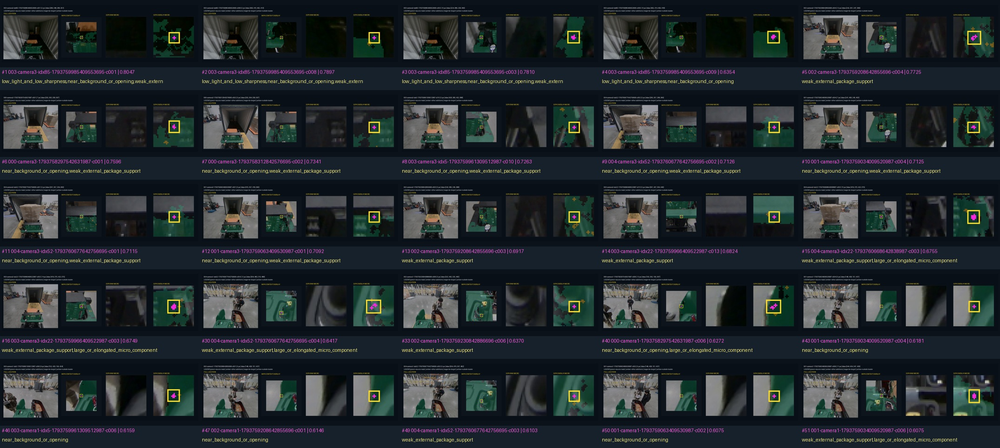

# Ego 微孔审阅风险队列（Round469–475）

日期：2026-11-22

状态：离线审阅排序；不自动接受/拒绝，不生成真值，不批准训练或部署

## 目标

Round464 有 245 个可逐项查看的微孔候选。逐项人工翻看成本较高，因此本轮只回答一个
问题：**哪些候选应该优先看？** 排序器不输出 pass/fail，也不改变任何 mask。

## Round469：第一版负结果

第一版仅使用全体样本的灰度亮度、清晰度、局部对比、梯度和面积分位数。已知唯一仍
不确定的 `000-camera3-1793758297542631987-c001` 只排到 84/245，没有进入前 30%。
因此该版明确冻结为负结果，不接工作台。

## Round470/473：解释性第二版

第二版依据独立设计审阅补充：

- camera1/camera3 分别做分位归一，避免曝光差异；
- 使用“低亮度 × 低清晰度”交互，而不是只因黑或亮提高风险；
- 计算邻近背景/大开口、灰度边缘方向延续、跨包弱支持；
- 面积和长宽比只占 5%，不让大一点的微孔单独主导；
- 所有行的 `automatic_decision` 固定为 `null`。

唯一不确定项自然提升到 6/245（前 2.5%）。三个已有助手结论的清晰样本分别排到
42、109、158；清晰紧固件没有仅因高纹理全部进入最高风险档。需要强调：这 4 项参与了
开发诊断，因此该结果不是独立泛化证明。

## Round471/474：轻微扰动稳定性

| 扰动 | 风险档位稳定率 | 前 30% 成员稳定率 | 中位排名变化 | 不确定项排名 |
| --- | ---: | ---: | ---: | ---: |
| Gamma 0.90 | 97.551% | 99.184% | 1 | 7 |
| JPEG Q95 | 99.184% | 100% | 1 | 6 |

基线、Gamma、JPEG 三种情况下，不确定项排名为 6/7/6，均留在前 10%。这是排序稳定性
证据，不是分割质量或未知数据泛化证据。

## Round472/475：可直接审阅的图板

全局前 25 最初全部来自 camera3，存在 camera1 被长期饿死的风险。Round473 增加相机内
排名，Round475 按组件数量比例分配 25 个名额：camera1 9 个、camera3 16 个；每个相机
内部仍按风险排序，唯一不确定项继续包含在图板中。

## 最终产物与哈希

- 排名包：`artifacts/round473-1104-ego-component-risk-ranking-v2-camera-balanced-20261122.json`
  - SHA-256：`23a6e15bd884e4fcc955019fa48c1fadcf2012d658f4c1aec33ff2d977cf8782`
- 稳定性收据：`artifacts/round474-1104-ego-component-risk-stability-camera-balanced-20261122/stability.json`
  - SHA-256：`1bd4fbf85bc6fbacbae6f4e99240e9f031429a9314338f22591effc44812dbd6`
- 图板索引：`artifacts/round475-1104-ego-component-priority-sheet-camera-balanced-20261122/priority_review.json`
  - SHA-256：`c2b7f614d5f059f1bb41e605c57698af42cff39c31651dc43646eafae074bd2d`
- 图板：SHA-256
  `5b5ac3ac36f69b38ac092955e6093b753526560135f2344239e3d2b2a833796a`

## 验证与边界

- 定向及相关 ego 工具测试 81 项通过、1 项因 Windows 符号链接权限跳过；
- 输入继续绑定 identity、queue、component review 和图像 SHA-256；
- 排序与图板均原子发布，篡改图像或写盘失败会失败关闭；
- 当前公式在已曝光 245 项上开发，尚未经过新批次盲审富集率验证；
- 只有当新数据 top 队列的 uncertain/fail 明显富集，才值得接入工作台；否则保持离线。
