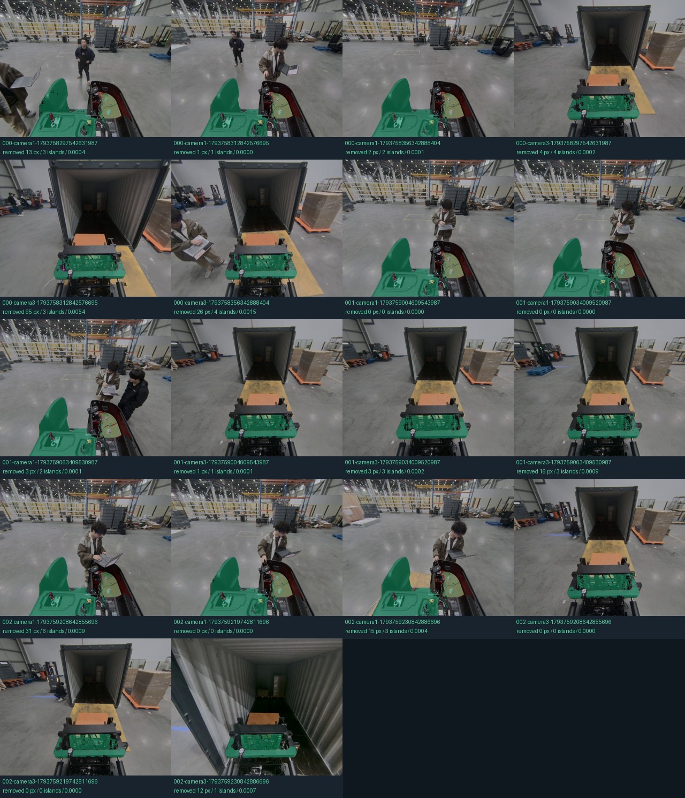
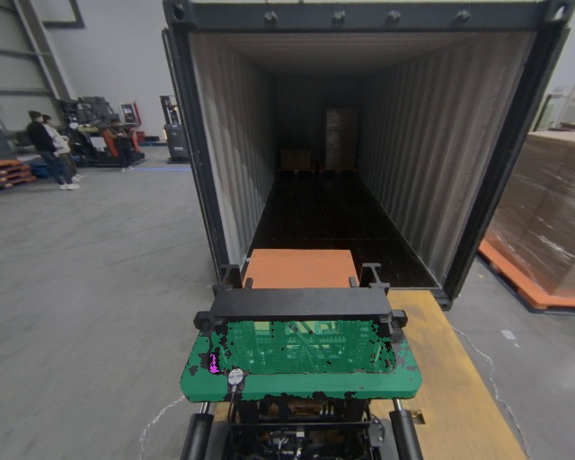

# Round436：ego 小孤岛去噪影子实验

日期：2026-11-22

## 目标和约束

针对 Round435 发现的少量离散小块，本轮只生成独立影子候选，不覆盖原 mask。规则冻结为：

- 仅处理 640×512；
- 8 邻域连通；
- 只删除严格小于 100 像素、且不承载该组件正提示点的连通域；
- 分别处理两个组件，再重新合并；
- 单组件总删除比例不得超过 1%；
- 所有正点仍在 mask 内、负点仍在 mask 外、面积仍在组件门禁内；
- 只减不增、第二次运行幂等；
- 原图、原 mask、身份清单和严格队列均做哈希绑定。

## 数值结果

| 项目 | 结果 |
|---|---:|
| 样本 | 18 帧 |
| 拟删除像素 | 222 |
| 拟删除孤岛 | 36 个 |
| 新增像素 | 0 |
| 单帧最大删除比例 | 0.5400% |
| 单组件最大删除比例 | 0.9329% |
| 正提示点保留 | 18/18 |
| 负提示点保留 | 18/18 |
| 面积门禁 | 18/18 |
| 幂等 | 18/18 |

50 项相关回归通过，1 项 Windows 普通权限下的符号链接测试跳过。原 mask 没有修改。

## 视觉复核为何没有通过

大部分拟删除区域只是 1–31 像素的零散点，但
`000-camera3-1793758312842576695` 的横梁组件包含一个 93 像素孤岛，位置在车体左侧白色
附件附近。它可能是噪声，也可能是真实车体细结构；稀疏正提示点不足以证明可以删除。

因此本轮结论是：**数值门禁通过，但视觉门禁不通过，不采用这版全局去噪。** 它不能解决
与主体相连的凹凸边界、孔洞或粘连，也不能把“页面看起来更干净”当成质量提升。

## 可追溯哈希

- 工具：`52b9b470ae3062b08dedae8683f082bdf1ad34b3e3d69bacfdebf7777028a0a5`；
- 测试：`17b01d9f15011683b6690406cc1c1bcf19fc2b9cfaf610b055a7f645346954a2`；
- 影子包：`433fb2ea5b9a4ab90bb07585994f6b980b53758196ae6e7cade89250557da6d5`；
- 总联系表：`1dcceaa8b275409d9a535f6f696bacb57c1dd689fc40fbe984f99c7831bc8212`；
- 关键不确定帧：`4e144f527989d1729f6e7ba3fd6e697a3763bdcc2355ddddb91f4e712528018b`。

## 下一步

加入跨时间/跨包复现保护：同一相机和组件中反复出现在相近位置的小块优先视为真实结构，
不自动删除；只对不重复且逐块视觉明确为噪声的区域保留影子候选。正式工作台、训练集和
人工真值继续保持不变。
