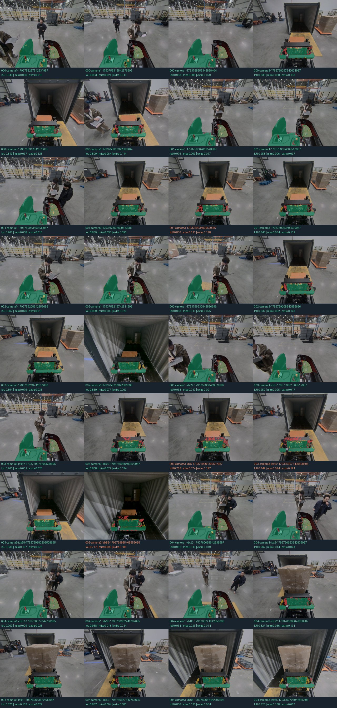
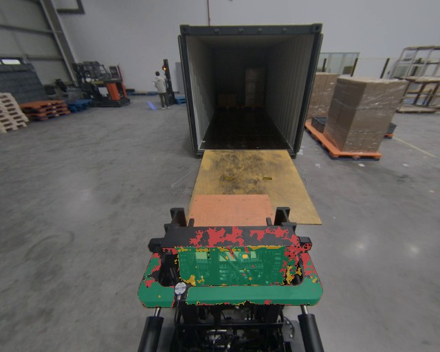
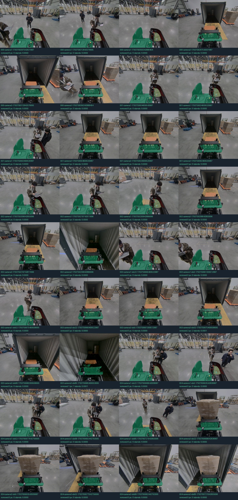

# Round440–445：五包 ego 严格审计与等权参考修正

日期：2026-11-22

## 本轮目标

把此前只覆盖 000/001/002 的 camera1、camera3 影子候选，扩到本机已有的 003/004
留出时间点，并回答两个问题：

1. 新数据是否仍能通过来源、身份、组件面积、正负提示点和 mask 哈希门禁；
2. 小孤岛去噪在更多时间点上是否会误删真实叉车结构。

所有输出均为本地助手候选。没有覆盖原 mask，没有写入人工真值，没有批准训练，也没有
部署到正式工作台。

## 数据身份与严格重放

- 身份清单由 18 个旧样本扩为 38 个样本，新增样本绑定包号、相机、帧号、相对路径和
  图像 SHA-256；
- 000/001：12/12 生成并集；002：6/6；003/004：18/20；
- 003 的两张 camera1 图因人员/遮挡接近控制区，左侧组件失败关闭，没有为了凑齐数量而
  放宽规则：
  - `003-camera1-idx68-1793759980309508695`；
  - `003-camera1-idx85-1793759985409553695`。

因此五包共有 36 张可审计候选，2 张安全拒绝。拒绝记录被显式带入后续审计，不会被静默
跳过或误写成通过。

## 为什么旧参考会产生偏差

Round443 最初把所有外部帧直接投票。000/001/002 每包各 3 个时点，003/004 每包各 5 个
时点，导致时点多的包权重更大。新增数据越多，某个包对参考轮廓的影响越强，这不是公平的
跨包评估。

Round445 改成两级等权参考：

1. 每个外部包先用自身时点形成包内多数轮廓；
2. 每个包只投一票，再用三分之二包票形成最终参考。

这样每个包权重相同，样本数量不再决定话语权。专门单测覆盖了“一个包 5 帧、另外两个包
各 1 帧”的不平衡情形。

| 指标 | Round443 按帧投票 | Round445 按包等权 |
|---|---:|---:|
| 可审计样本 | 36 | 36 |
| 显式安全拒绝 | 2 | 2 |
| 超阈值样本 | 8 | 4 |
| camera1 超阈值 | 0 | 0 |
| camera3 超阈值 | 8 | 4 |

这 4 个告警没有被“调低阈值”消除，而是在公平参考下仍然保留，因而更值得人工关注。

## 五包像素结果

| 相机 | 样本 | IoU 范围 | 参考覆盖率范围 | 候选超出范围 | 最大孔洞率 | 告警 |
|---|---:|---:|---:|---:|---:|---:|
| camera1 | 17 | 0.949–0.975 | 0.964–0.994 | 0.013–0.037 | 0.048 | 0 |
| camera3 | 19 | 0.747–0.894 | 0.862–0.990 | 0.029–0.197 | 0.093 | 4 |

四张 camera3 告警图的红色区域主要落在叉车控制台、横梁和侧翼等真实自车结构；绿色为
跨包共识，黄色为参考有而当前候选缺少的区域。助手目视未发现明显整片外部地面、人物或
货物被吞入，但 camera3 的真实结构变化明显大于 camera1，不能把这些差异简单当噪声删除。

其中 `003-camera3-idx5-1793759961309512987` 同时触发 IoU、超出和孔洞告警，是下一轮
camera3 子型设计的第一优先样本。

## 五包去噪影子

持续结构保护扩到五包后：

- 36 张可用候选只拟删除 3 个像素、3 个孤立点；
- 175 个小结构被保留，其中 72 个由跨包持续出现证据保护；
- 新增像素为 0，所有正提示点和负提示点保持，面积门禁和幂等检查通过；
- 两张失败关闭输入继续保持拒绝。

这个结果说明当前去噪足够保守，但只去掉 3 个像素，不应被宣传为显著质量提升。它的价值是
证明跨包保护能阻止误删；camera3 的大范围差异必须通过外观/姿态子型和更好的候选生成解决，
不能靠连通域清理硬抹平。

## 当前结论与下一步

1. 五包严格链路可复现：36 个候选进入审计，2 个危险输入失败关闭；
2. 等权参考修正了样本数不平衡，告警从 8 降到 4，但没有放宽任何阈值；
3. camera1 的 17 个可用候选无像素告警，另有 2 个危险输入安全拒绝；camera3 仍是主要短板；
4. 下一步为 camera3 建立独立的外观/姿态子型，参考选择必须基于原图或外部状态，不能用
   当前候选 mask 自己挑参考，以免形成循环自证；
5. 本机没有 005–012 本地包，且 `ossutil` 不可用，按既定只读规则没有安装工具、猜测凭证
   或继续访问 OSS。后续扩包需先由环境提供可用的只读 `ossutil`。

## 复现与验证

- 身份清单：`docs/evidence/workbench-stability-20261117/ego-1104-sample-identity-manifest-v2.json`；
- 结构化证据：`docs/evidence/workbench-stability-20261117/ego-five-package-audit-rounds440-445.json`；
- 独立审阅后又补齐偶数帧平票拒绝、队列/清单全集一致和重复身份/路径拒绝；
- 定向回归：53 项通过，1 项 Windows 普通权限下无法创建符号链接而跳过；
- Python 编译、JSON 读取和差异空白检查均需在提交前再次通过。
