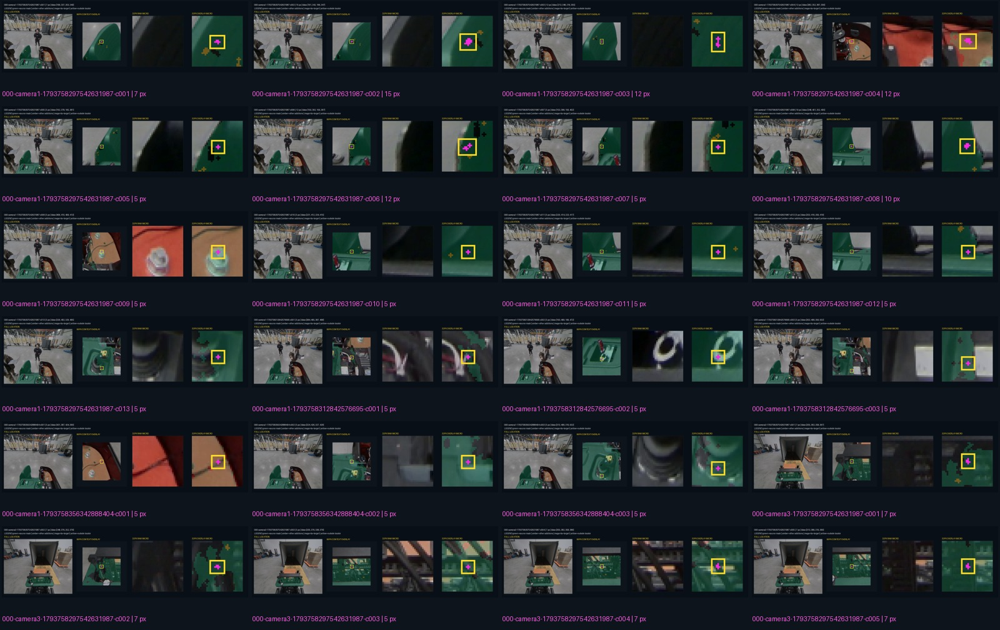
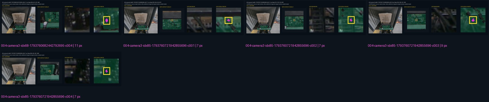

# Ego 微孔填补逐连通域复核（Round462–464）

日期：2026-11-22
状态：候选级、默认关闭、尚未成为真值/训练批准/生产部署

## 为什么继续做

Round458/461 已证明 35 张变化帧的 1,764 个新增像素都进入了逐帧放大包，但同一帧所有
变化共用一个总框。相距较远的微孔会让裁剪范围接近整帧，无法证明每一个微孔都真正被
看清。因此本轮不修改算法阈值，而是先把复核证据提升到逐连通域。

## 新的复核方式

新增 `tools/build_ego_shadow_component_review.py`：

1. 对 `shadow & ~original` 使用 8 连通域分解；
2. 按 `(y0, x0, y1, x1, area, digest)` 稳定排序并编号；
3. 每个连通域单独输出一张三尺度图：全图定位、96 像素上下文、32 像素微距；
4. 微距使用最近邻整数倍放大，避免 1–15 像素目标只被居中而未放大；
5. 每项保存独立二值 mask、原图/原 mask/影子 mask/复核图哈希；
6. 要求组件互斥、逐像素并集等于全部新增区域、面积和等于新增像素总数；
7. 完整写入临时目录、JSON 回读和全量哈希复核通过后才原子发布。

所有行仍固定为 `unreviewed`、`candidate_only=true`、`human_truth=false`、
`approved_for_training=false`、`production_deployed=false`、`default_enabled=false`。

## 运行中发现并纠正的问题

- Round462 首次形成 245 项，但微距图只做了居中，没有向上放大。该轮保留为中间证据，
  不作为最终视觉复核包。
- Round463 改为最近邻整数倍放大。独立审阅发现 1 像素目标会被黄色定位框遮挡，绿色
  原 mask 叠加也会掩盖螺栓、格栅和机械缝隙纹理，因此降级为部分复核，不记全量通过。
- Round464 将 32 像素原始微距与叠加微距并排，定位框在目标像素外留出 3 像素间隔，
  并在每张独立图顶部写明颜色图例；1 像素目标现在可以直接看到。

## Round464 结果

| 项目 | 结果 |
| --- | ---: |
| 可用候选帧 | 36 |
| 有变化帧 | 35 |
| 无变化帧 | 1 |
| 原有失败关闭输入 | 2 |
| 独立 8 连通域 | 245 |
| 新增像素 | 1,764 |
| 最小/最大连通域 | 1 / 15 像素 |
| 总览页 | 11 |
| 独立组件 mask | 245 |
| 独立三尺度复核图 | 245 |
| 哈希回读异常 | 0 |

最终包：
`artifacts/round464-1104-hole-fill-component-review-raw-overlay-20261122/component_review.json`

最终包 SHA-256：
`62ad809c528bd80a655c5369cfb4e85f357ab59f83ea31b1aa77c601d455c810`

为避免把 50 MB 可重建细图全部塞入 Git 历史，远端提交保存生成器、完整 JSON 索引和
11 张总览页；245 张独立 mask 与 245 张四面板细图保留在本地 Round464 目录，可用同一
命令从已绑定输入重新生成。该取舍不影响结构化哈希和总览证据，但远端仓库不声称包含
原始数据或全部细图。

首页总览：

尾页总览：

## 验证

- 逐项 ID：245/245 唯一；
- 面积和：1,764/1,764；
- 245 张 mask、245 张三尺度图、11 张总览页全部哈希回读一致；
- 定向及相关 ego 工具回归：67 项通过、1 项因 Windows 符号链接权限跳过；
- 故障注入：渲染失败后最终目录不存在，临时目录清零；
- 重复样本与被篡改的影子 mask 均失败关闭；
- Python 编译与 `git diff --check` 通过。

## 独立助手视觉审阅

独立代理逐页看完 11 张总览并打开 12 张独立图，未发现明确的大块误填、吞人物、吞货物、
吞地面或越界填充。但以下 4 项位于高纹理、机械缝隙、面板交界或紧固件中心，仅靠现有
图像不能确定应不应该填，保留为 `uncertain`：

- `000-camera3-1793758297542631987-c001`；
- `003-camera3-idx85-1793759985409553695-c006`；
- `003-camera1-idx5-1793759961309512987-c004`；
- `004-camera1-idx52-1793760677642756695-c001`。

其余项也没有被写成逐项人工 `pass`；本轮总体状态只能是
`assistant_component_overview_partial_uncertain`。

Round465 再用 Round464 的原始/叠加微距逐项复核上述 4 项：3 项降为助手 `pass`，1 项
仍为 `uncertain`，0 项明确 `fail`。剩余不确定项是
`000-camera3-1793758297542631987-c001`（7 像素）：原图低照度且严重模糊，不能可靠区分
暗色表面纹理和真实机械小开口。总体因此继续失败关闭。

四项详细图：

- [仍不确定：000-camera3 c001](../artifacts/round464-1104-hole-fill-component-review-raw-overlay-20261122/000-camera3-1793758297542631987-c001-review.png)
- [助手通过：003-camera3 idx85 c006](../artifacts/round464-1104-hole-fill-component-review-raw-overlay-20261122/003-camera3-idx85-1793759985409553695-c006-review.png)
- [助手通过：003-camera1 idx5 c004](../artifacts/round464-1104-hole-fill-component-review-raw-overlay-20261122/003-camera1-idx5-1793759961309512987-c004-review.png)
- [助手通过：004-camera1 idx52 c001](../artifacts/round464-1104-hole-fill-component-review-raw-overlay-20261122/004-camera1-idx52-1793760677642756695-c001-review.png)

## Round467–468：不确定项自动退回

新增 `tools/apply_ego_component_review_exclusions.py`，通用处理复核结果中的 `uncertain` 和
`assistant_fail`：只把对应连通域从影子候选中撤回，不修改原 mask，也不把其余候选自动
批准。工具逐项校验复核包、决策凭据、组件 mask 和 SHA-256，完整写入后再原子发布。

Round466 首次输出遗漏了冻结参考工具要求的身份清单绑定，因此保留为中间结果，不作为
最终包。Round467 补齐绑定后，将唯一不确定的 7 像素退回：候选从 245 个组件/1,764
像素变为 244 个组件/1,757 像素。

Round468 使用只由原始 mask 构造的冻结参考复算：告警保持 4→4、新增告警 0、消除告警
0；平均 IoU 增益从 +0.000767 微升到 +0.000773，候选超出从 +0.000592 降到
+0.000584。说明撤回看不清的小洞没有造成指标回退。

排除器定向与相关 ego 工具回归 70 项通过、1 项因 Windows 符号链接权限跳过；篡改决策
绑定会被拒绝，模拟写盘失败不会留下最终目录或 staging 残留。Round467 仍是部分复核、
默认关闭的影子候选，不是真值或训练数据。

## 当前边界和下一步

本轮解决的是“每一个微孔是否都能被看见和追溯”，不是把候选提升为人工真值。应继续：

1. 若后续要恢复那 7 像素，必须由独立人工复核；当前安全候选保持退回；
2. 任一 fail、uncertain 或 unreviewed 都不允许形成总体通过；
3. 即使助手全过，也仍只可作为候选质量证据，不能自动进入真值、训练或默认工作台；
4. 只有人工确认和既定完整门禁通过后，才讨论小流量影子对照。
