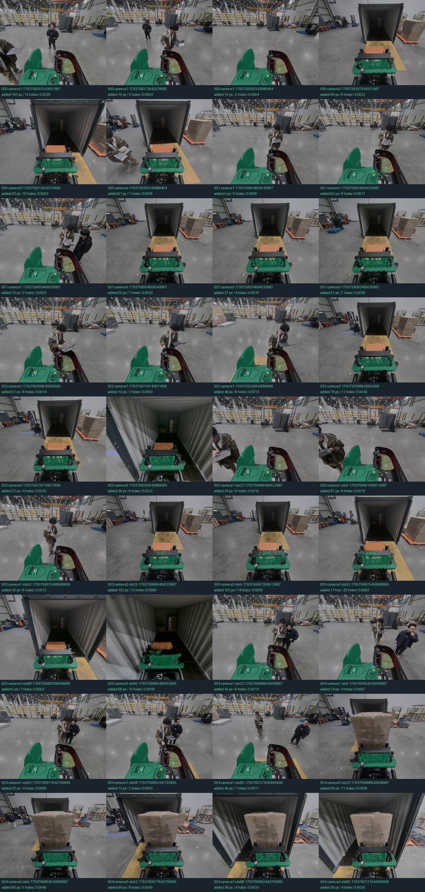
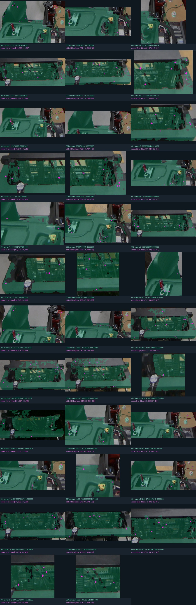

# Round450–457：五包 ego 微孔填补影子

日期：2026-11-22

## 目标与边界

针对 camera3 控制台掩膜内部大量细小孔洞，新增独立的组件级孔洞填补影子。它不直接处理
union，而是分别处理冻结的两个组件，避免把组件之间的真实空隙误填。所有结果仍是助手
候选，不覆盖源 mask，不写人工真值，不批准训练或正式部署。

## 严格规则

- 固定 640×512、8 连通；接触图像边界的背景永不填；
- 仅处理面积严格 `<16` 像素的封闭孔；
- 含负提示点的孔永不填；
- 同相机、同组件、至少两个外部包持续出现的孔洞永不填，位置容差 2 像素；
- 单组件新增面积不超过原组件的 1%；
- 填补后仍需通过组件面积门禁、正负提示点、只增不减和幂等检查；
- 组件集合必须完整并能精确重建原 union；全部计算通过前不创建输出目录。

## 门禁如何收敛阈值

最初的 `<100` 像素方案在
`000-camera3-1793758297542631987/camera3-crossbar-core-v2` 新增 105 像素，比例
`1.0280%`，被 1% 预算阻断。降至 `<32` 后，
`003-camera3-idx52-1793759975409508695` 仍达到 `1.4508%`，再次阻断。没有提高预算，
最终把单孔阈值冻结为 `<16`。

## Round456 影子结果

| 指标 | 结果 |
|---|---:|
| 可用候选 | 36 |
| 继续失败关闭 | 2 |
| 填补孔洞 | 245 |
| 新增像素 | 1,764 |
| 删除像素 | 0 |
| 单组件最大新增比例 | 0.8581% |
| 跨包持续孔洞保护 | 235 |
| 大孔保护 | 243 |

洋红色是新增像素。逐帧总览和新增量最高的 camera1/camera3 帧显示，新增区域均为掩膜内部
的微小点状孔，没有出现整片人物、货物、地面或机械大开口被填。由于单点很小，这一轮主要
改善局部碎孔，不会解决 camera3 大范围横梁/控制台召回变化。

## 冻结参考对比

Round457 只用原始 Round445 mask 重建参考，再把同一参考分别用于填补前后候选；填补后的
mask 不参与参考构造，避免集体填孔互相“洗白”。

| 指标 | 填补前 | 填补后 | 变化 |
|---|---:|---:|---:|
| 告警样本 | 4 | 4 | 0 |
| 新增告警 | — | 0 | 0 |
| 平均 IoU | — | — | +0.000767 |
| 平均参考覆盖率 | — | — | +0.001554 |
| 平均候选超出 | — | — | +0.000592 |
| 平均孔洞率 | — | — | -0.002397 |

结论是小幅正向：孔洞率下降、IoU/覆盖率略升，没有新增或消除既有告警；候选超出有极小
增加，因此只能标记为 `hole_fill_shadow_review_pass`，不能宣称模型能力或泛化提升。

## Round458 放大视觉复核

为避免全帧总览看不清 1–15 像素的微小变化，进一步对 35 张有变化帧自动生成新增区域
放大裁剪；1 张无变化。35 张、1,764 个新增像素全部进入同一哈希绑定联系表。

助手逐格复核未发现人物、货物、地面或大机械开口被填，较大的黑色机械空隙仍保持背景。
该结论记录为 `assistant_zoom_review_pass`，仍不等同独立人工像素真值。

## 下一步

保持默认关闭。下一步将 16 像素微孔填补接到工作台的只读影子预览开关之前，还需要：

1. 在独立人工像素真值上验证孔洞确属误分，而不是网格、线缆或真实机械开口；
2. 确认预览开关不会写回候选、人工真值或训练集；
3. 用新的数据包复核 1% 预算与持续孔洞保护，不在当前五包继续调阈值。
