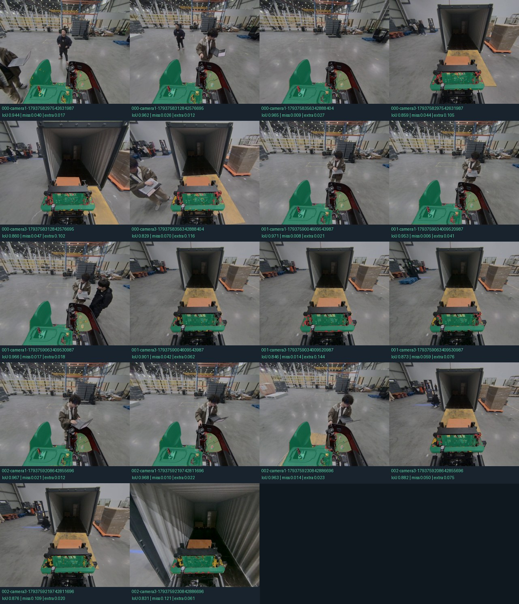

# Round435：1104 ego 并集像素安全审计

日期：2026-11-22

## 做了什么

新增独立工具 `tools/audit_ego_union_pixels.py`。它不修改 Round432/433 的候选掩膜，
不写人工真值，只用另外两个包的同相机掩膜构造“留一包外”参考，输出：

- 参考 IoU、参考覆盖率、候选超出比例；
- 小孤岛、孔洞、主要连通域与边界复杂度；
- 红黄绿逐帧差异图和总联系表；
- 所有输入队列、源图、并集 mask、身份清单的哈希复核。

颜色含义：绿色是候选和跨包参考重合，黄色是参考存在而当前候选缺失，红色是当前候选超出
参考。红黄区域只是“优先看哪里”，不是像素真值或自动错误判定。

## 结果

| 指标 | camera1（9 帧） | camera3（9 帧） |
|---|---:|---:|
| 参考 IoU | 0.9442–0.9710 | 0.8286–0.9011 |
| 参考覆盖率 | 0.9597–0.9937 | 0.8788–0.9862 |
| 候选超出参考 | 0.0120–0.0408 | 0.0198–0.1440 |
| 小孤岛面积占比最大值 | 0.002774 | 0.005400 |
| 孔洞/掩膜面积最大值 | 0.047871 | 0.029041 |

按冻结的影子筛查门槛，18 帧自动告警 0 帧。工具仍把 18 帧全部标记为 `review_required`，
不会因“未告警”自动变成人工真值、训练批准或生产候选。

## 助手逐图复核

我查看了 18 帧总联系表：

- 未看到整片人物、地面、货物、集装箱壁或橙色承载面被吞入；
- camera1 的差异主要位于车体面板和仪表附近，人物贴近时未见整个人被纳入；
- camera3 的红黄差异明显更大，主要集中在下部车架边缘和内部孔隙；没有跨到上方橙色
  承载面，但应保持比 camera1 更宽松的复核阈值；
- 没有发现 major 外部误纳或 major 目标组件缺口，仍存在 minor 边缘/孔隙差异。

这是助手复核，不是人工像素真值；没有把任何结果写回训练集或工作台。

## 效率与测试

- 第一版纯 Python 连通域统计在同一 18 帧约 15.8 秒；
- 改为项目已有 OpenCV 连通域后，同一命令约 0.81 秒，约 19 倍加速；
- 新工具 10 项单测通过，覆盖指标计算、少包拒绝、mask 哈希错误、身份错配、重复样本、
  输入只读和联系表可复现。

审计 JSON SHA-256：
`86445be92007bfad83bf4ad054087676f5fb69ab3c1035523e9d860c6dfa14dd`；
联系表 SHA-256：
`2250a592352321b878cb7829f9c68cea9197ccce95783d50dca9b1c9d062b8b4`。

## 下一步

现在可以做的安全优化是把小于 100 像素的孤岛作为“去噪候选”单独对照，而不是直接修改
现有掩膜。必须验证去噪前后正提示点全部保留、主要组件面积不变且 18 帧逐图没有细结构被
误删，才考虑把它加入候选后处理；正式工作台暂不接入。
