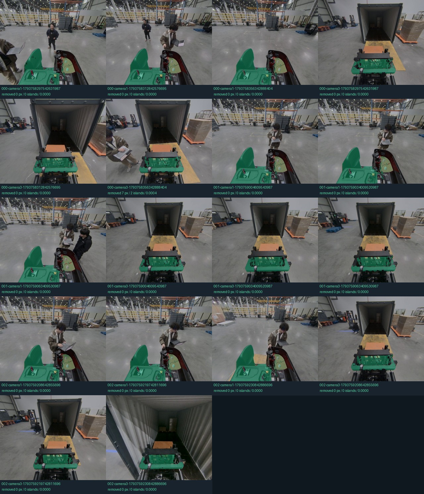
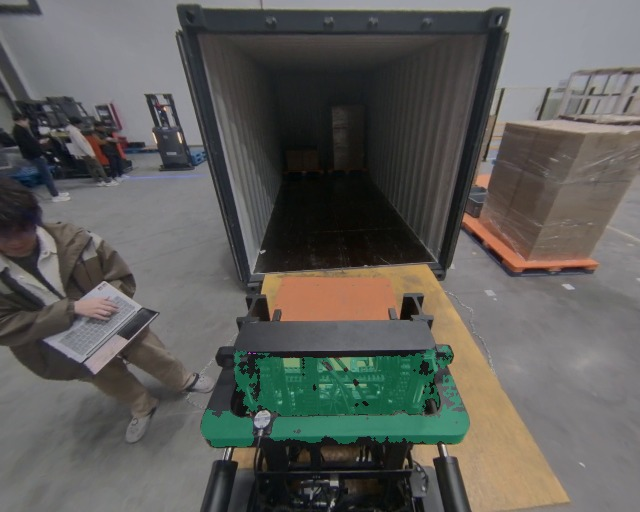

# Round439：跨包持续结构保护后的 ego 去噪影子

日期：2026-11-22

## 为什么重做

Round436 的全局 `<100` 像素规则数值通过，但可能删除一个 93 像素真实车体附件，因此被
视觉门禁阻断。本轮不放宽删除条件，而是增加更保守的否决：同一相机、同一组件、相近
像素位置只要得到至少两个不同包支持，就视为持续结构，禁止自动删除。位置容差冻结为
2 像素，仍使用 8 邻域。

## 结果变化

| 指标 | Round436 无持续保护 | Round439 跨包保护 |
|---|---:|---:|
| 拟删除像素 | 222 | 7 |
| 拟删除孤岛 | 36 | 2 |
| 被跨包保护的小组件 | 0 | 37 |
| 单帧最大删除比例 | 0.5400% | 0.0402% |
| 单组件最大删除比例 | 0.9329% | 0.0663% |
| 新增像素 | 0 | 0 |

上一轮阻断帧 `000-camera3-1793758312842576695` 的 93 像素区域现在删除为 0，横梁组件
共有 3 个小结构因跨包复现被保护。

## 剩余 7 像素

仅 `000-camera3-1793758356342888404` 仍有两个不重复孤岛：

- 4 像素，边界框 `[248, 352, 3, 2]`；
- 3 像素，边界框 `[253, 353, 3, 1]`。

它们位于下部车架掩膜内部附近，联系表和整帧叠图未见对应独立车体结构。助手复核认为可
作为去噪影子保留，但这不是人工像素真值，不能自动覆盖原 mask。

## 安全门

- 固定 640×512、8 邻域、严格 `<100`；
- 至少两个不同包、2 像素容差的持续结构保护；
- 单组件删除预算 ≤1%；
- 正提示点、负提示点、组件面积门禁全部保持；
- 只减不增、第二次运行幂等；
- 原 mask、人工真值、训练集和正式工作台均未修改。

相关单测增加到 12 项；连同上游链路共 52 项通过，1 项 Windows 符号链接测试跳过。

## 哈希

- 工具：`6a3c6e76f7f8f1ff18b57663cab09a2499a9b44bd524ced3587bc91745ebe327`；
- 测试：`c9f2e94ecb8fa40e1a7b3d50b49dc1ee1470c5144bbdbe2a862e8411035440ee`；
- 影子包：`dbbc1d3803e9878ce23dc2d3d4f6acbc85c3258062370185cd231fea9911e0ea`；
- 总联系表：`957e1d1d6bb8bc839477fb86d8628f5b28067b9db38d34b35008e51a68867493`；
- 剩余 7 像素叠图：`68cc6bf1e45cf54ac570dd55488c923b86be7f13a0dee914e13cf98614a3f12b`。

## 当前结论

Round439 可标记为 `denoise_shadow_review_pass`：它修复了 Round436 误删真实细结构的风险，
只留下 7 个非持续小点的可逆影子差异。它仍不等于人工真值或模型质量提升；下一步应在
更多 1104 包上验证持续结构保护，再决定是否把这一步作为默认关闭的工作台影子选项。
