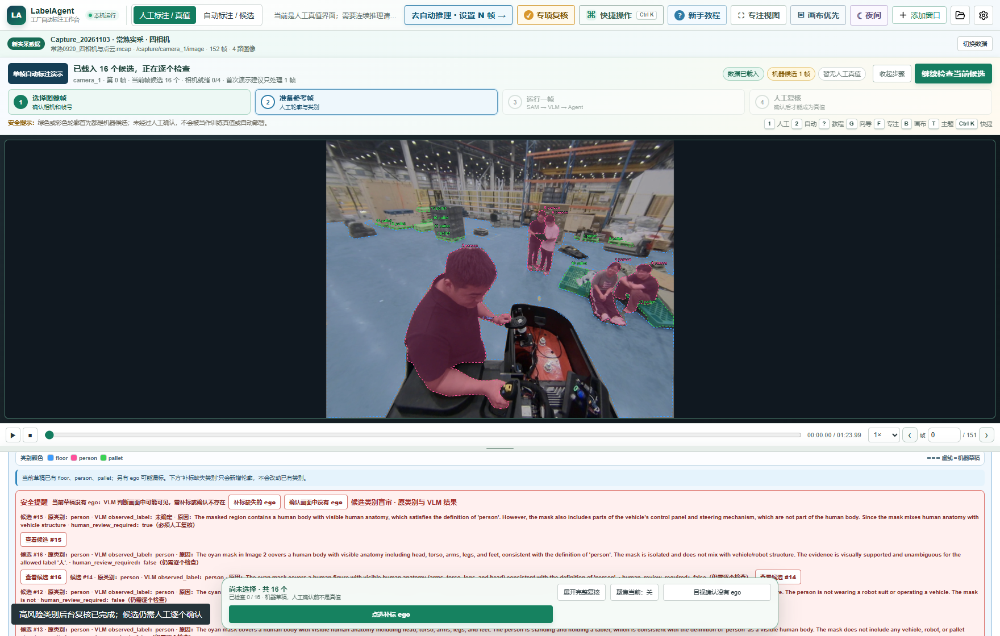
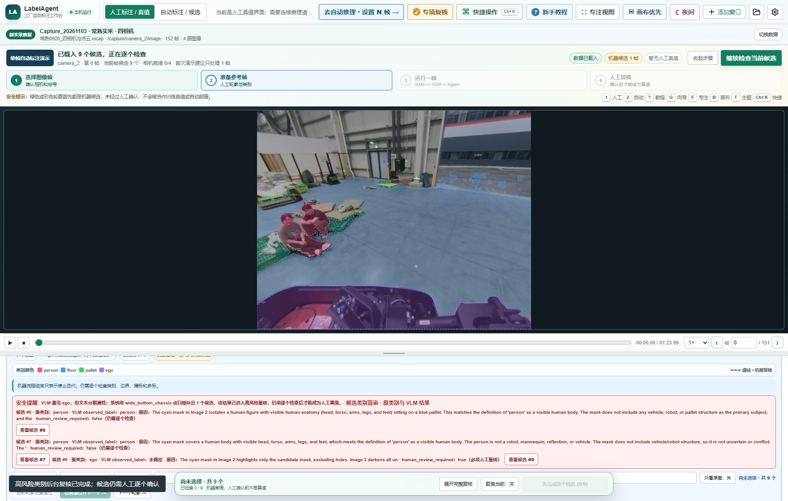

# 5090 VLM 小图加速验收（Round 328–330）

## 结论

本轮已把双卡 5090 的空闲 GPU1 正式接入 LabelAgent，作为“小图 VLM 复核”的可选加速路由。主 VLM 仍使用 4090；5090 不可用时会回退，不阻断工作台。

在同一份 `Capture_20261103/常熟0920_四相机与点云.mcap`、同一帧、同一标签表和同一 compact 提示配置下：

| 视角 | Round 328 总耗时 | Round 330 总耗时 | 降幅 | 首批候选出现 |
| --- | ---: | ---: | ---: | ---: |
| camera1 | 91.500 秒 | 25.688 秒 | 71.93% | 18.797 → 4.453 秒 |
| camera2 | 70.204 秒 | 13.125 秒 | 81.30% | 18.016 → 3.407 秒 |

这不是只比较界面动画。两轮候选几何做了去除运行编号后的内容哈希：

- camera1 均为 `03d4d439d1c96aaebf73aada120d4d3ef6a94c16bd02c02e94fd7176d8e4db98`；
- camera2 均为 `d8b16d47453d407c016d21395b52d94903196fad20fbd1ac9fdcf86626380996`。

因此本轮两帧的候选轮廓和类别没有因提速而改变。

## 实际效果

### camera1

- 16 个候选：floor 1、pallet 10、person 5；
- 1 个高风险 person 候选仍进入人工复核；
- 无页面错误、HTTP 错误或真值写请求；
- 结果仍是机器候选，不是人工真值。

### camera2

- 9 个候选：ego 1、floor 1、pallet 5、person 2；
- ego 候选仍保留人工复核要求；
- 无页面错误、HTTP 错误或真值写请求；
- 结果仍是机器候选，不是人工真值。

## 修复了什么

5090 上的管理脚本已经按 `dedicated-5090` 启动 VLM，但部署的服务端代码版本较旧，只接受 4090 运行模式，导致服务在模型加载前直接退出。

本轮完成：

1. 在 `tools/vlm_resources.py` 增加专用 RTX 5090 资源门禁：必须是指定 UUID、RTX 5090、无计算进程、利用率不高于 10%、直接报告的空闲显存不少于 28,000 MiB；
2. 在 `tools/local_vlm_server.py` 增加 `dedicated-5090` 服务配置；
3. 在隔离验收管理器中按健康状态注入 5090 小图路由，未就绪时保留空路由；
4. 5090 VLM 以 NF4、512 图像 token 启动，实测真实图片请求 1.241 秒返回；
5. 正式工作台只新增 `llm_fast_url` 和 `llm_fast_model`，没有修改数据集、标签、候选、参考帧或人工真值。

## 安全边界与回滚

远端替换前备份：

`/home/clw/projects/labelagent-5090/backups/round329-dedicated-vlm-20261120`

本地正式状态备份：

`D:/Apps/LabelAgent/.local/backups/fast-vlm5090-round329-20261120`

正式状态逐字段核对为未变化：`labels`、`truth`、`truths_by_topic`、`reference_frames`、`candidates`、`candidates_by_topic`、`human_review_transactions`、`rejected_candidates`、`video_path`、`topic`。唯一变化是新增 5090 的 URL 与模型名。

远端部署后文件哈希：

- `tools/local_vlm_server.py`: `8bb1768e4390b3918e897a8ef75a3f21b42c7eb7f264f18de1d4dbfe7dbe6495`
- `tools/vlm_resources.py`: `44e96d3c18941458665fb21c4e46a522d77e7b454518b334d3443305232fa7a6`

## 回归测试

- Python：`1123 passed, 186 subtests passed`；
- 前端 JavaScript：`148 passed`；
- 资源与管理器定向测试：`34 passed`；
- camera1、camera2 隔离浏览器验收：全部通过；
- 验收后 18797、18798 隔离端口均已释放；
- 正式工作台继续返回 HTTP 200，5090 VLM 健康状态为 `ok`。

机器候选、人工真值和训练集边界没有改变。此次验收仅覆盖两个相机各一帧，证明这一路由在已测样本上提速且不改变候选几何，不能替代后续多帧与新数据集泛化评测。

结构化证据见 [acceptance.json](evidence/fast-vlm5090-round330/acceptance.json)。
