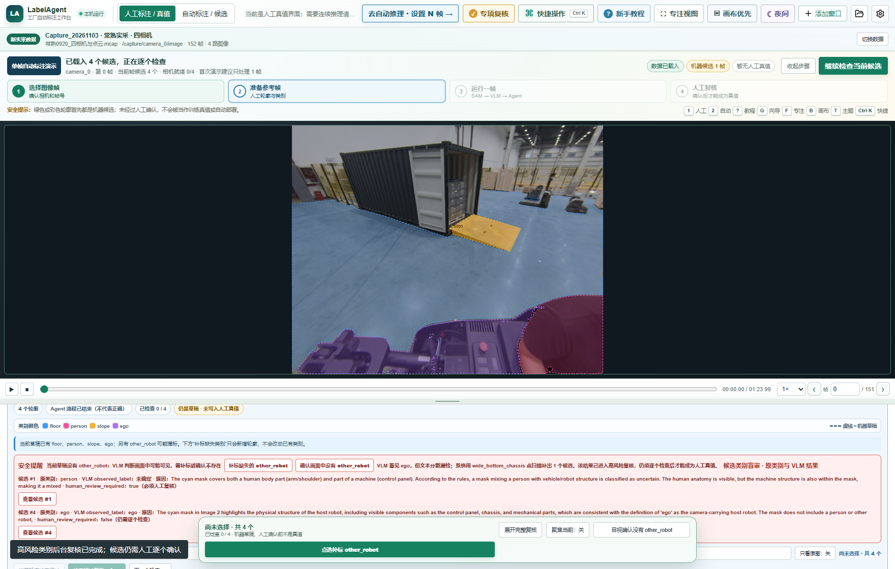
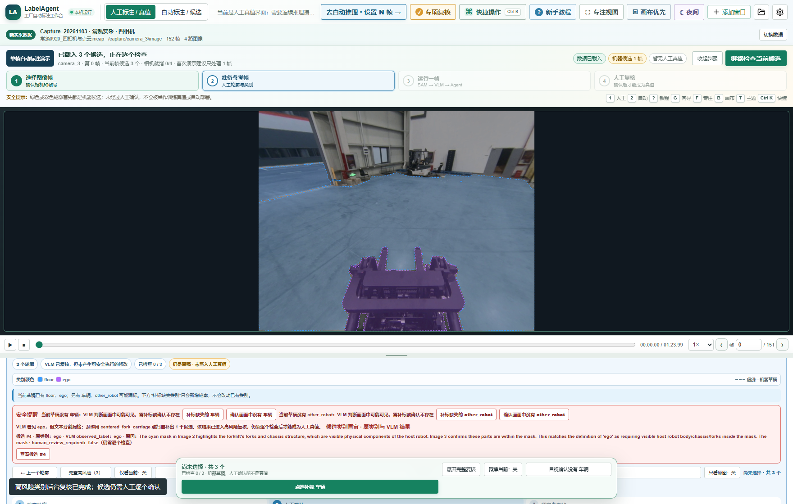

# 5090 四相机斜坡复验与大图路由门禁（Round 331–332）

## 结论

Round331补齐了5090加速上线后的camera0和camera3复验：真实斜坡保留，camera3假坡继续被拦截，两路候选几何均与上线前基线逐内容一致。

Round332尝试进一步把1920×1536大图发现交给5090 NF4。速度有提升，但一个原本需要人工复核的混合person候选被直接保留，安全门禁失败，因此该配置已拒绝且未部署。正式工作台继续保持“小图5090加速、大图4090主路由”。

## Round331：斜坡正负样本复验

### camera0：真实坡仍然存在

- 候选：ego 1、floor 1、person 1、slope 1；
- 真实坡板仍以独立橙色区域保留；
- 候选几何哈希与Round326完全一致：`eeb8f81b7bf0132b8b04ee9b0c8ea96e74f31a563303f950d989c1190356093b`；
- 页面错误、HTTP错误和真值写请求均为0。

### camera3：假坡仍被拦截

- 最终只保留ego 1、floor 2；
- slope候选有99.9%落在当前高置信ego内部，ego分数约0.957；
- `slope_candidate_current_ego_conflict`人工复核记录在后台Agent完成后仍存在；
- 候选几何哈希与Round327完全一致：`ad19045f5651819b90e92db1251c8e150415b0e68553697fe028b54f0b3df928`；
- 页面错误、HTTP错误和真值写请求均为0。

## Round332：大图5090路由被安全门禁拒绝

实验只在隔离工作台把快速路由上限从640长边提高到1920，未修改正式配置。

camera0总耗时从55.813秒降至36.093秒，下降约35.33%，候选数量和真实坡轮廓保持不变。但候选1是人体与控制台混合区域：

- 正式小图加速配置：`human_review_required`；
- 大图5090 NF4配置：`candidate_preserved`，并输出`human_review_required: false`。

这意味着NF4大图判断在已测困难候选上变得更宽松。即使轮廓没有变化，也不满足“提速不能降低人工复核保护”的门禁，所以没有继续跑camera3，也没有把大图阈值写入正式工作台。

## 收尾状态

- Round331与Round332隔离端口均已释放；
- 正式工作台HTTP 200，5090 VLM健康状态`ok`；
- 正式阈值仍为327,680像素、最长边640；
- 正式状态哈希仍为`CBA73B2DBFF671BE73EFFA6B67579C290337C755464EB18D66C0CC789BC7CD64`；
- 所有输出仍是机器候选，没有写成人工真值或批准进入训练集。

结构化证据：

- [Round331 acceptance.json](evidence/fast-vlm5090-slope-round331/acceptance.json)
- [Round332 rejected.json](evidence/fullframe-vlm5090-round332/rejected.json)

下一步应继续保持大图4090 BF16路由，优化其提示复用、缓存和确定性发现阶段；不能通过扩大5090 NF4路由范围来换取速度。
