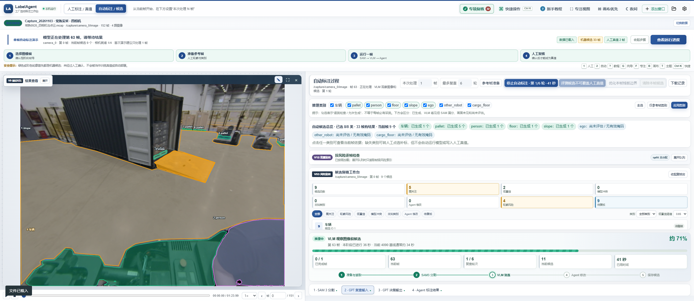
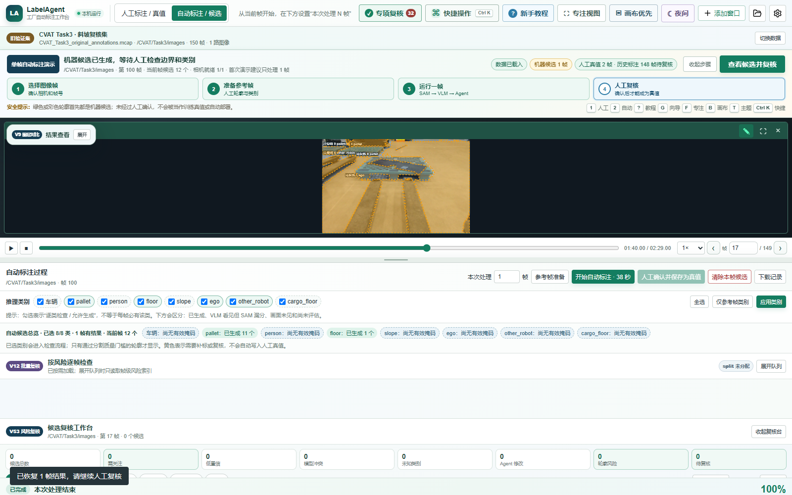
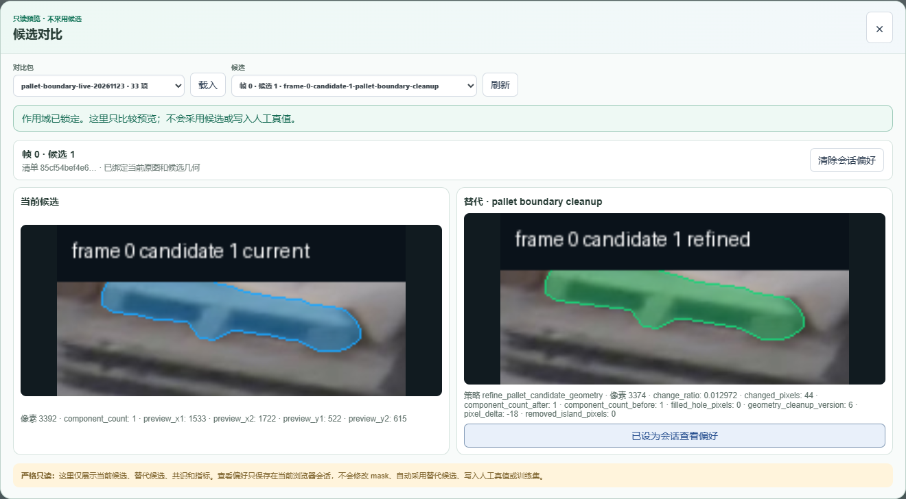
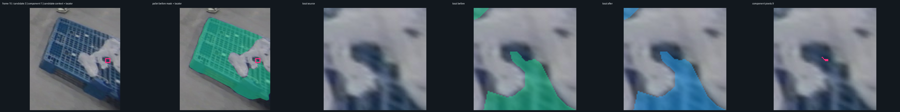

# LabelAgent 同事完整复现教程

版本日期：2026 年 11 月 23 日

复现分支：`reproduce`
固定提交：`255cdf2e22bf897d04c63f4bdb1135c2e910fe5a`

## 1 先说结论

同事应从 CNB 的 `reproduce` 分支下载，不要使用 `main`、`labelagent`、`codex/*` 或 `backup/*`。`reproduce` 是经过安装脚本、自检脚本和回归测试整理后的交付入口，`labelagent` 是持续开发分支。

- CNB 仓库：<https://cnb.cool/seer-robotics/EIC/BEV/LabelAgent>
- CNB 复现分支：<https://cnb.cool/seer-robotics/EIC/BEV/LabelAgent/-/tree/reproduce>
- GitHub 备用入口：<https://github.com/linweichen-ai/LabelAgent/tree/reproduce>

代码仓库不包含 SAM3 权重、私有 MCAP/OSS 数据、人工真值、VLM 密钥或内部 LoRA 权重。要“完整复现真实自动标注效果”，除了代码，还需要单独获得这些授权资源。缺少资源时仍可完成环境安装、页面启动、公开合成浏览器验收和只读复核流程，但不能据此声称模型效果已完整复现。

## 2 当前版本已经做到什么

当前提交已经具备以下闭环骨架：

```text
工厂图片或 MCAP
        ↓
SAM3 生成多类别候选
        ↓
VLM 读取原图 参考帧 候选叠加与类别约束
        ↓
Agent 校验并执行受控局部修改
        ↓
人工复核候选
        ↓
明确确认后保存人工真值
        ↓
评测与受控训练候选回流
```

工作台已经支持图片与 MCAP 导入、四路相机数据、SAM3 点提示、多类别自动候选、VLM 复查、Agent 局部修复、逐帧结果叠加、候选对比、专项复核和浏览器会话草稿。斜坡按当前约定属于可通行区域，可以与地面统一评估；保存为真值前仍必须人工确认。



图 1 展示自动模式的主界面。左侧是图像和分割叠加，右侧依次显示类别、候选统计、风险复核、实时进度以及 SAM3、VLM、Agent 的过程记录。



图 2 展示候选重新加载后的叠加结果。机器候选与人工真值在系统中是两种不同状态，候选不会自动升级为真值。



图 3 展示当前候选与替代候选的只读对比。查看偏好只保存在浏览器会话中，不会自动修改 mask 或写入训练集。



图 4 是最新 Round752 接入工作台的托盘边界六联证据：全局定位、原托盘 mask、局部原图、修改前、修改后和新增像素。当前 11 个真实候选组件已经可以在“组件证据复核”中逐项查看；这证明复核流程可用，不代表 11 个候选都正确，也不代表模型精度已提升。

## 3 同事需要准备什么

### 3.1 机器环境

- Windows 10 或 Windows 11；
- Python 3.12；
- Microsoft Edge；
- Node.js，用于网页逻辑和真实浏览器验收；
- NVIDIA 驱动和可用 CUDA 显卡；
- 至少 8 GiB 安装临时空间，完整虚拟环境约 5.1 GiB；
- PowerShell 和 Git。

脚本会在仓库自己的 `.venv` 中安装依赖，不修改系统 Python。

### 3.2 需要另行提供的资源

| 资源 | 是否在 Git 中 | 用途 |
|---|---|---|
| `sam3.pt` | 否 | SAM3 候选分割 |
| 图片或 MCAP/OSS 数据 | 否 | 真实输入数据 |
| VLM 接口地址和模型名 | 否 | GPT/VLM 复查与 Agent 决策 |
| VLM 密钥 | 否 | 仅在接口要求时使用 |
| 内部 LoRA ZIP | 否 | 可选的受控后训练候选 |
| 人工真值 | 否 | 评测、训练和验收 |

不要通过聊天、Git 或截图传递密钥。权重和数据应走团队批准的文件渠道，并保留来源与 SHA-256。

## 4 下载正确版本

在 PowerShell 中执行：

```powershell
git clone --branch reproduce --single-branch https://cnb.cool/seer-robotics/EIC/BEV/LabelAgent
cd LabelAgent
git rev-parse HEAD
```

预期提交号：

```text
255cdf2e22bf897d04c63f4bdb1135c2e910fe5a
```

为了避免以后 `reproduce` 前移造成差异，建议立即固定本教程对应版本：

```powershell
git checkout 255cdf2e22bf897d04c63f4bdb1135c2e910fe5a
```

如果 CNB 提示仓库不存在，通常是组织权限尚未开通，不是仓库真的不存在。可以先确认已登录正确 CNB 账号和组织；外部协作者可临时使用 GitHub 的 `reproduce` 分支。

## 5 一键安装依赖

```powershell
powershell -ExecutionPolicy Bypass -File tools\setup_windows.ps1
```

该脚本会执行：

1. 找到 Python 3.12 并建立 `.venv`；
2. 安装 `torch==2.10.0` 和 `torchvision==0.25.0` 的 CUDA 12.8 构建；
3. 安装固定版本的 Flask、PyAV、MCAP、NumPy、OpenCV Headless 和 Pillow；
4. 安装网页验收依赖；
5. 以 editable 模式安装仓库内 `source/sam3`；
6. 运行 CUDA 和依赖自检。

网络较慢时，PyTorch 下载阶段可能数分钟没有新输出。不要因为暂时安静就直接关闭终端。若系统盘空间不足，可把临时目录指向其他盘：

```powershell
powershell -ExecutionPolicy Bypass -File tools\setup_windows.ps1 `
  -TempDir E:\LabelAgentTemp
```

安装脚本实际安装的项目基础包为：

```text
av 18.1.0
Flask 3.1.3
mcap 1.5.0
mcap-protobuf-support 0.5.4
numpy 1.26.4
opencv-python-headless 4.11.0.86
Pillow 12.3.0
```

SAM3 还会安装 `timm`、`tqdm`、`ftfy`、`regex`、`iopath`、`huggingface_hub` 等依赖。不要在系统 Python 中手工混装这些包。

## 6 放置 SAM3 权重

从团队批准渠道获得权重后，将文件放到：

```text
source\sam3\weights\sam3.pt
```

检查文件存在：

```powershell
Get-Item source\sam3\weights\sam3.pt
```

权重不在仓库中是正常的。没有权重时，页面仍可打开，但本机 SAM3 服务不能完成真实分割。

## 7 启动工作台

### 7.1 本机同时运行 SAM3 和网页

```powershell
powershell -ExecutionPolicy Bypass -File tools\start_local.ps1
```

启动成功后打开：<http://127.0.0.1:8765>

日志位于：

```text
.repro\logs\sam3.out.log
.repro\logs\sam3.err.log
.repro\logs\workbench.out.log
.repro\logs\workbench.err.log
```

### 7.2 使用独立数据目录

建议不要把运行状态散落在仓库根目录：

```powershell
powershell -ExecutionPolicy Bypass -File tools\start_local.ps1 `
  -WorkDir D:\LabelAgentData\work
```

### 7.3 SAM3 在另一台机器上

若已有经过授权的 SAM3 服务，可指定地址：

```powershell
powershell -ExecutionPolicy Bypass -File tools\start_local.ps1 `
  -SamUrl http://127.0.0.1:28766
```

团队内部的 4090/5090 SSH 路由是站点专用配置，不应让新同事照抄服务器别名和私有路径。应先提供明确的服务地址、访问方式和责任边界。

### 7.4 停止

```powershell
powershell -ExecutionPolicy Bypass -File tools\stop_local.ps1
```

停止脚本只处理本次仓库启动并记录的进程，不扫描或结束其他用户任务。

## 8 配置 VLM

不配置 VLM 时，图片/MCAP 浏览、人工多边形、SAM3 点提示和候选复核仍可使用。完整自动标注的 VLM 复查与 Agent 修改需要 OpenAI 兼容的视觉模型接口。

在工作台右上角点击设置，填写：

- API 基址，例如 `http://127.0.0.1:18868/v1`；
- 服务端声明的模型名；
- 仅在服务要求时填写密钥。

保存后先执行一帧小样本，不要直接全量运行。如果出现 `Local VLM is busy`，说明共享模型槽位正在被占用；应等待当前请求释放或由服务管理员检查模型进程，而不是重复高速点击开始按钮。

## 9 第一次完整操作流程

### 9.1 加载数据

1. 点击右上角文件夹按钮；
2. 添加一张图片或一段 MCAP；
3. 选择相机 topic；
4. 确认页面显示正确的数据集、相机和帧数。

对于首次验收，优先使用一张已经知道目标位置的授权图片，避免一上来处理整段 MCAP。

### 9.2 准备参考帧

1. 切换到“人工标注 / 真值”；
2. 选择参考帧；
3. 用多边形或 SAM3 正负点完成参考轮廓；
4. 人工检查边界和类别；
5. 保存参考帧真值；
6. 切换到“自动标注 / 候选”，生成参考场景描述。

参考真值优先于文字描述。斜坡当前按可通行区域处理，可与地面统一，但若项目标签表仍保留 `slope`，需要在评测口径中说明是否合并。

### 9.3 运行一帧

1. 进入待处理帧；
2. 只选择本次确实需要的类别；
3. 把处理数量设为 1；
4. 复查轮数先用默认 6，Agent 可能提前停止；
5. 点击开始自动标注；
6. 依次查看 SAM3 分割、GPT 复查输入、GPT 决策输出和 Agent 标注结果；
7. 确认最终候选叠加回原图。

### 9.4 人工确认

机器候选不能自动变成人工真值。人工至少要检查：

- 类别是否正确；
- 托盘是否与地面、货物或相邻托盘粘连；
- 轮廓是否出现凹凸孔洞、过度填充或漏分；
- 斜坡和地面是否符合本项目的可通行区域口径；
- 人、车辆、ego、其他机器人是否被误并入地面；
- 远处小目标是否遗漏。

确认无误后再点击“人工确认并保存为真值”。未确认的绿色或彩色轮廓仍然只是机器候选。

## 10 托盘组件证据复核

最新版本把微孔和托盘边界证据统一到“组件证据复核”入口。已有所有权证据清单时，可执行：

```powershell
.\.venv\Scripts\python.exe `
  tools\build_pallet_boundary_component_review_pack.py `
  --review-manifest D:\ReviewA\manifest.json `
  --review-manifest D:\ReviewB\manifest.json `
  --output work\component_review_packs\pallet-ownership-review
```

重新打开自动标注页面，在候选复核工作台点击“组件证据复核”。每项可选择“倾向可补”“不确定”“倾向驳回”，但这些选择只存在当前浏览器会话中，不会修改 mask、人工真值、训练集或模型。

服务端会拒绝路径越界、哈希不一致、伪造图片、尺寸超限、自动决策标志、训练授权标志或人工真值标志异常的复核包。

## 11 三层验收

### 11.1 环境自检

```powershell
.\.venv\Scripts\python.exe tools\repro_doctor.py `
  --require-cuda --require-weight
```

### 11.2 完整代码回归

```powershell
powershell -ExecutionPolicy Bypass -File tools\verify_checkout.ps1 `
  -RequireCuda -RequireWeight
```

当前固定提交的开发工作树回归结果为：

```text
1790 passed, 1 skipped, 286 subtests passed
```

Windows 下必须保持 UTF-8；仓库脚本已经设置 `PYTHONUTF8=1`。

### 11.3 服务读回

```powershell
.\.venv\Scripts\python.exe tools\repro_doctor.py `
  --require-services `
  --sam-url http://127.0.0.1:8766 `
  --web-url http://127.0.0.1:8765 `
  --json
```

HTTP 200 只证明服务连通。最终还要在一张授权图片上真实完成：加载、SAM3 请求、候选显示、刷新恢复、VLM 复查和人工确认边界检查。

## 12 没有 GPU 或权重时怎么验收

只验证公开合成复核流程：

```powershell
powershell -ExecutionPolicy Bypass -File `
  tools\setup_public_browser_check.ps1
```

这条路径不读取私有数据、权重、密钥或人工真值，只证明页面、草稿、哈希篡改拦截和训练授权门禁可复现，不证明真实分割质量。

## 13 可选的 LoRA 候选验收

如果团队另行提供了授权 LoRA ZIP，应先核对提供方给出的整包 SHA-256：

```powershell
.\.venv\Scripts\python.exe `
  tools\verify_qwen3vl_controlled_bundle.py `
  D:\AuthorizedArtifacts\labelagent-qwen3vl2b-lora.zip `
  --expected-sha256 <64位SHA256> `
  --tensor-scan `
  --output .repro\qwen3vl2b-bundle-verification.json
```

通过完整性检查只证明权重包没有损坏或被替换，不证明新模型优于当前基线，也不代表已经部署到工作台。

## 14 常见问题

### 页面打不开

先检查 `.repro\logs\workbench.err.log`，再运行服务读回。8765 被其他程序占用时，启动脚本会拒绝接管，不要直接结束未知进程。

### SAM3 请求失败

检查 `sam3.pt` 是否存在、CUDA 是否可用、8766 是否健康，并查看 `sam3.err.log`。只有页面能打开不代表模型服务已就绪。

### Local VLM is busy

这是共享模型槽位被占用或上一次请求没有及时释放。先等待当前任务完成，再检查 VLM 服务健康和并发队列；不要连续重复提交同一帧。

### 推理完成但原图没有叠加

先确认当前帧、相机 topic 和数据集没有在运行期间切换，再查看 Agent 标注结果和候选计数。刷新后仍无候选时，下载运行记录并检查该帧是否被安全门禁拒绝。

### CNB 无法克隆

确认账号具有 `seer-robotics/EIC/BEV/LabelAgent` 权限。CNB 私有仓库对未授权用户可能显示“仓库不存在”。

## 15 向项目负责人回传什么

每次复现至少回传：

1. `git rev-parse HEAD`；
2. `python --version` 和 `pip check`；
3. GPU 型号、驱动和 `torch.cuda.is_available()`；
4. `repro_doctor.py --json`；
5. 回归测试通过、跳过和失败数；
6. SAM3 权重摘要；
7. 输入数据标识、相机 topic、帧号、标签表、处理数量和复查轮数；
8. 一张原图、一张候选叠加图和下载的运行记录；
9. 明确区分机器候选、人工真值、训练候选和正式部署状态。

只有环境、服务、真实请求和结果读回四层都通过，才能称为端到端复现完成。
