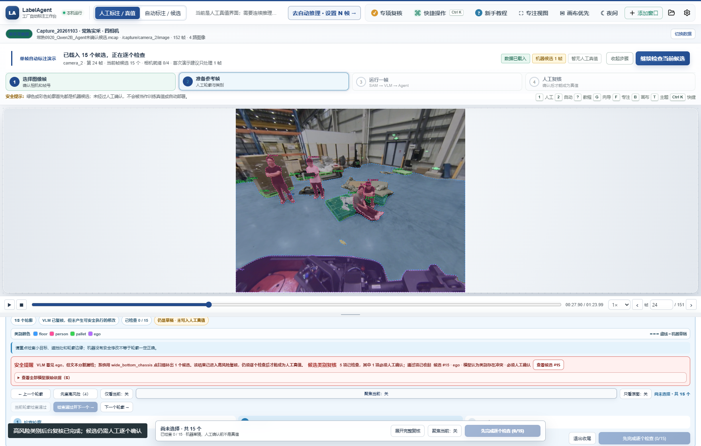

# LabelAgent 第370轮：新数据第二路相机完整覆盖验收

## 结论

为避免把 camera_1 的通过结果误当作整套新数据都可用，本轮在隔离工作区切换到同一 `Capture_20261103` 数据的 `camera_2`，选择此前没有人工真值和机器候选的第24帧，重新执行“自动识别 + 已选类别补漏”完整浏览器流程。

验收通过：19.359 秒收到首批结果，19.375 秒候选覆盖回原图，共15个候选，包括 pallet 9个、person 4个、floor 1个、ego 1个。八个已选类别都在页面逐项显示“已生成 / 本帧未见 / 需要复核”，没有因为某类未分割成功而从反馈中消失。

## 逐类别反馈

| 类别 | 页面反馈 |
|---|---|
| 车辆 | 本帧未见 |
| pallet | 已生成9个 |
| person | 已生成4个 |
| floor | 已生成1个，其中1个需复核 |
| slope | 本帧未见 |
| ego | 已生成1个，其中1个需复核 |
| other_robot | 本帧未见 |
| cargo_floor | 本帧未见 |

## 安全与稳定性

- 页面错误0、失败请求0、HTTP错误0；
- 人工真值写请求0；
- `candidate_only=true`、`human_truth=false`、`approved_for_training=false`；
- 候选类别复核和Agent后台检查均完成；
- 隔离端口8898已关闭，正式工作台8765保持在线；
- 没有修改正式状态、人工真值或训练集。

后台完整复核用了72.422秒，明显长于首批候选显示时间，原因是本帧有5个高风险候选需要独立复核。历史证据已经否决会放行错误候选的双目标强行批审，因此后续继续从缓存复用、进度反馈和安全调度优化，不降低复核门槛。

原始浏览器回执见 `docs/evidence/workbench-stability-20261117/new-dataset-camera2-coverage-round370.json`。
