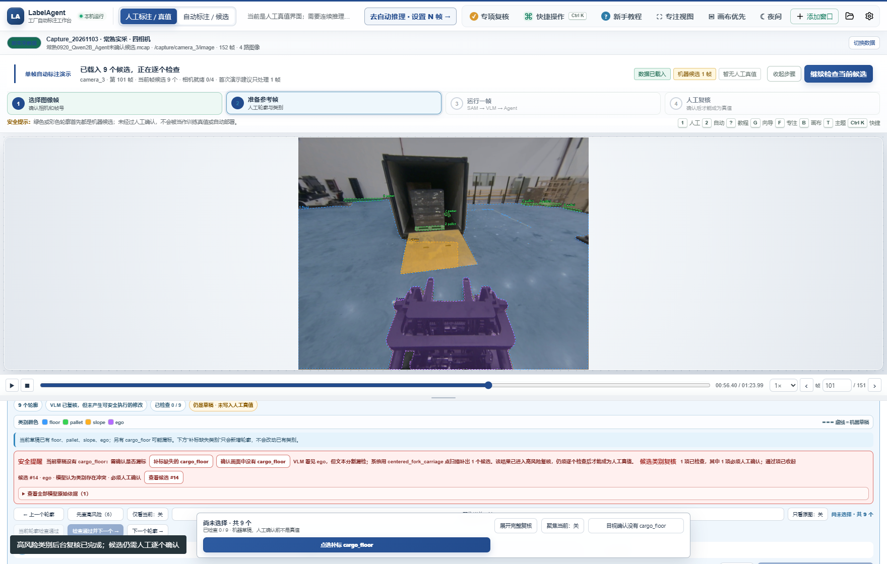

# LabelAgent 第371轮：新数据 camera_3 坡道专项验收

## 结论

本轮在隔离工作区切换到 `Capture_20261103` 的 `camera_3`，选择没有人工真值和机器候选的第101帧，执行“自动识别 + 已选类别补漏”完整浏览器流程。该画面包含一个明显的装卸坡板，可用于检查 `slope` 是否真正参与分割和逐类别反馈。

验收通过：19.344秒收到首批结果，19.375秒候选覆盖回原图，共9个候选，包括 pallet 6个、floor 1个、slope 1个、ego 1个。页面对八类均有明确反馈，`cargo_floor` 被VLM提示可能可见但SAM漏分，系统要求人工确认，没有伪造轮廓。

## 坡道候选核对

`slope` 候选为ID 12，模型分数0.69140625，边界258个点，外接范围为 x=677～1055、y=691～902。截图中橙色轮廓覆盖坡板主体，并与蓝色地面候选保持分离。

这是一条机器候选和助手目视核对证据，不是独立人工像素真值，因此本轮证明的是“斜坡类别能够被检出、显示和送审”，不宣称斜坡IoU、召回率或跨场景精度已经成立。

## 稳定性与隔离

- 页面错误0、失败请求0、HTTP错误0；
- 人工真值写请求0；
- `candidate_only=true`、`human_truth=false`、`approved_for_training=false`；
- Agent与候选类别复核均完成；
- 首批候选约19.4秒可看，后台完整复核约40.3秒完成；
- 隔离端口8898已关闭，正式工作台8765保持在线；
- 正式状态、人工真值和训练集均未修改。

原始浏览器回执见 `docs/evidence/workbench-stability-20261117/new-dataset-camera3-slope-round371.json`。
