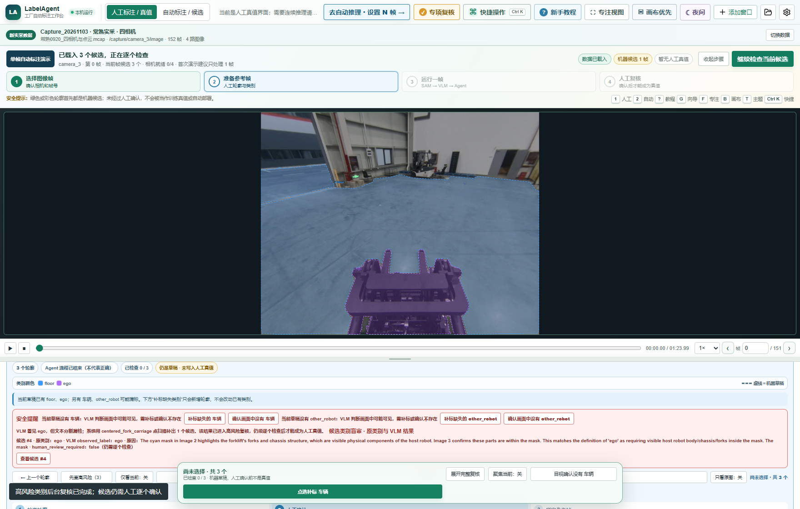
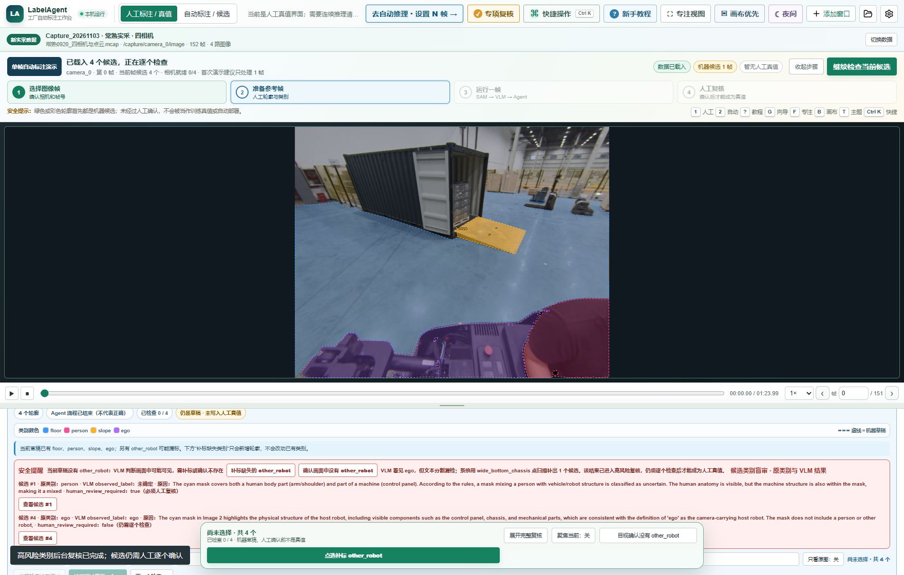

# 新实采四相机复验与斜坡/自车冲突保护（Round 326–327）

日期：2026-11-20  
结论：四路相机均能完成真实单帧推理与原图叠加；camera3 暴露的“自车前部误检为坡”已通过候选级冲突保护消除，camera0 的真实坡保持不变。正式人工状态、参考帧和训练批准均未改动。

## 1. 为什么做这轮复验

Round 325 只验证了 Capture 新实采数据的 camera0。为避免“一个视角跑通”被误解为“四相机均可用”，Round 326 在一次性隔离工作台中加载同一份真实 MCAP，并逐一验证 camera0–3。所有结果都保持机器候选边界：`candidate_only=true`、`human_truth=false`、`approved_for_training=false`。

## 2. Round 326：四相机真实结果

| 相机 | 首批候选可见 | 后台完成 | 总耗时 | 候选类别与数量 | 页面/HTTP/真值写入 |
|---|---:|---:|---:|---|---|
| camera0 | 2.312 秒 | 3.234 秒 | 4.562 秒 | ego 1、floor 1、person 1、slope 1 | 0 / 0 / 0 |
| camera1 | 19.484 秒 | 133.891 秒 | 135.203 秒 | floor 1、pallet 10、person 5 | 0 / 0 / 0 |
| camera2 | 19.343 秒 | 238.515 秒 | 239.797 秒 | ego 1、floor 1、pallet 5、person 2 | 0 / 0 / 0 |
| camera3 | 19.515 秒 | 35.265 秒 | 36.562 秒 | ego 1、floor 2、slope 1 | 0 / 0 / 0 |

这里的“通过”只表示流程、数据绑定、结果显示和安全边界通过，不等于每个候选都正确。camera1/2 已能较早显示首批候选，但后台类别复核最长仍需约 239 秒，是下一步的主要性能长尾。

## 3. camera3 发现的真实质量问题

camera3 的橙色 `slope` 实际落在主车前部结构上，是明显假坡。像素级复核显示：

- 假坡面积：46,382 像素；
- 与高置信度 `ego` 相交：46,334 像素；
- 假坡被 ego 覆盖比例：99.8965%；
- ego 分数：0.9570。

该错误不是颜色判断造成的，而是 SAM 候选之间的语义冲突。旧流程中的 slope 过滤先于后置 ego 点扫描，因此单元级规则虽然正确，真实流程第一次复跑仍未生效。Round 327 将同一保守规则补到 ego 后置恢复之后，关闭了这个执行顺序缺口。

## 4. Round 327：窄范围保护规则

规则只在以下条件同时满足时触发：

1. 同一帧存在分数不低于 0.85 的 `ego` 机器候选；
2. 一个 `slope` 候选至少 80% 被该 ego 覆盖。

触发后只把 slope 从自动叠加层中移出，并记录为 `slope_candidate_current_ego_conflict` / `human_review_required`。它不会把 ego 声明为真值，不会删除证据，也不会批准任何候选进入训练集。

### camera3 反例复跑

修正后得到 3 个候选：floor 2、ego 1；错误 slope 不再覆盖原图。最终版本复跑中首批候选 2.656 秒可见，后台 3.468 秒完成，总耗时 4.890 秒。拦截记录的覆盖率为 0.999（四位小数），后台 Agent 完成后仍有且仅有 1 条 `human_review_required` 记录，且 `human_truth=false`、`approved_for_training=false`。

### camera0 正例复跑

真实坡仍被保留：ego 1、floor 1、person 1、slope 1；冲突过滤数为 0，后置保护状态为 `no_conflict`。首批候选 2.906 秒可见，后台 3.875 秒完成，总耗时 5.141 秒。

## 5. 测试、部署和回滚

- Python 全量：1,104 / 1,104；
- JavaScript：148 / 148；
- ego 点扫描与后置冲突专项：14 / 14；
- camera0 与 camera3 浏览器真实验收：2 / 2；
- 正式备份：`D:\Apps\LabelAgent\.local\backups\slope-current-ego-guard-round327-20261120-091500`；
- 复核提示持久化增量备份：`D:\Apps\LabelAgent\.local\backups\slope-review-persistence-round327-20261120-093000`；
- 正式 state 部署前后 SHA-256 均为 `237844F73FF4495E575C6A3F966260B9385EFBDF1EDEE7D0E5177518470DDFAB`；
- 正式网页、状态接口、4090 VLM、4090 SAM、5090 SAM 均 HTTP 200；
- 5090 可选 VLM 当前未就绪，系统明确回退主 4090 VLM，不影响正常使用。

## 6. 尚未解决与下一步

1. camera1/2 后台复核长尾仍为 134–239 秒，需要减少不必要的逐候选 VLM 调用并保持安全门禁；
2. 部分栈板轮廓仍有纹理孔洞和凹凸边缘，继续走“只改善机器候选、不改人工真值”的轮廓质量门禁；
3. 当前 C 盘约 0.48 GiB、D 盘约 1.49 GiB，低于 2 GiB提醒线，暂不进行大批量导入或全量训练；
4. 本轮是推理与安全保护优化，不是新的 SAM3 微调或后训练完成证明。

结构化证据见 `docs/evidence/workbench-stability-20261117/new-dataset-cross-view-slope-guard-round326-327.json`。
