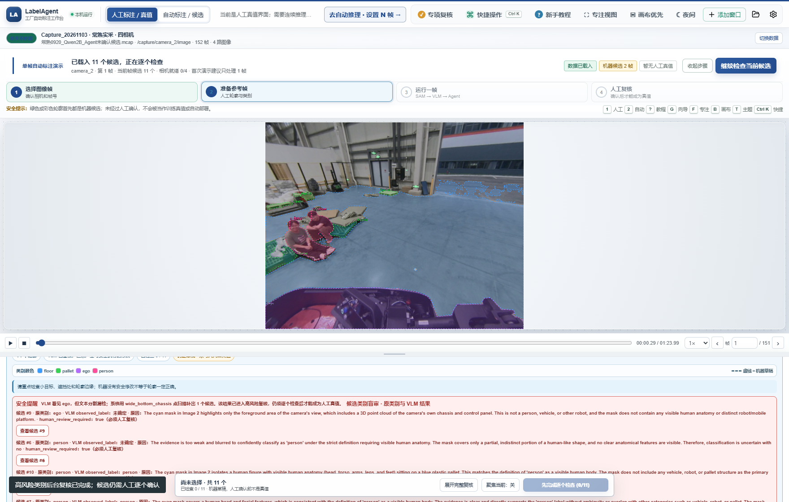

# 第 355 轮：新数据集非首帧端到端验收

## 本轮为什么这样做

此前的新数据集验收主要落在第 0 帧。它能证明新数据集可以载入，但还不足以排除两种风险：一是工具误用第 0 帧的旧候选，二是翻到其他帧后结果不能正确回贴到原图。

本轮把浏览器验收工具改为可以指定任意非负帧号，并在每次验收时强制核对当前帧、当前相机、当前图像地址、候选帧号、Agent 记录帧号和安全边界。HTTP 失败现在也会直接报告状态码和响应正文摘要，不再只显示难以理解的 JSON 解析异常。

## 真实验收对象

- 数据身份：`Capture_20261103 · 常熟实采 · 四相机`；
- 相机：`/capture/camera_2/image`；
- 验收帧：第 1 帧，而不是第 0 帧；
- 类别：车辆、pallet、person、floor、slope、ego、other_robot、cargo_floor，共 8 类；
- 运行方式：独立工作台、真实浏览器、真实 SAM3 → VLM → Agent 流程。

## 页面效果

图中候选已经叠加回当前原图，页面同时显示当前数据身份、`camera_2`、第 1 帧、候选数量和高风险复核说明。未出现画布错位、候选漂移到其他帧或只在列表中有结果而图上不显示的问题。

## 实测结果

| 指标 | 结果 |
|---|---:|
| 第一批候选返回 | 4.36 秒 |
| 候选在原图可见 | 4.39 秒 |
| 后台 Agent 与高风险类别复核全部完成 | 67.28 秒 |
| 总候选数 | 11 |
| pallet | 5 |
| person | 4 |
| floor | 1 |
| ego | 1 |
| 页面类别反馈 | 8/8 类均有“已生成/本帧未见”状态 |
| 页面错误 | 0 |
| HTTP 错误 | 0 |

没有证据的类别不会硬凑结果：车辆、slope、other_robot 和 cargo_floor 在该帧显示“本帧未见”。这只是当前帧的候选观察，不代表这些类别在整套数据中不存在。

## VLM 与 Agent 是否实际参与

本帧共有 5 个高风险候选进入类别复核：

| 项目 | 数量 |
|---|---:|
| 三目标独立批审 | 3 |
| 串行复核 | 2 |
| 保留候选 | 3 |
| 转人工复核 | 2 |
| 协议重试 | 0 |
| 矛盾原因码自动规范化 | 2 |

这说明 GPT/VLM 并非空展示：它对 person 与 ego 候选做了独立复核，明确留下保留或人工复核结论。对证据不足的两个候选，系统没有擅自删除，也没有包装成已经人工确认。

## 安全边界

- 人工真值写入：0；
- 参考帧写入：0；
- 自动批准训练：0；
- 自动批准部署：0；
- 正式 `state.json` SHA-256 前后保持 `9EF08118DD2BA0760CC93CF57BBEAAE4B3BED062D383DF4E6A454C389D4AB115`；
- 独立服务结束后已经关闭，8891 端口已释放；
- 正式工作台首页返回 HTTP 200，仍保持 `Capture_20261103 / camera_1` 的原有工作状态。

## 磁盘异常与修复

第一次运行在请求参考起稿后提前退出。当时系统明确报告 D 盘写入空间不足，导致服务器返回非 JSON 错误页。没有把它误判为 SAM3 或 VLM 模型失败。浏览器退出并释放临时文件后，D 盘恢复到约 1.44 GiB 可用，随后同一帧完整复跑通过。

验收工具也补上了可读错误：以后若请求失败，会直接显示 HTTP 状态码和响应正文摘要，方便快速区分“模型忙”“磁盘满”“接口错误”，而不是只看到 `JSONDecodeError`。

本轮没有删除模型、数据集、候选、人工真值或备份。Round352 的四个 1.51 GiB MCAP 名称经核对都是同一原始文件的硬链接，因此也没有为了表面数字而删除它们；删除硬链接并不能释放其仍被原始数据使用的物理空间。

## 测试结果

- 页面与交互测试：82/82 通过；
- 正式 Python 测试：1156 项、186 个子测试全部通过；
- 验收脚本语法检查：通过；
- 新数据集非首帧真实浏览器验收：通过。

结构化证据见 `docs/evidence/workbench-stability-20261117/new-dataset-nonfirst-frame-round355.json`。

## 下一步

下一轮优先把“磁盘空间不足”从运行中错误进一步前移到工作台运行前检查，并做清晰的阻断提示；随后选取另一相机和更靠后的帧复验，继续确认跨相机、跨帧均不会复用错误候选。
