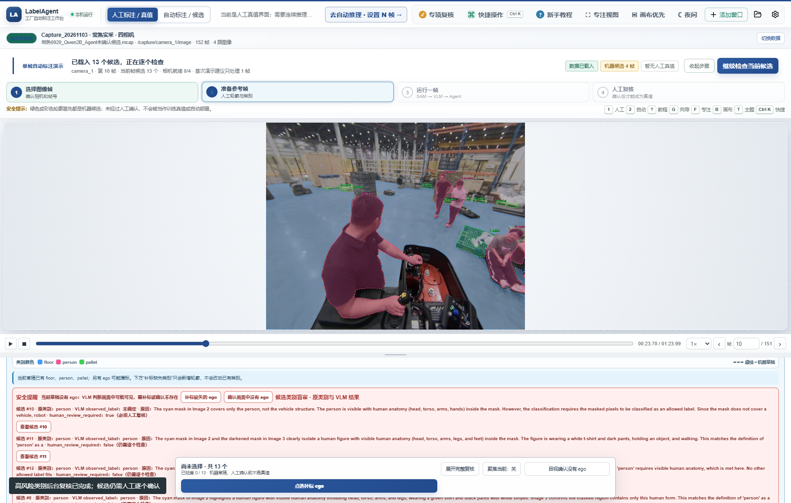
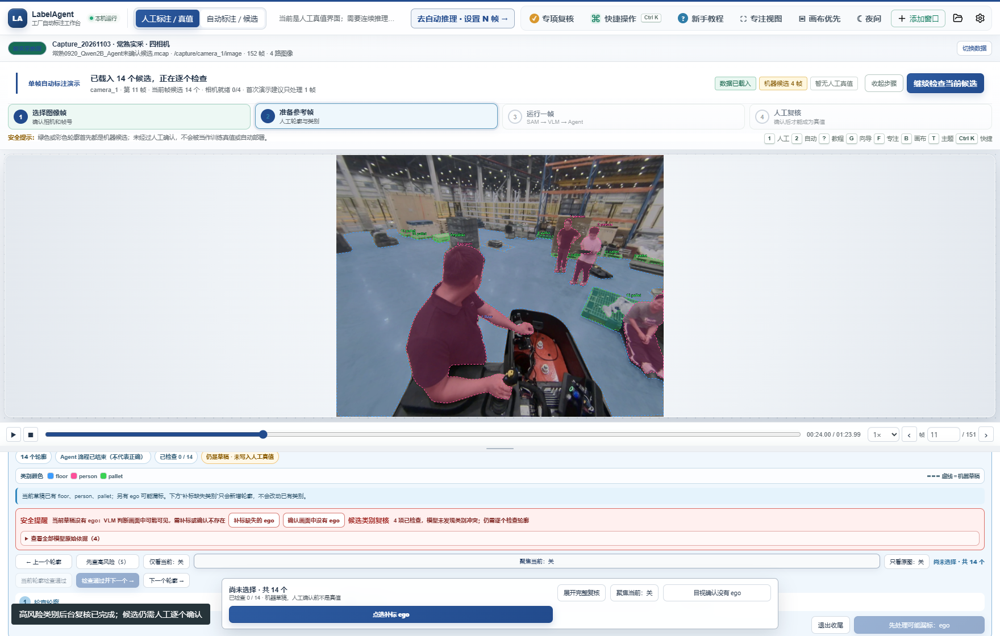

# LabelAgent 第366轮：新数据集复核体验与验收隔离

## 本轮结论

本轮完成两项改进：第一，自动化验收现在会硬性拒绝正式工作台`8765`端口，防止测试候选混入演示状态；第二，候选类别复核默认改为中文摘要，冗长的原始VLM理由折叠保存，需要时再展开。

正式状态、人工真值和训练集均未被实验修改。实验结束后，隔离端口`8891`与`8892`均已关闭。

## 1. 输出长度实验没有上线

保持原图、原prompt和4090主模型不变，只把结构化响应上限从默认768 token收紧到256 token。8个冷样本的类别和最终路由均为8/8一致，但中位耗时从4.580秒增加到4.738秒，约慢3.4%。

因此，256 token仅证明当前JSON通常可以完整输出，不能证明能加速；生产默认值保持不变。

## 2. 修复验收脚本误连正式工作台的风险

此前端到端脚本的说明写着“仅用于隔离工作台”，但代码只检查了本机地址，没有阻止`127.0.0.1:8765`。如果误用，虽然不会写人工真值，却会在正式状态里生成机器候选和Agent记录。

现在脚本会在打开网页之前检查端口：

- `8765`或未写端口：立即拒绝；
- 非本机地址或HTTPS：立即拒绝；
- 明确的本机隔离端口：允许继续；
- 被拒绝时不生成结果JSON和截图。

## 3. 新数据集真实浏览器验收

本轮从正式状态的副本启动两个隔离工作台，分别在`Capture_20261103`的camera 1第10帧和第11帧运行“8类逐类覆盖”流程。两次都满足：

- 数据集身份明确显示为“新实采数据 · 常熟实采 · 四相机”；
- 8/8类别均有“已生成、本帧未见或VLM看见但SAM漏分”的明确反馈；
- 候选轮廓真实叠加在1920×1536原图上；
- 首批候选出现后，Agent与高风险类别复核继续在后台完成；
- 页面错误、HTTP错误、真值写入均为0；
- 候选仍标记为机器草稿，不会成为人工真值或训练数据。

这两帧内容和候选数量不同，耗时只能证明流程完成，不能作为严格速度A/B。

## 4. 复核区改版前后

改版前，底部直接展开每个候选的英文`observed_label`、原因与布尔字段，信息完整但占据大面积画布。

改版后，默认只显示中文摘要，例如“4项已检查，模型未发现类别冲突；仍需逐个检查轮廓”。原始模型依据仍完整保存在折叠区，点击“查看全部模型原始依据”即可展开。

如果存在必须人工确认的候选，摘要会直接显示候选编号、当前类别和中文风险结论，并保留“查看候选”按钮；只有已通过的普通记录会收起。这样不会用界面简化掩盖风险。

## 5. 实测数据

| 项目 | 改版前隔离帧 | 改版后隔离帧 |
|---|---:|---:|
| 已选类别 | 8/8 | 8/8 |
| 候选数量 | 13 | 14 |
| 候选首次可见 | 20.078秒 | 18.906秒 |
| 后台全部完成 | 73.531秒 | 69.781秒 |
| 页面 / HTTP错误 | 0 / 0 | 0 / 0 |
| 真值写入 | 0 | 0 |
| 原始审计详情默认展开 | 是 | 否 |

由于使用的是相邻但不同的真实帧，上表不宣称性能提升。界面改进的验收依据是：折叠状态为`false`、4条原始依据仍存在、默认摘要不再出现`VLM observed_label`，并且候选画布和完整后台流程均通过。

## 6. 安全边界

- 机器候选与人工真值继续分离；
- 人工确认前不进入训练集；
- 原始模型依据没有删除，只改变默认展示层级；
- 本轮不启用被第365轮否决的车辆/AGV快速冷路径；
- 生产状态SHA-256继续保持`9ef08118dd2ba0760cc93cf57bbeaae4b3bed062d383df4e6a454c389d4ab115`。

结构化证据见`docs/evidence/workbench-stability-20261117/new-dataset-ui-round366.json`。
