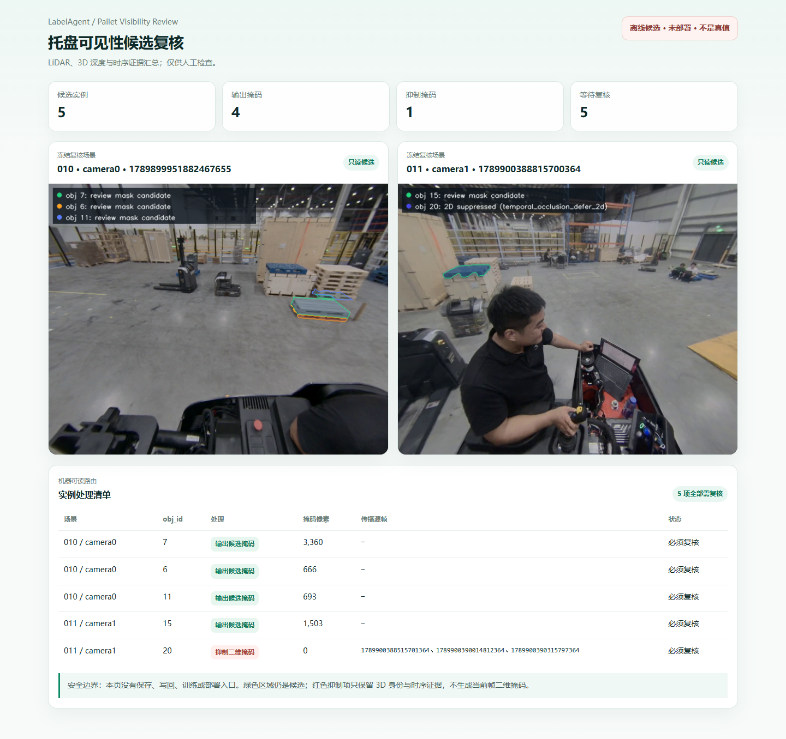

# Round 562：托盘候选只读复核页

## 结果

Round 561 的候选包已经生成独立、只读的复核页面。页面不依赖正式工作台进程，不包含保存、写回、训练或部署按钮。



## 浏览器验收

使用本机现有 Microsoft Edge 进行无头浏览器验收，避免安装新的 Chromium：

- 顶部统计值：`5 / 4 / 1 / 5`；
- 实例表格：5 行；
- 场景预览：2 张，均完整加载为 640×512；
- 部署状态：`not-deployed`；
- 页面按钮数量：0；
- 整体验收：`passed=true`。

页面清楚区分：

- 绿色：复核候选掩码，并非真值；
- 红色：抑制当前二维掩码，只保留 3D/时序证据；
- 所有 5 个实例状态均为“必须复核”。

## 页面特点

- 两张预览并排显示，没有工作台历史版本中的大面积黑边或无意义留白；
- 图像采用固定比例并完整显示，不拉伸、不裁切；
- obj20 的三个传播源帧可直接回读；
- 仅展示当前任务所需信息，没有运行控制、模型配置或其他干扰项；
- 900 px 以下自动切换为单列，便于窄窗口查看。

## 复现

```powershell
.\.venv\Scripts\python.exe tools\build_pallet_candidate_review_page.py `
  --bundle artifacts\round561-pallet-visibility-candidate-bundle-20261122\bundle.json `
  --output <候选包目录>\index.html

node tools\browser_pallet_candidate_review_acceptance.cjs `
  --page <候选包目录>\index.html `
  --output <新的浏览器验收目录>
```

## 产物与边界

- 页面生成器：`tools/build_pallet_candidate_review_page.py`
- 浏览器验收：`tools/browser_pallet_candidate_review_acceptance.cjs`
- 单元测试：`tests/test_build_pallet_candidate_review_page.py`
- 页面：`artifacts/round561-pallet-visibility-candidate-bundle-20261122/index.html`
- 验收：`artifacts/round562-pallet-candidate-review-browser-20261122/acceptance.json`
- 收据：`artifacts/round562-pallet-candidate-review-browser-20261122/receipt.json`
- 实现提交：`423dd06`
- 28 项相关单元测试通过。
- 正式工作台未修改、未重启；该页面仍为隔离验收页面。

## 下一步

为正式工作台增加一个受配置开关保护的“只读候选复核”入口，在隔离端口先验证数据加载、切换和关闭行为；默认关闭，不改变现有自动标注流程。
