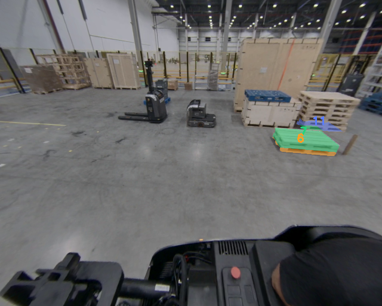
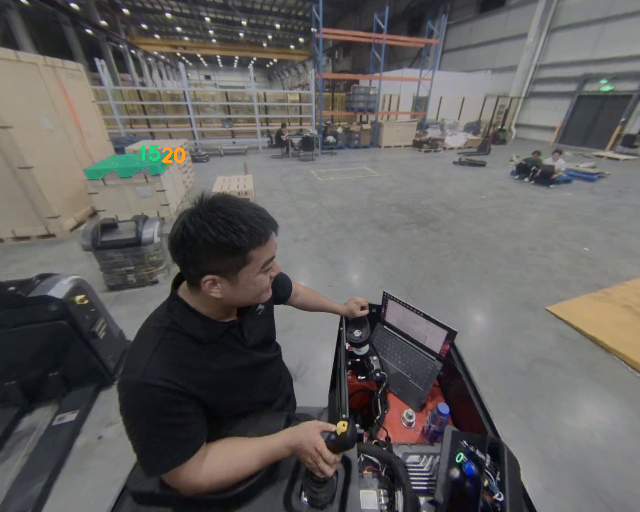

# Round 554：托盘粘连的 3D 深度拆分与遮挡路由

## 结论

Round 550 的 12 张跨序列图像全部完成 3D 定位，但有 2 张因为多个 3D 托盘框在二维投影中重叠，不能证明实例隔离。本轮对这两张图逐个投影重叠框、独立运行 ROI 分割，并比较实例掩码。

- 原始独立 ROI 掩码严格分离：0/2；两对主要冲突掩码 IoU 分别为 0.977、0.983。
- 3D 深度拆分候选通过：1/2。
- 另一张被判为“远端实例当前视角不可观测”的遮挡候选。
- 两张歧义图都得到明确的候选处理路径，但仍未获得人工二维真值确认。
- 工作台写入、训练回流、正式部署均为 0。

## 010 / camera0：堆叠托盘拆分

obj7 和 obj6 的 LiDAR XY 几乎相同，高度相差约 0.19 m，原始 SAM 掩码重叠 99.47%。按相机深度把共同视觉掩码中的重叠像素分配给最近实例后：

| obj_id | 相机深度 | 拆分像素 | 投影框覆盖 | 原掩码保留 |
| ---: | ---: | ---: | ---: | ---: |
| 7 | 4.080 m | 3,360 | 82.31% | 82.95% |
| 6 | 4.181 m | 666 | 16.44% | 17.62% |
| 11 | 5.362 m | 693 | 37.10% | 59.84% |

三个实例均保留超过 32 像素、3% 投影框支持和 5% 原掩码支持，因此通过离线几何拆分候选门槛。

## 011 / camera1：遮挡而非强行拆分

obj15 位于 4.618 m，obj20 位于 6.149 m；obj20 投影框的 72.30% 被更近的 obj15 覆盖。深度分配后：

- obj15 保留 1,503 像素，投影框覆盖 62.83%；
- obj20 只剩 7 像素，投影框覆盖 0.66%，原掩码保留 0.46%。

因此 obj20 被标记为 `occluded_unobservable_candidate=true`：保留 3D 身份和复核记录，但不生成伪精确二维实例掩码。

## 方法边界

- 深度拆分使用 3D 框中心在相机坐标系中的深度近似，并不是逐像素深度图。
- `depth_split_candidate_pass` 只是几何可用门槛，不是人工边界准确率。
- 遮挡判定要求：拆分后投影框覆盖和原掩码保留均低于 1%，且至少 70% 投影框被更近实例覆盖。
- 所有产物仍为 `candidate_only`，不能写入人工真值或训练集。

## 产物

- 实现：`tools/evaluate_pallet_box3d_overlap_pairs.py`
- 测试：`tests/test_evaluate_pallet_box3d_overlap_pairs.py`
- 完整结果：`artifacts/round554-box3d-depth-occlusion-routing-20261122/results.json`
- 收据：`artifacts/round554-box3d-depth-occlusion-routing-20261122/receipt.json`
- 实现提交：`71e7351`

## 下一步

用带逐像素深度或原始 LiDAR 点投影的可见性判断替换“框中心深度近似”；在获得对应 PCD 或人工二维边界前，不部署该拆分候选。

## 后续校正（Round 558）

已取得对应的冻结 PCD 并完成 LiDAR 可见性检查。010/camera0 的 obj7、obj6、obj11 均有稳定可见点，支持深度拆分；011/camera1 的 obj20 在 3D 框内为 0 个 LiDAR 回波，不能用点云独立证明“被遮挡”。因此 Round 554 的 `occluded_unobservable_candidate` 应进一步降级为“无 LiDAR 回波、证据不足”，仍不生成二维伪掩码。详见 `PALLET_LIDAR_VISIBILITY_ROUND558_20261122.md`。
