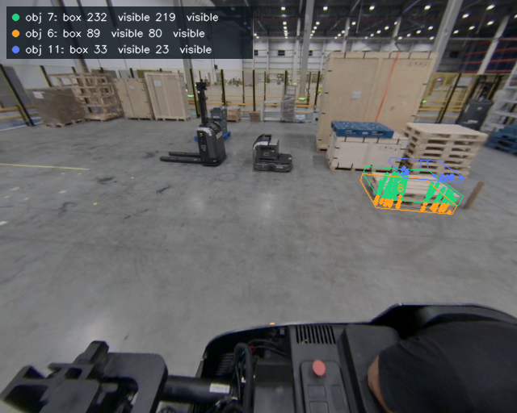
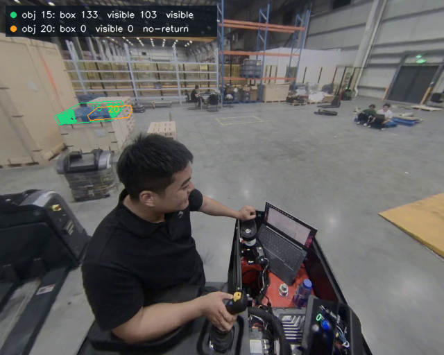

# Round 558：重叠托盘的 LiDAR 可见性复核

## 结论

本轮从 OSS 只读下载 010、011、012 三个目标帧的 PCD，共约 6.7 MiB。真实 OSS 前缀为：

`oss://seer-kubeflow/dataset/robot_data/SFL-CPD15-Y/20260920_cs-seer_Dev_P2605901028248/`

三个 PCD 的 frame_id 与冻结图像和标签完全一致，文件大小与 SHA-256 已写入 `round557-pcd-manifest.json`。没有读取其他点云，也没有向 OSS 写入任何对象。

## 两张歧义图的结果

### 010 / camera0：支持深度拆分

在 9 组遮挡参数（cell size 2/4/8，depth slack 0.05/0.12/0.20 m）下：

| 实例 | 3D 框内点 | 默认可见点 | 九组最少–最多可见点 | 结论 |
| --- | ---: | ---: | ---: | --- |
| obj7 | 232 | 219 | 113–231 | 稳定可见 |
| obj6 | 89 | 80 | 38–89 | 稳定可见 |
| obj11 | 33 | 23 | 3–29 | 稳定可见 |

三个重叠托盘都有独立点云回波，Round 554 对该图进行深度拆分有物理证据支持，但仍不是人工像素边界真值。

### 011 / camera1：无回波，不能声称点云证实遮挡

| 实例 | 3D 框内点 | 默认可见点 | 九组最少–最多可见点 | 结论 |
| --- | ---: | ---: | ---: | --- |
| obj15 | 133 | 103 | 50–130 | 稳定可见 |
| obj20 | 0 | 0 | 0–0 | LiDAR 证据不足 |

obj20 虽然在二维投影中被更近的 obj15 大面积覆盖，但其 3D 框内没有任何 LiDAR 回波。0 点可能来自完全遮挡、点云稀疏、标签位置误差或其他采集因素，不能仅凭 0 点区分。因此处理策略是：保留 3D 标注身份，暂缓生成二维实例掩码，并进入人工/多视角复核。

## 保守门控

- `box_points == 0`：一律记为 `no_lidar_return_insufficient_evidence`，不得称为 LiDAR 证实遮挡；
- 九组参数下最少可见点仍不少于 3：记为 `visible_lidar_supported`；
- 只有视野内存在足够框内点、九组参数均几乎不可见、且被近端投影覆盖至少 70% 时，才允许记为 `occluded_lidar_supported`；
- 本轮 `occluded_lidar_supported` 为 0。

## 产物与安全边界

- 实现：`tools/evaluate_pallet_lidar_visibility.py`
- 测试：`tests/test_evaluate_pallet_lidar_visibility.py`
- PCD 清单：`docs/evidence/workbench-stability-20261117/round557-pcd-manifest.json`
- 完整结果：`artifacts/round558-pallet-lidar-visibility-final-20261122/results.json`
- 收据：`artifacts/round558-pallet-lidar-visibility-final-20261122/receipt.json`
- 实现提交：`f308322`
- 21 项相关测试通过；GPU 请求为 0；工作台写入为 0。
- 所有结论均为离线候选证据，未写回人工真值、训练集或正式工作台。

## 下一步

把 `no_lidar_return_insufficient_evidence` 作为自动标注流水线中的强制复核分支；继续寻找 obj20 的其他相机视角或相邻帧点云，只有跨视角/跨帧证据成立后才生成二维候选。

## 后续结果（Round 559）

同一帧其他三路相机无法投影 obj20，因此转向相邻标注帧复核。11 帧时序窗口中，前 4 帧为 `ignore=true`，只作上下文；7 个有效帧显示：中心帧可见点为 0，近端 obj15 投影覆盖存在时 obj20 可见点中位数为 0，覆盖消失后的两帧回波升至 12、20。时序证据支持中心帧受到遮挡，但仍不提供中心帧二维像素边界。详见 `PALLET_TEMPORAL_OCCLUSION_ROUND559_20261122.md`。
