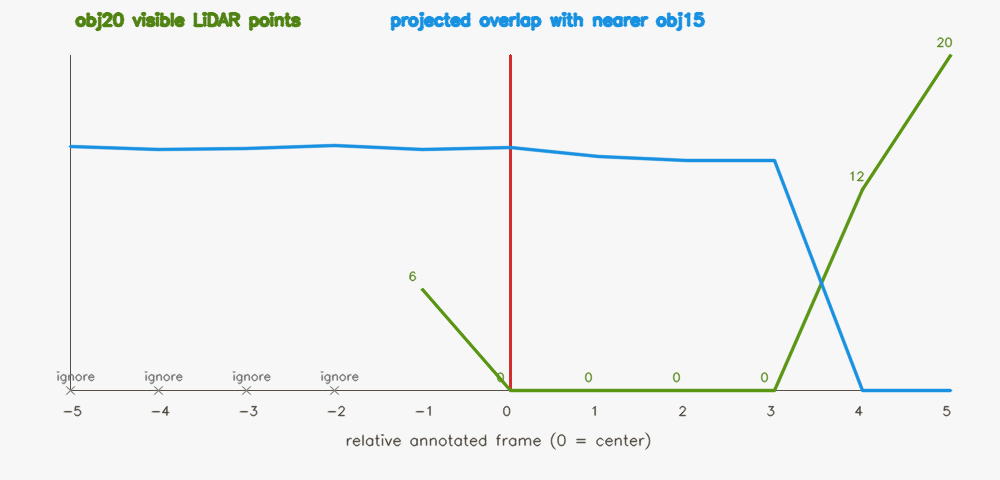

# Round 559：obj20 相邻帧 LiDAR 遮挡复核

## 通俗结论

中心帧里 obj20 没有 LiDAR 回波，单帧不能判断它究竟被挡住、点云太稀，还是标签有偏差。本轮沿同一 `obj_id=20` 查看前后相邻标注帧：

- 11 帧中 obj20 始终存在，类别均为 `empty`，3D 框尺寸保持一致；
- 最早 4 帧被人工标签标记为 `ignore=true`，只保留作上下文，不参与门控统计；
- 7 个有效帧中，中心帧可见点为 0；
- 中心前有 1 帧、中心后有 2 帧重新得到至少 3 个可见回波；
- 近端 obj15 与 obj20 明显重叠时，obj20 可见点中位数为 0；
- obj15 离开 camera1 视野后的两帧，obj20 可见点升至 12 和 20。

这形成了“被近端托盘遮住—随后重新显现”的时序模式。因此可以把中心帧从“完全未知”提升为“时序支持遮挡”，但仍不能为中心帧虚构精确二维边界。

图中绿色为 obj20 可见 LiDAR 点数，蓝色为它与更近 obj15 的投影重叠比例，红线是中心帧。前 4 个灰色叉号是 `ignore=true` 帧，不参与统计。

## 门控逻辑

只有同时满足以下条件，中心帧才记为 `temporal_support_for_occlusion_not_pixel_truth`：

1. 中心帧自身没有可见回波；
2. 有效窗口中目标身份持续存在；
3. 中心前、中心后都至少有一帧恢复可见；
4. 无近端遮挡时的可见点中位数，至少比遮挡时高 5；
5. ignore 帧不得计入任何通过条件。

当前实例满足上述门槛：遮挡时中位数 0，无遮挡时中位数 16，差值为 16。

## 自动标注策略

- 保留中心帧 obj20 的 3D 身份与遮挡状态；
- 不生成中心帧二维 SAM 掩码，不把 7 个像素或空掩码写入真值；
- UI/Agent 应提示“时序支持目标存在，但当前帧不可可靠分割”；
- 可把相邻可见帧作为后续时序传播的源，但传播结果仍需几何门控和人工抽检。

## 产物与安全边界

- 实现：`tools/evaluate_pallet_temporal_visibility.py`
- 测试：`tests/test_evaluate_pallet_temporal_visibility.py`
- 冻结清单：`docs/evidence/workbench-stability-20261117/round559-obj20-temporal-manifest.json`
- 完整结果：`artifacts/round559-obj20-temporal-visibility-final-20261122/results.json`
- 收据：`artifacts/round559-obj20-temporal-visibility-final-20261122/receipt.json`
- 实现提交：`7d25030`
- 23 项相关测试通过；GPU、工作台写入、OSS 写入均为 0。
- 本轮只读下载 10 份相邻标签和 10 个相邻 PCD；没有下载相邻相机图像或整批数据。
- 该结果是时序存在性/遮挡证据，不是人工像素真值，也未部署到正式工作台。

## 下一步

把该时序门控接入离线候选流水线：单帧 `no-return` 时自动查找同一 obj_id 的前后有效帧；只有门控通过才标记为“时序支持遮挡”，仍将二维边界留给可见帧传播或人工复核。
