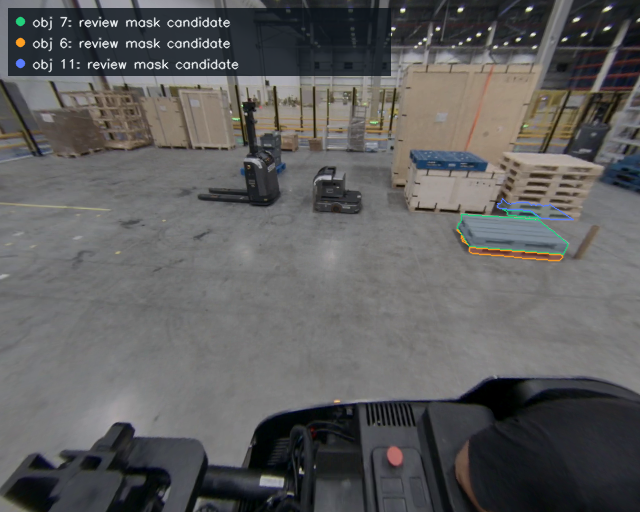
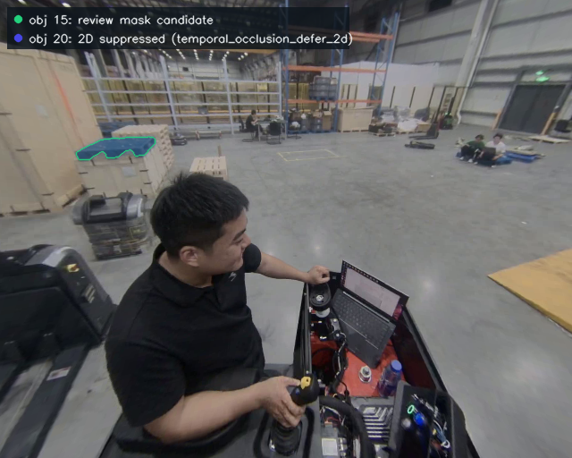

# Round 561：托盘可见性路由候选包

## 结果

Round 560 的路由决策已经转成一个可检查、可复制但不会自动部署的候选包：

- 输入候选：5 个；
- 实际输出二值掩码：4 个；
- 抑制当前帧掩码：1 个（obj20）；
- 预览图：2 张；
- 人工真值、训练集、工作台写入：均为 0。

每个掩码都经过以下检查：

1. 必须是 640×512 单通道 PNG；
2. 像素值只能是 0 或 255；
3. 非零像素数必须与 Round 554 深度拆分报告一致；
4. 复制前后 SHA-256 必须一致；
5. 只有 `candidate_pass=true` 且路由允许的实例才能生成文件。

## 预览

### 010 / camera0

三个具有独立 LiDAR 支持的堆叠托盘均输出为复核候选。



### 011 / camera1

只输出 obj15；obj20 在图例中明确标记为 `2D suppressed`，原图上没有绘制任何 obj20 掩码。



## 文件清单

| 实例 | 掩码像素 | SHA-256 前缀 | 状态 |
| --- | ---: | --- | --- |
| 010/camera0 obj7 | 3,360 | `d003bb75...` | 输出复核候选 |
| 010/camera0 obj6 | 666 | `a1555b11...` | 输出复核候选 |
| 010/camera0 obj11 | 693 | `171058a8...` | 输出复核候选 |
| 011/camera1 obj15 | 1,503 | `5677c6a9...` | 输出复核候选 |
| 011/camera1 obj20 | 0 | 无文件 | 抑制当前二维候选 |

obj20 的 bundle 记录仍保留三个非 ignore、可见点不少于 3 的传播源帧，但本轮没有自动执行传播。

## 复现

```powershell
.\.venv\Scripts\python.exe tools\build_pallet_visibility_candidate_bundle.py `
  --route-report artifacts\round560-pallet-visibility-candidate-routes-20261122\results.json `
  --split-report artifacts\round554-box3d-depth-occlusion-routing-20261122\results.json `
  --split-mask-root artifacts\round554-box3d-depth-occlusion-routing-20261122\masks `
  --image-manifest docs\evidence\workbench-stability-20261117\heldout-test12-manifest-round49.json `
  --output <新的空目录>
```

## 产物与边界

- 实现：`tools/build_pallet_visibility_candidate_bundle.py`
- 测试：`tests/test_build_pallet_visibility_candidate_bundle.py`
- Bundle：`artifacts/round561-pallet-visibility-candidate-bundle-20261122/bundle.json`
- 收据：`artifacts/round561-pallet-visibility-candidate-bundle-20261122/receipt.json`
- 实现提交：`c3ca70e`
- 27 项相关测试通过。
- 该候选包仍为 `review_only_candidate_bundle_not_deployed`，不能作为人工真值或训练数据。

## 下一步

在隔离页面读取该 bundle，验证 UI 能正确显示四个候选和一个“遮挡、无二维掩码”的状态卡；只有隔离验收无误后，才考虑接入正式工作台候选区。

## 后续结果（Round 562）

只读隔离复核页已生成并通过真实 Edge 浏览器验收：统计 5/4/1/5、5 行实例、2 张 640×512 预览全部正确，页面标记 `not-deployed`，按钮数量为 0。详见 `PALLET_CANDIDATE_REVIEW_UI_ROUND562_20261122.md`。
