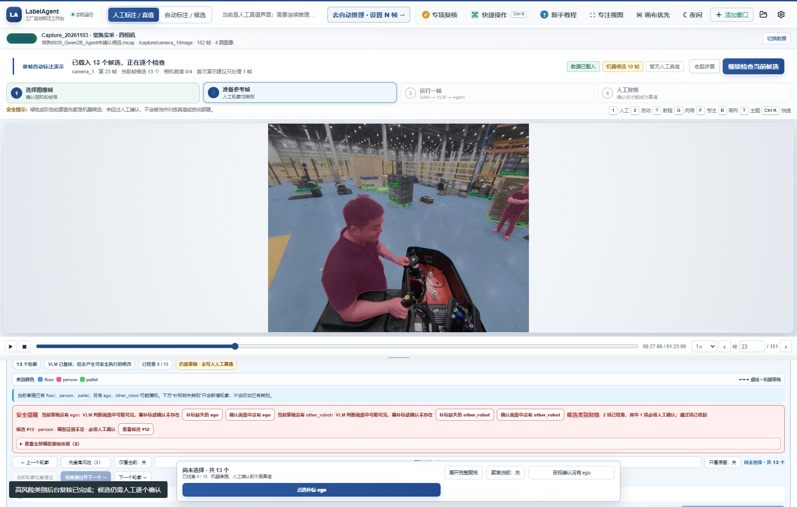

# LabelAgent 第368轮：自动识别与 SAM3 并行预热

## 本轮结论

“自动识别当前帧可见类别，并补漏全部已选类别”原来有一段可以并行的等待：4090 上的 VLM 先识别画面里有什么，结束后 5090 才开始准备八类 SAM3 分割。本轮把两件互不依赖的工作同时启动，VLM 负责看懂画面，SAM3 同时准备固定的八类提示。

四组相邻帧实测中，首批候选中位等待时间从 **21.21 秒降至 18.95 秒**，减少 **2.26 秒（10.64%）**。同一帧的结果核对显示，类别发现、13 个候选轮廓和最终产物的 SHA-256 均完全一致，说明本轮只减少等待，没有改写分割结果。

## 1. 为什么会慢

旧流程中，页面虽然已经提前调用“参考帧预热”，但只预热了 VLM 判断为可见的少数类别。用户选择“全类补漏”后，正式起稿仍需等待一次完整八类 SAM3 请求，因此出现约 5 秒的额外等待。

本轮改为：

1. VLM 开始识别当前画面；
2. 同时让 SAM3 预热完整标签表；
3. VLM 返回可见类别后，再补一次精确可见子集缓存；
4. 正式起稿直接复用已经准备好的八类结果；
5. Agent 复核与高风险类别检查仍在候选显示后继续。

## 2. 速度对比

| 路径 | 测试帧 | 首批候选耗时（秒） | 中位数（秒） |
|---|---|---|---:|
| 改动前：先 VLM、后八类 SAM3 | 14 / 16 / 18 / 20 | 22.304 / 21.554 / 20.468 / 20.861 | 21.2075 |
| 改动后：VLM 与八类 SAM3 并行 | 15 / 17 / 19 / 21 | 19.196 / 18.921 / 18.931 / 18.970 | 18.9505 |

这组数字来自相邻帧冷路径，用于观察真实使用中的稳定趋势，不宣称为严格同帧延迟 A/B。同帧第 22 帧用于核对输出一致性；候选路径命中精确缓存，所以不拿它夸大速度收益。

## 3. 同帧输出一致性

| 核对项 | 改动前 | 改动后 |
|---|---:|---:|
| 帧号 | 22 | 22 |
| 候选总数 | 13 | 13 |
| 类别发现 SHA-256 | `b8038a60...c685c76f` | 完全一致 |
| 候选输出 SHA-256 | `3b439fab...b1663e5` | 完全一致 |
| 最终产物 SHA-256 | `542ad5ea...97dad1` | 完全一致 |
| 人工真值写入 | 0 | 0 |

## 4. 真实网页验收

在新实采数据 `Capture_20261103`、`camera_1`、第 23 帧完成了浏览器全流程验收：19.282 秒收到首批结果，19.328 秒候选覆盖回原图，最终得到 13 个候选，其中 floor 1 个、pallet 10 个、person 2 个。

页面错误、HTTP 错误和失败请求均为 0。页面明确显示“仍是草稿，未写入人工真值”；测试期间没有人工真值写请求，也没有把候选批准进训练集。

## 5. 验证与安全边界

- Python：1185 项通过，另有 190 个子测试通过；
- Node：156 项通过；
- 新增并发时序测试，确认 SAM3 确实在 VLM 尚未完成时已经启动；
- 候选保持 `candidate_only=true`、`human_truth=false`、`approved_for_training=false`；
- 本轮没有改变标签定义、SAM 提示词、Agent 规则或人工门禁；
- `visible_vehicle_point_recovery` 继续保持未启用。

结构化证据见 `docs/evidence/workbench-stability-20261117/parallel-reference-prefetch-round368.json`，浏览器原始回执见同目录下的 `new-dataset-parallel-prefetch-round368.json`。
