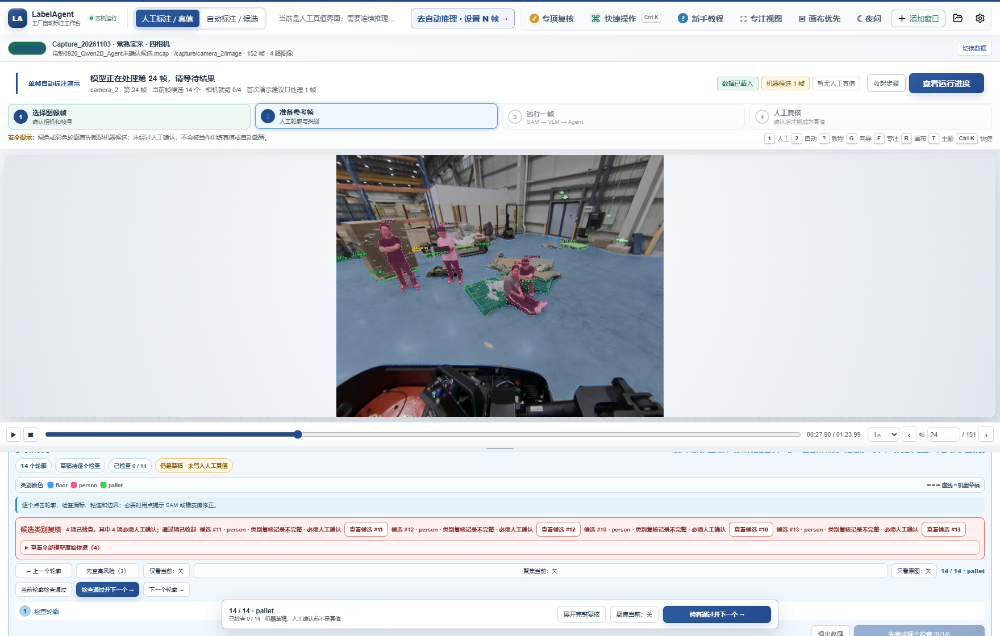

# LabelAgent 第373轮：新实采数据真实后台进度验收

## 结论

第372轮上线后，本轮不再使用合成任务状态，而是在隔离工作台上对 `Capture_20261103` 的 `camera_2` 第24帧重新执行真实“一键起稿”。首批候选返回后，人工检查区确实持续显示真实 Agent 后台阶段，操作者可以立即开始检查，不必等待全部类别复核结束。

界面实测文字为：

> 轮廓草稿待人工确认 · 初始候选已显示；Agent 正在后台精修（已进行 9 秒），可先逐个检查，不会写入人工真值

## 实测结果

| 项目 | 结果 |
|---|---:|
| 数据 | Capture_20261103 / camera_2 / 第24帧 |
| 首批响应 | 3.282 秒 |
| 候选覆盖到原图 | 3.313 秒 |
| 后台 Agent 与类别复核全部完成 | 52.938 秒 |
| 候选总数 | 14 |
| pallet / person / floor | 9 / 4 / 1 |
| 页面错误 / 失败请求 / HTTP错误 | 0 / 0 / 0 |
| 人工真值写请求 | 0 |

3.3秒是同一新数据集已经完成相邻预取、模型已热启动条件下的结果，不能外推为所有冷启动帧的固定时延。此前冷帧约19秒出现首批候选的证据仍保留；本轮证明的是“热路径能快速出图，而且长后台阶段不再表现为无反馈等待”。

## 安全边界

- `candidate_only=true`；
- `human_truth=false`；
- `approved_for_training=false`；
- 没有创建人工真值；
- 没有创建参考帧；
- 4项高风险候选完成独立类别复核；
- 隔离端口8898已关闭，正式8765保持在线；
- 正式状态、权重、候选、人工真值和训练集没有被本轮验收修改。

机器回执见：

`docs/evidence/workbench-stability-20261117/real-reference-background-progress-round373.json`

最终复核完成截图见：

`docs/evidence/workbench-stability-20261117/real-reference-background-progress-round373.png`
