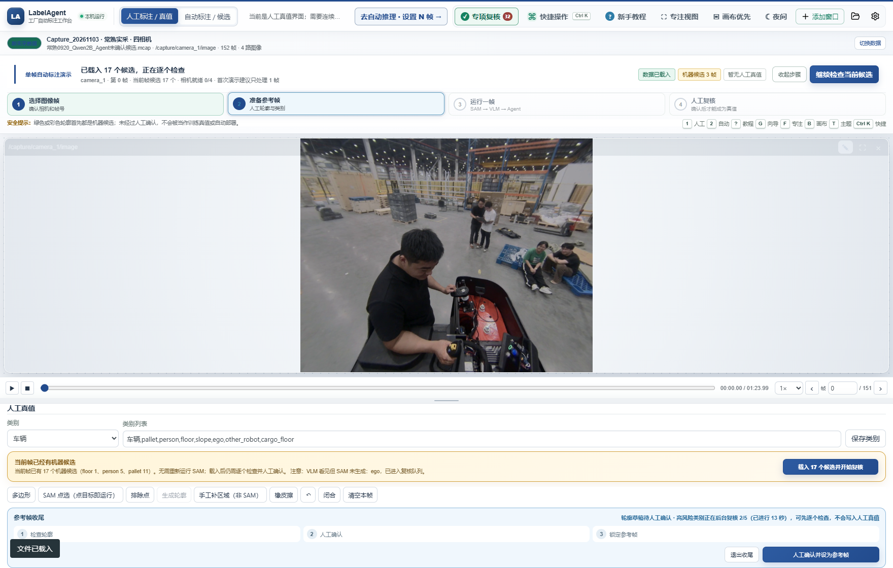

# LabelAgent 第372轮：人工检查区后台进度可见化

## 结论

本轮解决的是“首批候选已经出现，但后台 Agent 精修或类别复核仍在运行时，人工检查区看起来像卡住”的体验问题。现在人工可以立刻开始逐个检查，同时在同一区域看到后台阶段、已运行时间和高风险类别复核计数。

界面会明确区分三种状态：

1. `初始候选已显示；Agent 正在后台精修`；
2. `高风险类别正在后台复核 2/5`；
3. 后台结束后恢复为 `轮廓草稿待人工确认`。

所有运行中提示都明确写明“可先逐个检查，不会写入人工真值”。本轮没有减少复核、没有更改候选几何、没有自动确认类别，也没有把机器候选送入训练集。

## 验收证据

| 检查项 | 结果 |
|---|---:|
| Python 项目测试 | 1,187 项通过，另含 190 个子测试 |
| Node 网页测试 | 164 项通过 |
| 隔离浏览器验收 | 通过 |
| 正式 8765 浏览器验收 | 通过 |
| 页面错误 / 失败请求 / HTTP错误 | 0 / 0 / 0 |
| 人工真值写请求 | 0 |
| 正式工作台 | HTTP 200，任务 idle |
| SAM / VLM | ready / ready |
| 隔离端口 8891–8898 | 全部关闭 |

隔离和正式验收回执分别位于：

- `docs/evidence/workbench-stability-20261117/reference-background-progress-round372/result.json`；
- `docs/evidence/workbench-stability-20261117/reference-background-progress-round372-production/result.json`。

第一次完整 Python 回归误用了系统 Python 3.14，该解释器没有安装 `pytest`，测试未开始；没有为此安装或污染系统依赖。随后改用项目虚拟环境，1,187项及190个子测试全部通过。

第一次正式浏览器验收在工作台仍处于自动推理模式时尝试滚动隐藏的人工检查区，因此验收脚本超时；这不是产品推理失败。脚本随后显式切回人工检查模式，正式端口复跑通过，并保留“零真值写入”约束。

## 部署与回滚

正式状态文件部署前后 SHA-256 均为：

`9EF08118DD2BA0760CC93CF57BBEAAE4B3BED062D383DF4E6A454C389D4AB115`

正式前端与工作树逐字节一致：

- `app.js`: `4D96A93EAF2E3018DD1B644285886C2F5C9258770CCD962686E04D5F8285EAA3`；
- `index.html`: `CE64CCCB6D722E32058D590824F545EDF5915E2AF40CC49C8441FB3E80932A85`。

旧版前端已备份至：

`D:\Apps\LabelAgent\.local\backups\round372-20261120\source\web`

本轮只替换 `app.js` 和 `index.html`，没有重启或改写模型服务、候选、人工真值、参考帧、训练批准、权重或 OSS 数据。
