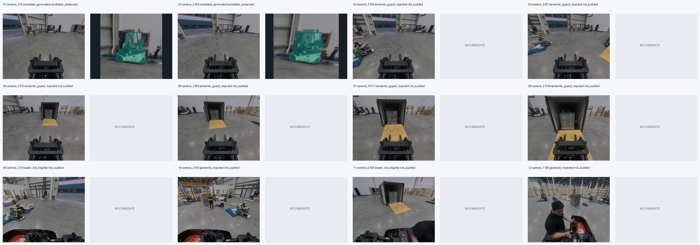

# LabelAgent 第364轮：新图冷路径归因与4090/5090盲审A/B

## 目的

第363轮证明重复帧可依靠持久缓存稳定降到亚秒级。本轮改用12个未进入上一轮清单的固定帧，记录每次模型调用的实际路由、图像数、图像token、缓存、预处理和生成元数据，定位新数据首次推理的真实等待来源。

## 冷路径结果

12帧全部完成，0错误：

- 2帧生成车辆候选并通过独立类别盲审；
- 6帧在机器完整性语义门禁拒绝；
- 4帧在定位或几何门禁结束；
- 全流程中位耗时8.185秒，P95为14.651秒；
- 32次模型调用中VLM首次缓存命中为0，证明这次测到的是冷路径而非上一轮缓存结果。

调用级归因：

| 阶段 | 实际路由 | 图像数 | 典型耗时 | 说明 |
|---|---|---:|---:|---|
| 远处车辆定位 | 4090主通道 | 1 | 约3.5秒 | 输入为完整高分辨率原图 |
| 车辆/AGV完整性判断 | 4090主通道 | 3 | 约4.6秒 | 原图加候选高亮与隔离图 |
| 独立类别盲审 | 5090小图通道 | 3 | 约6.0–6.8秒 | 三张局部裁图，隐藏当前类别 |

有候选帧的串行路径约为“定位3.5秒 + 完整性4.6秒 + 盲审6秒”，因此达到14–15秒；拒绝帧不执行最后盲审，约8–9秒。

## 强制4090 A/B

为了确认5090三图盲审是否真的更快，在同一两个候选上保留所有前序结果，只将盲审强制切到4090主通道：

| 候选帧 | 5090盲审 | 4090盲审 | 语义结论 |
|---|---:|---:|---|
| camera3 第2帧 | 6.798秒 | 13.578秒 | 一致，保留车辆候选 |
| camera3 第20帧 | 5.964秒 | 10.723秒 | 一致，保留车辆候选 |

两条路径的逐帧状态、类别和盲审路由差异数为0。虽然5090没有达到单图探针的约1秒水平，但在这类三图严格盲审中仍比4090快约一倍。因此，“关闭5090快速路由”被实测否决，没有部署。

## 新增评测能力

`tools/evaluate_visible_vehicle_recovery_shadow.py` 现在会记录：

- `model_route` 与快速通道回退原因；
- 图像数量和实际图像token；
- 预处理、生成及总耗时；
- 缓存命中与请求合并状态；
- 可选 `--disable-fast-route`，只修改评测进程内配置，不改正式状态。

该能力用于以后判断“慢在SAM、4090、5090、缓存还是排队”，不再只看整帧总时间猜测原因。

## 结论与下一步

本轮没有改变生产推理规则。正式工作台继续保留5090小图加速和4090主路回退，功能开关、人工真值与训练集均未改变。

下一步不再尝试简单换卡，而是验证两道独立复核并行：机器完整性判断继续走4090，类别盲审继续走5090；二者使用相同候选但互不读取对方结论，最终再做一致性门禁。理论上可把约4.6秒+6秒的串行等待压缩到接近6秒，同时保留双模型制约。只有输出一致性、取消行为、繁忙回退和候选哈希绑定全部通过后才会部署。
