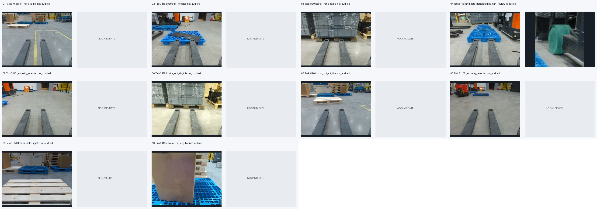
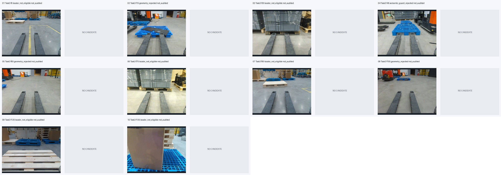
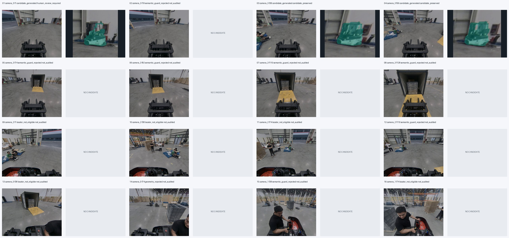

# LabelAgent 第362轮：参考标注门禁与局部机器碎片前置拒绝

## 本轮目标

第361轮已经阻止了独立 Task3 样本中的 AGV 被自动保留为普通车辆，但仍有一个只覆盖轮子的 `other_robot` 候选进入第二道类别盲审。它最终没有越过人工门禁，安全边界是正确的；问题在于无效候选仍占用一次 VLM 复核并增加人工检查负担。

本轮完成两项工作：

1. 给只读影子评测增加固定参考标注对齐，包括同类轮廓 IoU、错类重合和参考来源审计；
2. 把“只有轮子、脚轮、货叉尖端、保险杠、柜体边缘或小块底盘”的区域提前标为 `partial_fragment`，不再进入类别盲审。

## 参考标注来源边界

Task3 会话中保存了 150 帧 `truth`，但 `truth` 只是历史文件字段名，不等于人工真值。本轮逐帧检查发现：

- 10 个抽样帧中共有 15 个车辆/机器人目标轮廓；
- 15 个轮廓的 CVAT 元数据均为 `source=auto`；
- 0 帧具有当前版本、绑定精确轮廓哈希的人工审核回执；
- 因此来源分类为 `legacy_auto_preannotation`。

这些轮廓只能用于“与历史自动预标注的一致性回归”，不能表述为人工真值准确率、模型泛化能力或可直接进入训练集。

## 修复前证据

同一组独立 Task3 10 帧中：

- 8 帧含历史 `other_robot` 参考轮廓，共 15 个实例；
- 1 帧生成 `other_robot` 候选，但只覆盖局部轮子；
- 该候选与同类参考轮廓的最佳 IoU 仅为 0.04；
- 第二道盲审把它送入人工复核，没有自动保留；
- 其余 9 帧无候选，0 运行错误。

这说明已有双门禁能阻止错误落地，但第一道检查对“看得见机器人、掩膜却只覆盖一个零件”的情况不够严格。

## 修复方法

车辆/AGV 语义检查现在必须同时满足“类别可识别”和“轮廓覆盖机器主体”两项要求。若全图里确实有机器，但青色候选和隔离图里只有单个零件，则返回 `partial_fragment` 并立即拒绝。它不会：

- 写入人工真值；
- 加入参考帧；
- 进入训练集；
- 绕过类别盲审或人工门禁。

## Task3 修复后结果

同一10帧修复后：

- 局部轮子在第一道语义门禁被拒绝；
- 候选数由 1 降为 0；
- 类别盲审调用由 1 次降为 0；
- 模型调用总数由 16 次降为 15 次；
- 10 帧全部完成，0 运行错误；
- 工作台状态文件和参考会话文件的哈希均保持不变。

这项结果证明的是“已观察到的局部碎片候选被更早拦截”，不是机器人召回率提升。由于参考标注并非当前人工真值，8 个参考阳性帧没有生成候选也不能直接统计为漏检率；本通道本来只负责正常分割之后的远处车辆补漏，不替代完整 `other_robot` 分割。

## Capture 回归结果

在原有 16 帧、四相机 Capture 回归集上：

- 3 帧生成候选；
- camera3 第38帧和第56帧由语义检查与类别盲审一致判为普通车辆并保留为机器候选；
- camera3 第1帧两级模型意见冲突，继续进入人工复核；
- 13 帧无候选，0 运行错误；
- 相比第361轮，争议候选由4个减少到1个，明显的车辆候选仍保留。

这里仍没有人工类别真值，因此第56帧只能记录为“两级模型一致、视觉上呈现有人叉车结构的候选”，不能宣称为已验证正确。

## 可复现工具与测试

`tools/evaluate_visible_vehicle_recovery_shadow.py` 新增可选 `--reference-session`：

- 精确绑定当前媒体路径；
- 对参考来源实行 fail-closed 分类；
- 计算候选与同类/异类参考轮廓的像素 IoU；
- 检查源状态与参考会话在运行前后是否改变；
- 仅在新建的 `artifacts` 目录写评测结果。

测试结果：

- Python：1162 项通过；
- 前端 Node：155 项通过；
- 新增局部碎片、参考会话精确选择、同类 IoU 和无候选边界测试均通过；
- 初次 Python 全量测试因 Windows 默认 GBK 读取 UTF-8 临时 JSON 失败，按项目既有 `PYTHONUTF8=1` 环境重跑后全部通过；该失败未被隐藏或计作成功。

## 当前结论与下一步

第362轮降低了无效候选与额外 VLM 复核开销，同时保留了已观察到的真实远处车辆候选。功能仍默认关闭，所有结果仍是机器候选。

下一步优先级：

1. 在 Task3 中由人工确认一小批普通车辆、AGV 和“只有局部零件”的帧，生成绑定轮廓哈希的审核回执；
2. 用同一评测工具把“一致性指标”升级为真正的人工真值 precision、recall 和 IoU；
3. 扩展到不同厂区、不同颜色 AGV 和有人叉车，避免把橙绿外观学成类别捷径；
4. 只有人工门禁、跨数据集门禁和延迟门禁同时通过后，才考虑默认开启该补漏通道。
