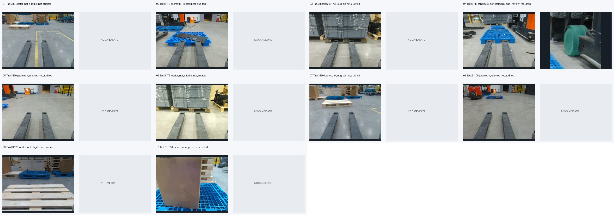
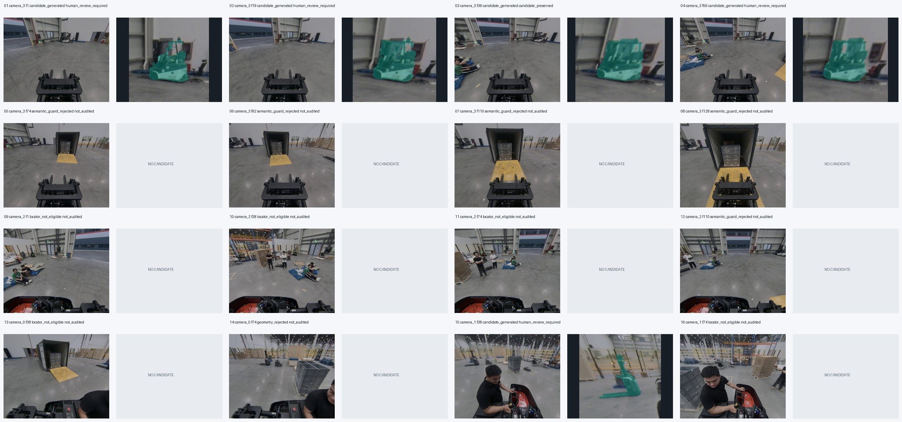
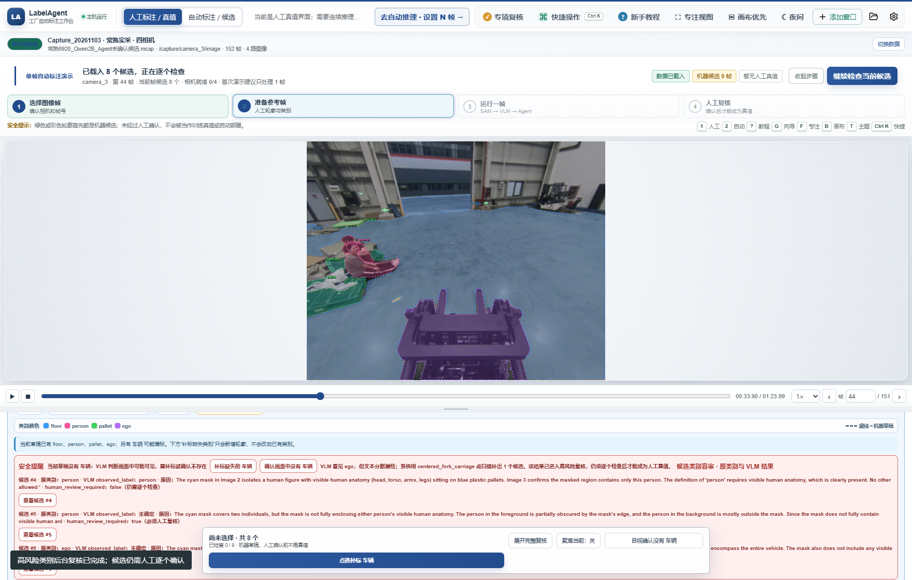

# LabelAgent 第361轮：普通车辆与AGV语义互斥路由

## 为什么需要这一轮

第360轮主要在同一录包中验证远处机器补漏，缺少独立场景。第361轮换用 `CVAT_Task3_original_annotations.mcap`，每隔15帧抽取1帧，共10帧做影子评测。

初次结果暴露出严重问题：画面中的橙绿SEER自主移动机器人被VLM称为“叉车”，4帧生成了 `车辆` 候选，其中3帧甚至通过原有类别盲审。如果直接默认开启，会把 `other_robot` 错写成 `车辆` 机器候选。

## 初始失败证据

初始10帧结果：

- 4帧生成 `车辆` 候选；
- 3帧被盲审错误保留为 `车辆`；
- 1帧进入人工复核；
- 其余6帧没有候选；
- 0运行异常。

失败不是界面问题，而是语义规则不足：仅看到轮子、底盘或工业设备外观时，VLM容易把自主机器人也称为普通叉车。

## 修复方法

本轮新增三层约束。

### 1. 确定性面积门禁

该补漏只针对远处或背景目标，因此候选面积上限从全图8%收紧到3%。近处大机器、局部轮子或大块粘连区域不再由这个补漏通道接管，避免把近景AGV碎片当成远处车辆。

### 2. 全图语义门禁

SAM得到紧凑轮廓后，VLM同时查看原图、青色高亮候选和只保留候选像素的图像，并区分：

- 普通车辆：可见驾驶舱、座椅、转向区域、配重，或与叉车底盘相连的门架和货叉；
- 自主机器人/AGV：低矮移动底盘、竖直控制柜、SEER标识、激光雷达或安全扫描器，且没有驾驶位；
- 不明确：像素模糊、关键结构不在掩膜内。

只有置信度不低于0.90才允许继续。

### 3. 不再强行都归为车辆

语义门禁确认普通车辆时，候选路由到 `车辆`；确认自主机器人时，路由到 `other_robot`；不明确时直接拒绝。无论路由到哪一类，都必须继续经过原有独立类别盲审。两级模型意见不一致时，只能进入人工复核，不能自动保留为可信类别。

## Task3最终结果

最终同一10帧结果为：

- 不再有任何AGV被自动保留为 `车辆`；
- 1帧局部机器候选被路由为 `other_robot`，但因轮廓只覆盖局部轮子，独立盲审将其送人工复核；
- 其余9帧因目标不存在、面积过大或证据不足而不生成候选；
- 0运行异常，0正式状态写入。

这不是“漏掉了3个机器人”的生产结论：当前补漏通道只负责远处紧凑漏检，大型或近景AGV仍应由正常的 `other_robot` 文本分割和人工参考帧流程处理。收紧门禁的目标是避免错误类别自动进入候选，而不是替代所有机器人检测。

## 原录包回归

原16帧回归中：

- 5帧生成机器候选；
- camera3第38帧在语义门禁和盲审中都被识别为 `车辆`，正常保留；
- 另外4帧被语义门禁认为更像自主机器人，路由到 `other_robot`；
- 但独立盲审仍认为它们像普通车辆，因此4帧全部进入人工复核，没有自动保留争议类别；
- 11帧不生成候选，0运行异常。

这一结果说明模型对远处白色机器的类别仍存在分歧。系统现在能够显式暴露分歧并停在人工门禁，而不是选择一个看似确定的类别。没有人工真值前，不能把这些争议帧统计成正确或错误。

## 工作台验收

新实采camera3第44帧完整浏览器验收通过：

- 首批候选约29.42秒显示；
- 后台复核约60.98秒完成；
- 总流程约66.95秒；
- 未满足车辆/AGV语义一致性门禁的远处机器没有被强行加入；
- Agent与类别复核状态均正常结束；
- 候选仍为机器草稿，人工真值、参考帧和训练数据均无写入。

## 当前结论

本轮消除了独立Task3样本中“AGV被自动保留为普通车辆”的已观察失败，并把车辆/机器人模型分歧明确转为人工复核。它提升的是类别安全性，不是已经证明了车辆或机器人召回率。

当前仍保持功能默认关闭，原因包括：

1. 两批样本都没有为本轮单独制作人工类别真值；
2. 远处白色机器在两个VLM复核视角间仍有分歧；
3. 新增语义门禁会增加一次VLM调用；
4. 还需在真正不同厂区、不同机器人外观和常规有人叉车上验证。

## 测试、部署与回滚

- 网页交互测试：85/85通过；
- 正式Python回归：1171项通过，另有186个子测试通过；
- Python编译和差异检查通过；
- 正式工作台8765已更新并正常运行；
- 正式状态文件SHA256保持 `9EF08118DD2BA0760CC93CF57BBEAAE4B3BED062D383DF4E6A454C389D4AB115`；
- 隔离端口8891已释放；
- 部署前文件备份位于 `D:\Apps\LabelAgent\.local\backups\round361-20261120`；
- 功能默认开关仍关闭，不改变普通推理路径。

结构化证据见：

- `docs/evidence/workbench-stability-20261117/visible-machine-semantic-routing-round361.json`
- `docs/evidence/workbench-stability-20261117/visible-machine-task3-result-round361.json`
- `docs/evidence/workbench-stability-20261117/visible-machine-capture-result-round361.json`
- `docs/evidence/workbench-stability-20261117/visible-machine-browser-frame44-round361.json`
