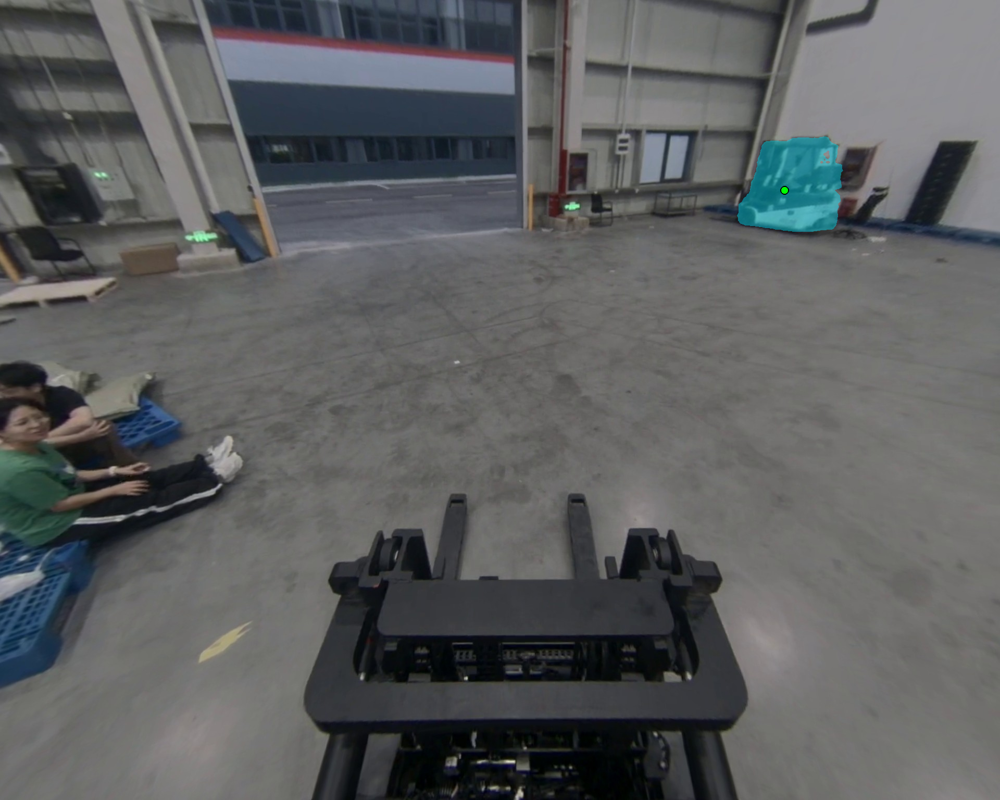
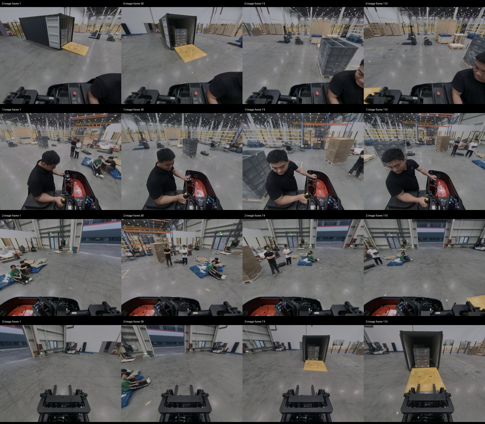
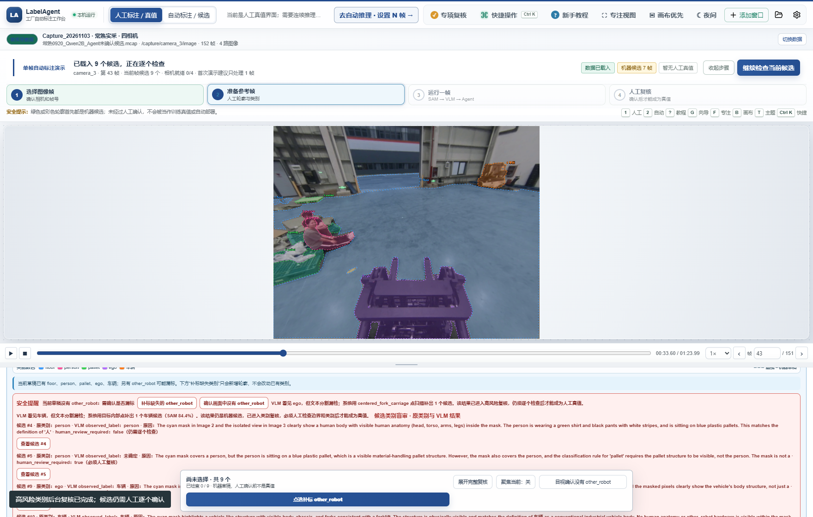

# LabelAgent 第359轮：可见车辆补漏与前端完成态修复

## 本轮要解决的问题

上一轮证明，新实采数据可以跨相机运行，但普通文本提示容易漏掉远处叉车。固定网格点扫描虽然能提高召回，却可能把墙板、地面和叉车粘成一大块，不能直接进入工作台。

本轮改成更受约束的两步流程：先由 VLM 在原图上给出一个“常规车辆主体内部点”，再只用这个点调用 SAM。输出仍是机器候选，必须经过类别盲审和人工确认，不能自动成为真值或训练数据。

## 实现方法

1. VLM 只允许寻找普通叉车、牵引车、托盘车等常规车辆，并明确排除前景主机、墙、地面、托盘和人员。
2. 定位点必须在图像上半部，避免把前景 `ego` 当成背景车辆。
3. 点提示 SAM 返回后执行分数、面积和包围框门禁；过大、过小或低分轮廓直接拒绝。
4. 车辆补漏候选无条件进入独立类别盲审。盲审只能保留候选或送人工复核，不能写成人工真值。
5. 常规叉车、牵引车、托盘车和普通工业车辆统一归 `车辆`；只有看到自主底盘或 AGV 硬件证据时才可归 `other_robot`。

## 直接效果

### 原始点扫描的粘连问题被拆开

第38帧中，VLM 给出叉车主体内部点，SAM 得分为 0.84375，轮廓包围框为 `[1415,262,1619,445]`，掩膜面积占全图约 0.99%。轮廓集中在叉车主体，不再像上一轮那样把大块墙面一起吃进去。

### 跨相机小样本

冻结的 6 个代理样本中，4 个正样本代理有 3 个生成候选，且 3 个候选均被独立盲审识别为车辆；2 个负样本代理均未生成候选。camera2 第38帧因定位点没有落在目标主体上，被几何门禁安全拒绝。该结果只是视觉代理复核，不是人工真值准确率。

## 工作台真实验收

在隔离工作台的真实新数据集 `/capture/camera_3/image` 第43帧执行“逐类补漏”后：

- 首批候选约 23.95 秒显示在原图上；
- 完整 SAM、VLM、Agent 和类别盲审约 65.06 秒完成；
- 共显示 9 个候选，其中远处白色叉车被补回为 1 个 `车辆` 候选；
- 车辆候选 ID 为 10，SAM 分数 0.84375，包围框 `[1475,263,1687,450]`；
- 独立盲审将其识别为 `车辆`，置信度 0.95，路由为 `candidate_preserved`；
- 页面最终同时读回 `agent_review_status=complete` 和 `candidate_class_audit_status=complete`；
- 没有写入人工真值、参考帧或训练集。

## 修复的界面卡住问题

第42帧首次验收时，后台已经完成 4 条类别盲审，但前端仍按旧规则只预期 3 条，因此拒绝了已完成结果并一直等待。现已把车辆补漏候选加入前端的高风险盲审规则，前后端数量与作用域一致。第43帧完整浏览器验收通过，证明不再出现“后台完成、页面一直转圈”的状态分裂。

## 测试与部署状态

- 网页交互测试：85/85 通过；
- 正式 Python 回归：1165 项通过，另有 186 个子测试通过；
- Python 编译与 `git diff --check` 通过；
- 正式工作台 8765 已更新并重启；
- 正式状态文件 SHA256 仍为 `9EF08118DD2BA0760CC93CF57BBEAAE4B3BED062D383DF4E6A454C389D4AB115`，说明候选、真值和配置未被部署过程改写；
- 隔离端口 8891 已释放；
- 新车辆补漏开关在正式配置中保持关闭，避免在样本门禁完成前改变默认推理耗时和行为；
- 部署前文件备份位于 `D:\Apps\LabelAgent\.local\backups\round359-20261120`。

## 当前边界与下一步

当前结果证明“VLM 定位主体点 + 点提示 SAM + 独立类别盲审”比固定网格扫描更安全，但 3/4 的正样本代理召回还不足以直接默认开启。下一步应扩大不同相机、距离、遮挡和光照条件下的冻结样本，重点检查：漏检率、墙面粘连率、前景 ego 误选率和额外耗时。只有全部门禁通过后，才考虑把该功能默认打开；在此之前仍只作为可追溯机器候选实验。

该扩大样本门禁已在第360轮执行，见 `docs/VISIBLE_VEHICLE_SHADOW_GATE_ROUND360_20261120.md`。

结构化证据见 `docs/evidence/workbench-stability-20261117/visible-vehicle-recovery-round359.json`。
