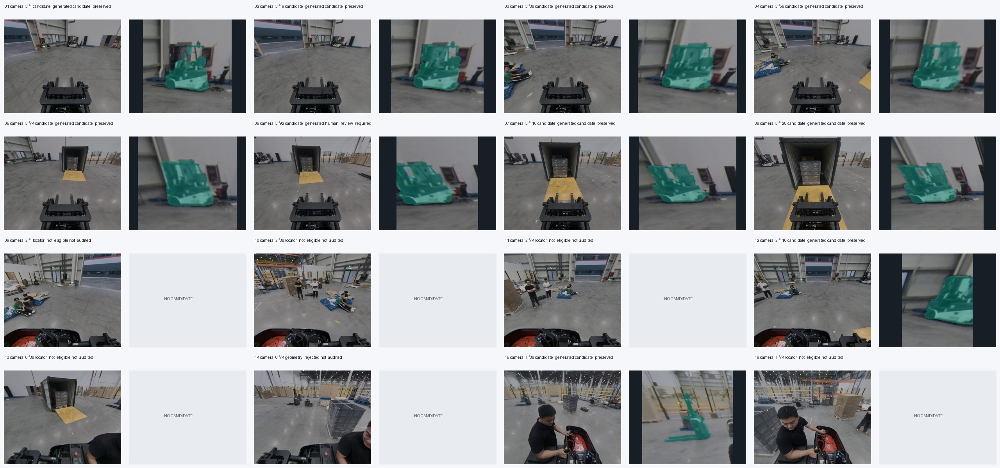
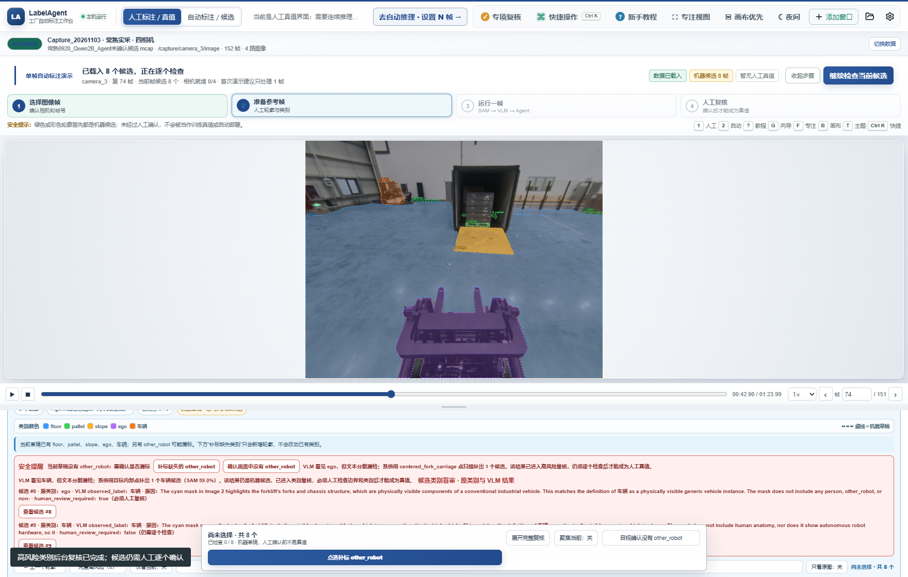

# LabelAgent 第360轮：车辆补漏跨相机影子门禁

## 目的

第359轮仅用6个视觉代理样本证明了方法可行，但样本数量太少。本轮将固定样本扩大到16帧、4路相机，并新增可复现评测工具，同时检查召回、误触发、轮廓粘连、类别复核和工作台完整链路。

本轮仍不是人工真值准确率评测。所有结果都是只读影子候选，不能写入真值、参考帧或训练集。

## 可复现评测方法

新增工具 `tools/evaluate_visible_vehicle_recovery_shadow.py`，输入：

- 正式状态文件，只读取模型地址和标签表；
- 一份本地 MCAP；
- 固定的相机与帧号清单；
- 仓库 `artifacts/` 下全新的输出目录。

工具逐帧执行“VLM主体点定位—点提示SAM—几何门禁—独立类别盲审”，并输出逐帧JSON和联系表。运行前后会核对正式状态文件哈希，保证没有写入工作台状态。

固定样本清单见 `docs/evidence/workbench-stability-20261117/visible-vehicle-shadow-samples-round360.json`。

## 16帧跨相机结果

在旧的0.75 SAM分数门槛下：

- 16帧中有8帧产生候选；
- 7帧通过独立车辆盲审；
- 1帧因目标模糊进入人工复核；
- 8帧没有产生候选；
- 0运行异常，正式状态文件没有变化。

视觉检查发现，camera3第74帧和camera1第38帧的轮廓实际上都紧凑覆盖了叉车，但SAM分数分别只有0.5898和0.7031，被0.75门槛过早拒绝。另一方面，camera0第74帧的错误候选分数仅0.2676，面积占全图约32.69%，会同时被分数与面积门禁拒绝。

## 低分紧凑候选门禁

本轮将最低分数从0.75调整为0.55，但没有直接放宽为“低分就接受”。候选仍必须同时满足：

1. 面积占全图0.01%至8%；
2. 宽高均不超过图像一半；
3. 不位于图像底部前景主机区域；
4. 无条件进入独立类别盲审；
5. 始终保持机器候选，禁止自动成为真值或训练数据。

调整后，同一批固定样本的候选数由8增至10：新增的camera3第74帧和camera1第38帧均被盲审确认是车辆；大面积错误候选仍被拒绝。最终10个候选中，9个通过车辆盲审，1个因模糊进入人工复核，0个运行异常。

这里的“9个通过”只表示VLM盲审支持候选类别，不代表9/10人工准确率。样本中多帧是同一背景叉车的不同时间位置，因此也不能当作跨场景泛化结论。

## 完整工作台验收

隔离工作台在camera3第74帧完成全链路验收：

- 首批候选约24.33秒显示；
- 全部后台复核约48.66秒完成；
- 总验收约54.70秒；
- 共8个候选，其中车辆候选SAM分数0.58984375，标记为 `guarded_low`；
- 独立盲审以0.95置信度识别为 `车辆`，路由为 `candidate_preserved`；
- 页面正确读回Agent与类别复核均完成；
- 人工真值、参考帧和训练数据均未写入。

影子评测第二次配对运行大量命中了模型缓存，因此其亚秒耗时不能代表冷启动或新图时延。真实演示应以完整浏览器验收中的24秒首屏和55秒总时长作为当前参考，不使用缓存结果夸大加速效果。

## 测试与安全边界

- 新增影子评测工具测试及低分紧凑候选测试；
- 正式Python回归：1168项通过，另有186个子测试通过；
- 完整浏览器验收通过；
- 隔离端口8891在验收后释放；
- 车辆补漏功能继续保持正式配置默认关闭；
- 候选、人工真值和训练集边界不变。

## 当前结论

本轮证明，在同一固定样本上，受几何门禁约束的0.55低分阈值能找回两个视觉上正确的紧凑叉车候选，同时保留对大面积错误候选的拦截。该修改适合继续进入更大规模影子验证，但由于样本仍主要来自同一录包、缺少人工真值，尚不足以默认开启或宣称准确率提升。

下一步应换用另一批录包和不同厂区画面，构造至少包含：无车辆、远处车辆、遮挡车辆、前景主机、墙板和AGV的人工复核集，再给出候选级precision/recall和额外耗时分布。

独立CVAT Task3录包的AGV专项门禁已在第361轮执行，见 `docs/VISIBLE_MACHINE_SEMANTIC_ROUTING_ROUND361_20261120.md`。

结构化结果见：

- `docs/evidence/workbench-stability-20261117/visible-vehicle-shadow-result-round360.json`
- `docs/evidence/workbench-stability-20261117/visible-vehicle-threshold-comparison-round360.json`
