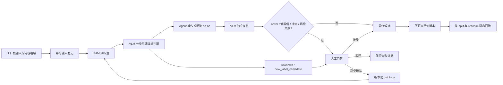

# LabelAgent 闭环架构与证据门禁

本设计把模型服务、候选和可信真值分开。服务健康只表示基础设施可用；只有一帧同时留下输入、SAM、VLM、Agent、再次 VLM、人工门禁、最终候选或真值和哈希回执，才可称为最小闭环跑通。

## 输入与幂等

每个输入必须包含 `dataset_id`、`source_batch`、`frame_id`、`sensor`（相机或 topic）、带时区的 `captured_at`、`source_kind=real|sim` 和帧内容 `content_sha256`。前六项计算稳定 `input_id`；相同身份再次进入且内容哈希相同，返回原记录，不重复产生事件。身份相同但内容不同会被拒绝为幂等冲突。

账本位于 `runs/<input_id>/`：`input.json`、按序号和哈希命名的 `events/*.json`、不可覆盖的 `receipts/*.json`。每个事件包含上一事件哈希；任何历史修改都会使读回失败。

## 状态机与标签分层

主路径为：

`received → sam_candidate_ready → vlm_reviewed → agent_actioned → vlm_reverified → candidate_final → human_review_required → human_accepted|human_rejected → truth_committed → version_committed`

标签层固定为：

- `preannotation`：SAM 输出；不能当真值。
- `agent_candidate`：VLM/Agent 处理后的候选；`done` 只表示该轮停止，不表示正确。
- `human_truth`：只有显式人工接受后才允许写入。

账本只有同时观察到 SAM、首次 VLM、Agent、再次 VLM、人工接受以及最终候选/真值，才把 `minimum_closed_loop_complete` 设为 `true`。只有不可变数据版本写入后，`training_ready` 才为 `true`。

## Open-set 与 ontology

VLM 只能输出 `unknown` 或 `new_label_candidate`。记录必须包含视觉证据、候选名称、最接近既有类别、差异说明和 0～1 置信度，且 `ontology_write=false`。open-set 事件不能使用 `human_truth` 层，下一状态必须进入人工门禁。

人工确认新类时另写 `ontology_approved`，同时记录父 ontology 版本和新版本；驳回写 `ontology_rejected`。确认前禁止修改生产 ontology、禁止直接成为真值。ontology 升版后的重跑必须使用原 `input_id` 和新模型/提示/ontology 版本生成新的可追溯事件。

## 人工路由与数据回流

人工队列只接收 novel、低置信、模型冲突或质量检查失败样本，路由原因写入事件。最终真值版本必须记录 `train|val|test`、真值 artifact 哈希、ontology 版本、`real|sim`、样本权重和父版本。已有 split 不得因回流改变；real 与 sim 分开统计、加权和评测。

## KPI 定义

- 自动可接受率：无需人工修改且最终被接受的候选数 / 进入候选门禁的帧数。
- 人工分钟/帧：人工门禁计时总分钟 / 完成人工决策帧数。
- unknown 发现准确率：人工确认的新类或真实 unknown 数 / VLM 提交的 open-set 候选数。
- 错误标签泄漏率：抽检中错误但已进入真值版本的目标数 / 抽检真值目标数。
- 端到端延迟：`received` 到最终候选或真值回执的墙钟时间。
- 单帧成本：该帧实际模型调用、GPU 时间和人工时间折算成本之和。

无分母或没有独立人工结果时指标为 `null`，不得填 0。real 与 sim 必须分别报告。

## 当前真实垂直帧

`tools/closed_loop_vertical.py` 从回环工作台读取一帧，直接从 MCAP 解出采集时间，计算实际帧哈希并写入账本。当前没有人工参考真值时，它只会写 `received → human_review_required`，回执中的 `minimum_closed_loop_complete=false`。这是一条真实的门禁证据，不是完成声明。

机器约束见 `schemas/labelagent-closed-loop.schema.json`，代码约束见 `source/agent/closed_loop.py`。
