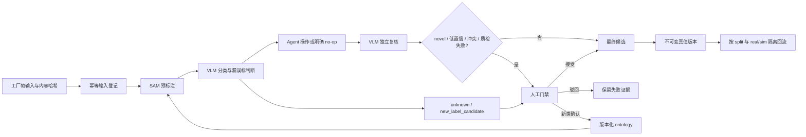

# LabelAgent 闭环架构与证据门禁

本设计把模型服务、候选和可信真值分开。服务健康只表示基础设施可用；只有一帧同时留下输入、SAM、VLM、Agent、再次 VLM、人工门禁、最终候选或真值和哈希回执，才可称为最小闭环跑通。

本文描述当前运行时哈希账本。跨组件 1.1 版高层事件格式、仿真元数据与 slope 安全规则见 [`CLOSED_LOOP_ARCHITECTURE.md`](CLOSED_LOOP_ARCHITECTURE.md)；两层协议互补，后者不得覆盖本文账本。其 unknown 示例是显式占位数据，不是实测或生产结果。



## 输入与幂等

每个输入必须包含 `dataset_id`、`source_batch`、`frame_id`、`sensor`（相机或 topic）、带时区的 `captured_at`、`source_kind=real|sim` 和帧内容 `content_sha256`。前六项计算稳定 `input_id`；相同身份再次进入且内容哈希相同，返回原记录，不重复产生事件。身份相同但内容不同会被拒绝为幂等冲突。

账本位于 `runs/<input_id>/`：`input.json`、按序号和哈希命名的 `events/*.json`、不可覆盖的 `receipts/*.json`。每个事件包含上一事件哈希；任何历史修改都会使读回失败。

## 状态机与标签分层

主路径为：

`received → quality_checked → sam_candidate_ready → vlm_reviewed → agent_actioned → vlm_reverified → candidate_final → human_review_required → human_accepted → truth_committed → version_committed → evaluation_completed`

拒绝和新类采用显式分支：候选驳回走 `candidate_rejected → remediation_required → quality_checked`；未知类走 `open_set_candidate → ontology_review_required → ontology_approved|ontology_rejected → remediation_required`。驳回不再是无法修正的终态，ontology 批准/驳回也不再借用普通候选人工状态。

标签层固定为：

- `preannotation`：SAM 输出；不能当真值。
- `agent_candidate`：VLM/Agent 处理后的候选；`done` 只表示该轮停止，不表示正确。
- `human_truth`：只有显式人工接受后才允许写入。

账本只有按顺序观察到输入质量通过、SAM、首次 VLM、Agent、再次 VLM、最终候选、针对该候选的人工接受以及真值提交，才把 `minimum_closed_loop_complete` 设为 `true`。最终人工事件必须记录 `accepted_event_id` 和 `accepted_artifact_sha256`，并紧邻 `truth_committed`；较早的参考帧确认不能授权后续候选写真值。只有带 `version_id`、`parent_version`、`train|val|test`、序列/实体级 `split_group_id`、ontology 版本、truth/manifest SHA-256 和 real/sim 来源的不可变数据版本写入后，`training_ready` 才为 `true`。同一 `split_group_id` 不得跨 train/val/test，避免同一坡道或序列泄漏。

模型事件必须记录模型名/版本和 prompt 版本；权重、配置、prompt 内容和所有 artifact 哈希如果出现，必须是小写 SHA-256。完全相同的事件在状态推进后再次提交仍返回原事件并标记 `idempotent_replay=true`；真正的新一轮复检必须携带不同动作、轮次或证据。receipt 只由最后事件及稳定派生字段决定，同一 `last_event_id` 复用既有 receipt，不使用墙钟生成时间制造新哈希。

## Open-set 与 ontology

VLM 只能输出 `unknown` 或 `new_label_candidate`。记录必须包含视觉证据、候选名称、最接近既有类别、差异说明和 0～1 置信度，且 `ontology_write=false`。open-set 事件不能使用 `human_truth` 层，下一状态必须进入人工门禁。

open-set 后先写 `ontology_review_required`。人工确认新类时另写 `ontology_approved`，同时记录父 ontology 版本和新版本；驳回写 `ontology_rejected`。两者随后都进入显式 remediation/reprocess，不允许直接绕到真值。确认前禁止修改生产 ontology、禁止直接成为真值。ontology 升版后的重跑必须使用原 `input_id` 和新模型/提示/ontology 版本生成新的可追溯事件。

## 人工路由与数据回流

人工队列只接收 novel、低置信、模型冲突或质量检查失败样本，路由原因写入事件。最终真值版本必须记录 `train|val|test`、真值 artifact 哈希、ontology 版本、`real|sim`、样本权重和父版本。已有 split 不得因回流改变；real 与 sim 分开统计、加权和评测。

工作台的“保存当前帧真值”和“保存结果”不会直接落盘；它们先弹出人工复核门禁，要求填写复核人自报 ID（`identity_assurance=self_declared`，不是登录认证身份）。门禁打开时会冻结 `dataset_id + dataset_version + camera/topic + frame_sha256 + candidate_sha256`，提交时服务端在同一把锁内重新计算并严格核对；任一变化返回 HTTP 409，必须重新复核。服务端依据候选与保存结果的规范化哈希自动区分：

- `accept_candidate`：候选未修改，人工直接接受；
- `correct_candidate`：人工修改候选后接受；
- `manual_annotation`：没有机器候选，由人工从零标注；
- `confirmed_empty`：人工明确确认该帧没有目标；必须同时提交 `decision=confirmed_empty` 与 `confirmed_empty=true`，不能与驳回或失败混淆；
- `reject_candidate`：候选被人工驳回；原 artifact 写入只读驳回归档，但从活动候选区移除，绝不写入真值，也不能原样再次接受。

每次决定写入 `LABELAGENT_WORK/human_reviews/` 的追加式哈希链，包含数据集/版本、相机/topic、帧、候选、真值哈希、自报复核人、起止时间和耗时。状态/真值先事务式持久化，审计回执随后提交；首次状态保存失败不产生 accepted 回执或真值，最终事务标记保存失败则保留可恢复链接。接口成功前还必须从持久化 `state.json` 和不可变审计链回读，确认事务 committed、真值哈希一致、活动候选已移除，UI 只有看到 `readback.verified=true` 才显示成功。`GET /api/human_reviews?frame=<id>` 可回读。`tools/closed_loop_human_gate.py` 会同时核对不可变输入帧哈希、人工回执、当前真值哈希以及最新 `candidate_final` 的 event/artifact SHA；核对成功后才把有精确候选绑定的 `human_accepted` 与紧随其后的 `truth_committed` 写入闭环账本并把事件 ID 回写到关联回执。驳回写入 `candidate_rejected`，候选状态改为 rejected/remediation_required；完全相同的驳回幂等复放，原候选不能直接接受，只能用新复核幂等键和 `remediation_of_review_id` 提交不同哈希的修正版或新候选。

Slope hard case 是独立质量门禁，训练/标注/专项评测层必须继续保留 `floor` 与 `slope` 两类以及各自真值；只有下游业务/导航投影执行 `traversable_area = floor UNION slope`。投影必须保留来源语义和候选/真值层级，不得回写或永久合并训练标签。Slope 事件还必须记录 `label_type=slope`、`semantic_label=slope_visible`、`visible_status`、精确 `candidate_sha256`、evidence provenance、hard-set strata、`human_pixel_truth_available` 和 `approved_for_training`。业务政策默认 passable，不再要求 LiDAR/几何作为闭环前置条件；未来禁行只能由 human/system_policy 通过版本化 `non_passable` override 明确设置，模型不得自行推断。`evaluation_completed` 没有人工像素真值、完整 slope 单类指标或已分配 hard-set strata仍会被拒绝；机器候选仍不能自动成为真值或训练数据。

示例：

```powershell
python tools/closed_loop_human_gate.py `
  --bundle outputs/frame0-gate-bundle.json `
  --workbench-root D:/path/to/labelagent-work `
  --ledger-root outputs/closed-loop-ledger `
  --output outputs/frame0-human-gate-bundle.json
```

## KPI 定义

- 自动可接受率：无需人工修改且最终被接受的候选数 / 进入候选门禁的帧数。
- 人工分钟/帧：人工门禁计时总分钟 / 完成人工决策帧数。
- unknown 发现准确率：人工确认的新类或真实 unknown 数 / VLM 提交的 open-set 候选数。
- 错误标签泄漏率：抽检中错误但已进入真值版本的目标数 / 抽检真值目标数。
- 端到端延迟：`received` 到最终候选或真值回执的墙钟时间。
- 单帧成本：该帧实际模型调用、GPU 时间和人工时间折算成本之和。

无分母或没有独立人工结果时指标为 `null`，不得填 0。real 与 sim 必须分别报告。

## 当前真实垂直帧

`tools/closed_loop_vertical.py` 从回环工作台读取一帧，直接从 MCAP 解出采集时间，计算实际帧哈希并写入账本。若工作台已有机器候选，会写 `received → quality_checked → sam_candidate_ready → human_review_required`；缺人工真值、参考帧或人工复核回执只标记 `missing_human_gate`，不会冒充 `quality_failure`。已有 slope 候选同步写入 `slope_visible`，人工真值仍为 false；业务通行性按项目政策写为 passable，不影响人工像素门禁。

工具会从只读 `/api/human_reviews` 回读人工回执，并同时核对输入帧、候选和真值哈希。机器候选先冻结为 `candidate_final` 再进入人工门禁；真值、参考帧和有效人工回执全部存在后，才追加 `human_accepted → truth_committed → version_committed`。重复输入复用原 receipt；同一 `--output` 的相同状态保持字节不变，后续状态写入以 `last_event_id` 命名的新快照，绝不覆盖前一阶段证据。SAM 模型版本、prompt 版本、`version_id`、`parent_version`、split、`split_group_id` 和 ontology 版本必须由命令行显式提供。

`tools/closed_loop_register_image.py` 用于直接登记一张已落地的真实图像。调用方必须提供 OSS 等原始来源 URI、数据批次、真实 `frame_id`、相机、带时区采集时间和预期 SHA-256；工具会重新读取文件并核验哈希，只写入 `received`，不会臆造 SAM、VLM、Agent 或人工事件。后续模型步骤必须沿用返回的 `input_id` 追加证据，直到人工门禁和不可变版本回执齐备后才能声称闭环完成。

机器约束见 `schemas/labelagent-closed-loop.schema.json`，代码约束见 `source/agent/closed_loop.py`。
