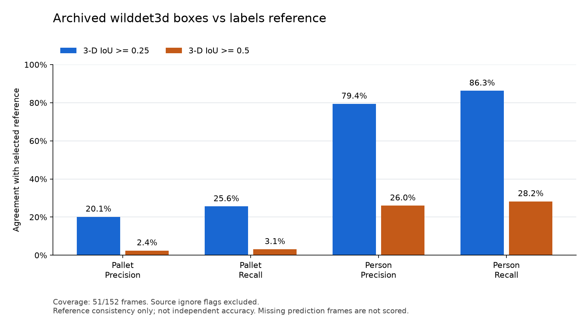

# 已有三维框与 labels 参考的对比

本轮参考来源固定为 `labels` 全部 152 帧。包内两套待比较结果都只有 51 帧，对比覆盖率为 **33.6%**；其余 101 帧没有对应结果，不计为已执行测试，也不默认为空预测。

这是对压缩包内已有输出的比较，没有新运行三维检测模型。参考标注尚未认定为独立人工真值。

## wilddet3d-labels

共同帧中有 1,099 个参与比较的托盘参考框、255 个人员参考框。已有输出包含 1,395 个托盘框、277 个人员框。

| 类别 | IoU ≥ 0.25 匹配数 | 对参考 precision / recall | IoU ≥ 0.5 匹配数 | 对参考 precision / recall |
| --- | ---: | ---: | ---: | ---: |
| 托盘 | 281 | 20.14% / 25.57% | 34 | 2.44% / 3.09% |
| 人员 | 220 | 79.42% / 86.27% | 72 | 25.99% / 28.24% |

托盘在较严格 IoU 阈值下的匹配明显减少。几何核查包括薄框的平移敏感性：同姿态、厚度 0.15 的框，沿局部高度方向错开 0.05，就会降到 IoU 0.5。这个解析例子说明指标对薄框偏差敏感，尚不能单凭它判断本数据低重合的具体原因。框范围定义、位置偏差和遮挡仍需结合本地原图与点云复核。

## ali_label 一致性检查

51 个共同帧上，参与比较的 1,334 个已有框都能与 `labels` 匹配，匹配框的平均 IoU 约为 1；`labels` 另外有 20 个参与比较的托盘框未在该来源匹配。两者显然存在共享几何或派生关系，因此这组结果是来源一致性检查，不能作为第二个独立模型的准确率证明。

## 方法与边界

- `labels` 全集共 4,119 个框，来源内 `ignore:true` 的 74 个框剔除。共同帧实际参与比较的参考框为 1,354 个；`ali_label` 内剔除 25 个框，wilddet3d 内没有该标记。
- 采用同类一对一匹配，在各阈值先最大化合格匹配数量，再最大化 IoU 总和；未做额外忽略区域抑制，也没有按分数筛选。
- 采用完整旋转长方体交集；根据字段名按弧度制 `Rz(yaw) Ry(pitch) Rx(roll)` 解释姿态，尚无额外坐标系说明。
- 这是三维框对参考的一致性，不是官方 AP、二维 mask 准确率、跟踪性能或 VLM Agent 改善幅度。
- 原始输入留在本机；可公开的计数、分母、方法和逐阈值结果见 [机器可读汇总](box3d_comparison.json)，复现命令见 [对比说明](../capture-comparison.md)。
